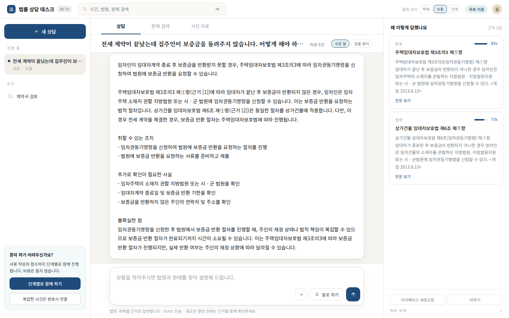
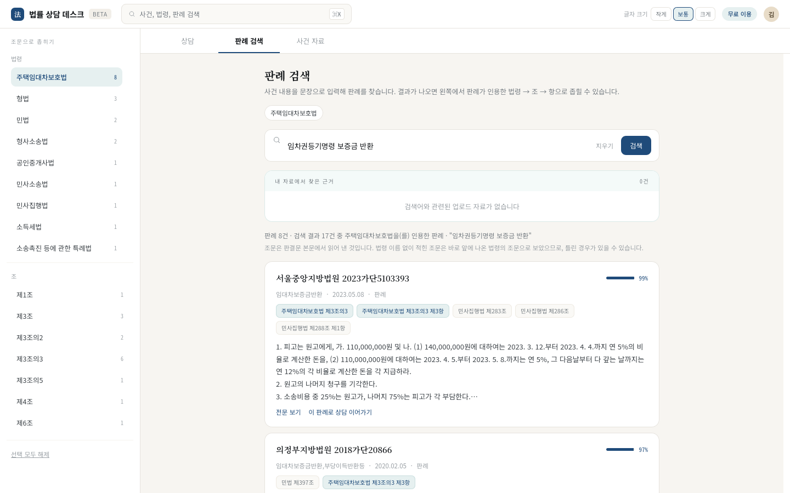
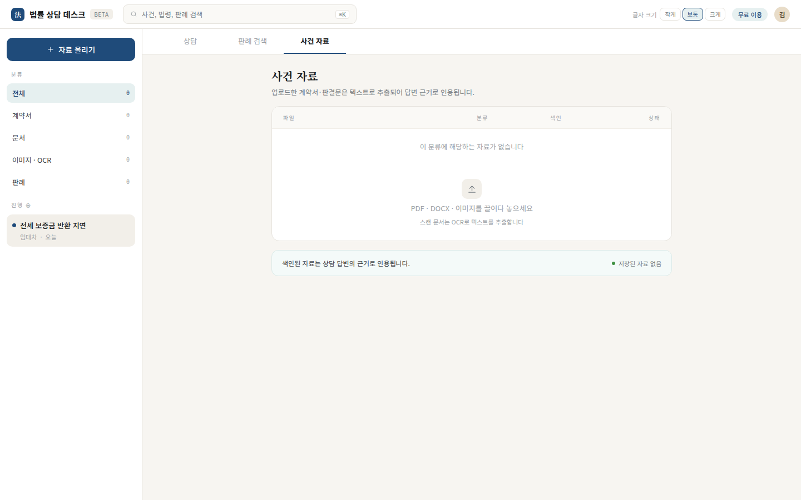
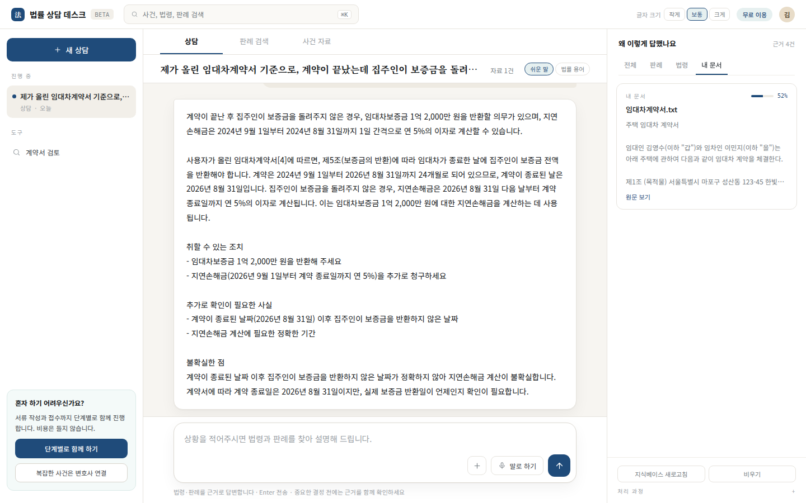

# 한국어 법률 RAG 에이전트

이 프로젝트는 한국어 법률 질문에 답합니다. 먼저 법령과 판례를 검색합니다. 그다음 검색한 근거만 사용해 답변을 씁니다. 마지막으로 답변의 인용을 근거와 대조합니다.

이 프로젝트는 1차 정보를 주는 도구입니다. 법률 자문이 아닙니다. 중요한 결정 전에는 근거 원문과 전문가의 확인이 필요합니다.

**핵심 결과** (개발에 쓰지 않은 질문 274개, 로컬 qwen3:4b, 2026-10-06. 자세한 내용은 [6절](#6-평가-결과))

| 측정한 것 | 결과 |
| --- | ---: |
| 법령 질문: 정답 조문이 근거 5개 안에 있다 | 0.92 (116/126) |
| 판례·유권해석 질문: 정답 문서가 근거 5개 안에 있다 | 0.24 (35/148), 하한 |
| 답변이 인용 검증을 통과했고 확인 안내가 없다 | 0.98 (269/274) |
| 답변이 참조 답변의 핵심 결론을 말한다 | 0.74 너그러운 기준, 0.60 엄격한 기준 |
| 웹 채팅에서 질문을 보낸 뒤 답변이 보이기까지 (중앙값) | 17.5초 (2026-10-10 측정) |
| 답변 초안의 첫 글자가 오기까지 (중앙값, 검증 전) | 5.6초 (2026-10-17, API 측정) |

## 목차

1. [무엇을 하는가](#1-무엇을-하는가)
2. [화면](#2-화면)
3. [시스템 구조](#3-시스템-구조)
4. [한 턴의 흐름](#4-한-턴의-흐름)
5. [검색 방법](#5-검색-방법)
6. [평가 결과](#6-평가-결과)
7. [알려진 한계](#7-알려진-한계)
8. [실행 방법](#8-실행-방법)
9. [코드와 문서](#9-코드와-문서)

## 1. 무엇을 하는가

- **근거로 답합니다.** 답변의 각 주장은 검색한 근거를 가리킵니다. 화면은 답변이 인용한 근거만 보여 줍니다.
- **인용을 검증합니다.** 백엔드는 답변의 조문과 사건번호를 근거와 대조합니다. 맞지 않으면 답변을 한 번 다시 씁니다. 그래도 맞지 않으면 그 문장을 지우거나 답변을 거절합니다.
- **답하면서 묻습니다.** 사실이 부족해도 아는 범위에서 먼저 답합니다. 그리고 더 필요한 사실을 묻습니다. 화면은 이 질문을 답변 아래에 버튼으로 보여 줍니다. 사용자가 버튼을 누르고 답을 쓰면, 화면은 질문과 답을 한 메시지로 묶어 보냅니다. 그래서 "두 달이요" 같은 짧은 답도 어느 질문의 답인지 알 수 있습니다. 법률 분야를 알 수 없는 질문에만 질문으로 답합니다.
- **대화를 이어 갑니다.** "그 신청은 어디에 하나요?" 같은 후속 질문은 앞 대화를 넣어 독립된 질문으로 다시 씁니다. 검색은 이 질문으로 합니다.
- **사건 자료를 읽습니다.** 사용자가 계약서나 통지서를 올리면, 답변은 그 자료의 날짜, 금액, 조항을 사건의 사실로 씁니다. 자료는 법적 근거가 아닙니다. 법적 근거는 계속 법령과 판례에서만 가져옵니다.
- **답변 경로는 하나입니다.** 웹 채팅, API, CLI가 같은 백엔드를 씁니다. 백엔드가 멈추면 웹 채팅은 오류를 표시합니다. 다른 모델로 몰래 바꾸지 않습니다.

## 2. 화면

화면은 세 탭입니다.

| 탭 | 하는 일 | 상태 |
| --- | --- | --- |
| 상담 | 질문에 답하고 인용한 근거를 보여 줍니다 | 실제 검색과 모델로 동작합니다 |
| 판례 검색 | 법령, 조, 항 순서로 범위를 좁혀 판례를 찾습니다 | 예시 데이터로 동작합니다 |
| 사건 자료 | 계약서, 판결문, 이미지를 올리고 텍스트를 추출합니다 | 동작합니다. 올린 자료는 상담 답변에 쓰입니다 |

### 판례 검색

### 사건 자료

### 사건 자료를 쓴 답변

아래 답변은 올린 임대차계약서의 보증금, 기간, 지연손해금 조항을 씁니다. 오른쪽의 "내 문서" 카드가 그 자료입니다.

## 3. 시스템 구조

프로그램은 두 개입니다. Flask 앱은 화면과 대화 기록을 맡습니다. FastAPI 백엔드는 검색, 답변 생성, 인용 검증을 맡습니다.

~~~mermaid
flowchart LR
    User["사용자"] --> Web["Flask 웹 앱 화면 · 대화 기록"]
    Caller["API · CLI"] --> API
    Web -->|"POST /v1/chat 질문 + 사건 자료 조각"| API["FastAPI 백엔드 법률 RAG"]
    API -->|"답변 · 근거"| Web
    Web -->|"SSE"| User

    API --> Qdrant[("Qdrant 법령 · 판례 색인")]
    API --> Embed["Ollama bge-m3 임베딩"]
    API --> Rerank["bge-reranker-v2-m3 재정렬"]
    API --> LLM["답변 모델 Ollama qwen3:4b 또는 Gemini"]

    Web --> SQLite[("SQLite 대화 기록")]
    Web --> Chroma[("Chroma 사건 자료")]
~~~

| 구분 | 사용 기술 |
| --- | --- |
| 웹 앱 | Flask, Server-Sent Events (SSE), SQLite |
| 법률 RAG 백엔드 | FastAPI, Uvicorn |
| 답변 모델 | Ollama qwen3:4b 또는 Gemini. `LEGAL_RAG__LLM__BACKEND`로 고릅니다 |
| 임베딩 | Ollama bge-m3 |
| 검색과 재정렬 | Qdrant, BM25, RRF, BAAI/bge-reranker-v2-m3 |
| 사건 자료 | Chroma, Tesseract OCR |
| 설정 | `.env`, `configs/default.yaml`, `configs/local.yaml` |

답변 모델을 바꾸면 FastAPI 서버를 다시 시작해야 합니다.

**데이터.** 원문 데이터, 가공 데이터, Qdrant 색인은 저장소에 없습니다. 실행 전에 따로 준비해야 합니다.

- **판례·유권해석과 평가 질문:** AI Hub의 형사법, 민사법, 행정법, 지식재산권법 질의응답 데이터입니다. AI Hub에서 이용 신청 후 받습니다.
- **법령:** 국가법령정보센터 Open API에서 받습니다. 방법은 [8.3절](#83-전체-법령-코퍼스-만들기)에 있습니다.
- **AI Hub 원문은 분야마다 [전처리 스크립트](scripts/preprocess/)로 바꿉니다.** 결과의 `documents.jsonl`과 `chunks.jsonl`을 `scripts/import_processed.py`로 가져옵니다. 명령과 필요한 필드는 [법률 RAG 개발 안내](docs/legal-rag-backend.md#import-externally-preprocessed-jsonl)에 있습니다.

## 4. 한 턴의 흐름

백엔드는 질문 하나를 아래 순서로 처리합니다.

~~~mermaid
flowchart TB
    Q["사용자 메시지"] --> A["1. 분석 법률 분야, 조문, 사건번호"]
    A --> C{"법률 분야를 알 수 있는가"}
    C -->|"아니오"| Ask["되묻기 필요한 사실을 질문"]
    C -->|"예"| D["2. 질문 다시 쓰기 앞 대화를 넣어 독립된 질문으로"]
    D --> R["3. 검색 법령 · 판례 5개 코퍼스"]
    R --> E["4. 근거 구성 상위 5개 조각"]
    E --> G["5. 답변 생성 근거만 사용"]
    G --> V{"6. 인용 검증"}
    V -->|"통과"| OK["답변 + 근거"]
    V -->|"실패, 첫 번째"| G
    V -->|"실패, 두 번째"| S["근거 없는 문장 삭제"]
    S -->|"남은 내용이 있다"| OK
    S -->|"남은 내용이 없다"| X["거절 근거를 확인할 수 없음"]
~~~

- **1. 분석:** 모델이 질문에서 법률 분야와 사용자가 직접 적은 조문·사건번호를 뽑습니다.
- **2. 질문 다시 쓰기:** 최근 4턴을 참고합니다. 사용자의 원래 문장은 그대로 보존합니다.
- **3. 검색:** [5절](#5-검색-방법)의 방법으로 합니다.
- **4. 근거 구성:** 조각 하나에서 앞 1,500자를 씁니다.
- **5. 답변 생성:** 답변은 요약, 분석, 취할 수 있는 조치, 추가로 확인이 필요한 사실, 불확실한 점으로 구성됩니다. 모델은 분석을 먼저 쓰고 요약을 그다음에 씁니다. 화면은 요약을 먼저 보여 줍니다. 모델이 쓰는 동안 분석은 "작성 중 · 검증 전" 초안으로 화면에 흐릅니다(`/v1/chat/stream`). 검증을 마친 답변이 오면 초안을 바꿔 씁니다. 재생성이나 복구 재시도가 시작되면 초안을 지우고 새로 씁니다. 상태 줄은 백엔드의 실제 단계를 보여 줍니다(질문 분석 중 → 법령·판례 검색 중 → 답변 작성 중 → 근거 확인 중, 재생성 때는 "근거가 맞지 않아 다시 쓰는 중"). 초안은 1,500자에서 더 늘리지 않습니다.
- **6. 인용 검증:** 답변의 조문과 사건번호가 근거나 사용자의 문장에 있는지 확인합니다. 재생성은 한 번만 합니다. 같은 대화의 최근 답변이 인용한 조문은 후속 답변이 다시 말해도 통과합니다. 법령 이름과 조문 번호가 모두 같아야 합니다. 되묻기 턴에 적힌 조문은 통과시키지 않습니다.

**사건 자료가 있을 때:** Flask 앱은 질문으로 그 브라우저의 사건 자료를 검색합니다. 그리고 질문과 가까운 조각을 3개까지 질문과 함께 보냅니다. 질문과 먼 조각은 보내지 않습니다. 백엔드는 5번 단계에서 이 조각을 법령·판례 근거와 다른 블록으로 모델에 줍니다. 자료가 법령 이름과 함께 적은 조문과 사건번호는 사용자가 직접 적은 것으로 봅니다. 그래서 6번 단계는 이것을 지어낸 인용으로 세지 않습니다. 계약서 자체의 조항 번호("제5조")는 법령 이름 없이 쓴 경우에만 통과합니다. "주택임대차보호법 제5조"처럼 법령 이름이 붙으면 법령·판례 근거에 있어야 합니다. 화면은 답변이 쓴 자료만 "내 문서" 카드로 보여 줍니다. 자료가 없으면 요청과 프롬프트는 자료 기능이 없을 때와 같습니다.

Flask 앱은 받은 답변을 한 번 더 확인합니다. 근거에 없는 조문이나 사건번호가 답변에 있으면 확인 안내를 붙입니다. 짧은 인사말에는 백엔드를 부르지 않고 안내 문구로 답합니다.

## 5. 검색 방법

~~~mermaid
flowchart LR
    Q["검색 질의"] --> D["Dense 검색 bge-m3 · Qdrant 코퍼스마다 100개"]
    Q --> S["Sparse 검색 BM25 코퍼스마다 100개"]
    D --> F["RRF 결합 상위 100개"]
    S --> F
    F --> X["Cross-encoder 재정렬 bge-reranker-v2-m3"]
    X --> E["근거 5개"]
~~~

- **코퍼스는 다섯 개입니다.** 형사, 민사, 행정, 지식재산권, 전체 법령입니다. 코퍼스마다 색인이 따로 있습니다.
- **두 방법으로 찾습니다.** Dense 검색은 뜻이 가까운 조각을 찾습니다. Sparse 검색(BM25)은 같은 단어가 있는 조각을 찾습니다.
- **RRF로 합칩니다.** Sparse 쪽 가중치는 0.75입니다. 각 검색 목록의 상위 3개는 항상 재정렬 단계로 갑니다.
- **Cross-encoder가 순서를 다시 정합니다.** 이 모델은 질의와 조각을 함께 읽습니다. local 프로필은 CUDA와 float16으로 실행합니다.
- **법령은 조 단위입니다.** 전체 법령 코퍼스는 한 조(항)가 한 조각입니다. 국가법령정보센터 Open API에서 받았습니다.

## 6. 평가 결과

모든 값은 참조 답변이나 정답 문서와의 일치도입니다. 법률적 정답률이 아닙니다.

### 6.1 최종 테스트 (2026-10-06)

개발에 쓰지 않은 질문 274개로 측정했습니다. 형식 질문이 154개, 같은 내용을 일상 표현으로 바꾼 질문이 120개입니다. 답변 모델은 로컬 qwen3:4b입니다. 목표 값은 실행 전에 정했습니다. 대괄호는 95% Wilson 신뢰구간입니다.

이 값은 2026-10-06 코드의 값입니다. 그 뒤에 [6.3절](#63-답변-품질-라운드-2026-10-06--10-07)과 [6.4절](#64-그-뒤에-시험한-변경-2026-10-09--10-15)의 변경이 들어갔고, 274문항은 다시 측정하지 않았습니다. 모든 답변에 영향을 주는 변경은 질문 80개의 고정 근거 비교로 확인했습니다.

| 층 | 측정한 것 | 목표 | 결과 |
| --- | --- | ---: | ---: |
| 1. 검색 | 인용 조문이나 정답 문서가 근거 5개 안에 있다 | 0.70 | 151/274 = 0.55 [0.49, 0.61] |
| 2. 인용 무결성 | 검증을 통과했고 확인 안내가 없다 | 0.95 | 269/274 = 0.98 [0.96, 0.99] |
| 3. 결론 일치 | 답변이 참조 답변의 핵심 결론을 말한다 | 0.70 | 204/274 = 0.74 [0.69, 0.79] |
| 4. 가용성 | 답변을 돌려준다 | | 274/274 |

층 1은 목표에 닿지 못했습니다. 질문 종류로 나누면 원인이 보입니다.

| 질문 종류 | 검색 (층 1) | 결론 일치 (층 3) |
| --- | ---: | ---: |
| 법령이 정답인 질문 126개 | 116/126 = 0.92 | 109/126 = 0.87 |
| 판례·유권해석이 정답인 질문 148개 | 35/148 = 0.24 | 95/148 = 0.64 |

- **법령 검색은 됩니다.** 형식 질문은 69/69, 일상 표현 질문은 47/57입니다.
- **판례 검색이 병목입니다.** 다만 0.24는 하한입니다. 이 값은 정답으로 표시된 문서 한 건만 셉니다. 같은 결론을 주는 다른 판례를 찾은 경우는 세지 않습니다.
- **검색이 맞으면 답변도 맞습니다.** 결론 일치는 검색이 맞았을 때 136/151 = 0.90이고, 맞지 않았을 때 68/123 = 0.55입니다.
- **채점 기준에 따라 값이 달라집니다.** 층 3의 0.74는 너그러운 기준입니다. 엄격한 기준으로 같은 답변을 채점하면 164/274 = 0.60입니다. 두 기준은 234개 답변에서 같은 판정을 냅니다.
- **속도:** 검색을 뺀 한 턴의 중앙값은 17.5초, 90백분위는 35.7초입니다. 검색은 중앙값 2.2초를 더합니다.

채점은 qwen3:8b가 합니다. 채점기는 질문마다 참조 답변의 핵심 결론 한 문장을 뽑습니다. 그다음 답변이 그 결론을 말하는지 판정합니다. 방법은 [채점기 문서](docs/answer-grader-core.md)에 있습니다.

### 6.2 전체 법령 코퍼스 (채택, 2026-10-06)

기존 코퍼스에는 현행 법령 5,621건 중 2,483건만 있었습니다. 민사소송법, 상법, 주택임대차보호법, 헌법이 없었습니다. 또 법령 조각 하나가 여러 조를 담은 약 3,450자 창이었습니다. 그래서 Open API로 5,595건을 받아 조(항) 단위 조각 315,058개로 새 코퍼스 `statute-api-full-v1`을 만들었습니다.

값은 인용 조문이 근거 5개 안에 든 질문 수입니다. held-out 질문 319개로 측정했습니다.

| 질문 묶음 | 기존 → 추가 후 |
| --- | ---: |
| 형식 질문, 법령 정답 82개 | 42 → 81 |
| 일상 표현 질문, 법령 정답 73개 | 36 → 59 |
| 형식 질문, 판례·유권해석 정답 87개 | 24 → 24 |
| 일상 표현 질문, 판례·유권해석 정답 77개 | 19 → 19 |

- 검색 시간은 2.15초에서 2.18초가 됐습니다.
- 근거 글자 수는 14,000자에서 5,600자로 줄었습니다.
- 이 질문들의 법령은 이미 코퍼스에 있었습니다. 그래서 증가는 조 단위 조각의 효과입니다.
- 코퍼스에 없던 법령을 묻는 질문 20개는 정답 조문이 상위 5개에 든 질문이 0개에서 14개가 됐습니다.
- 새 코퍼스는 Qdrant 메모리를 약 1.3GiB 더 씁니다.

### 6.3 답변 품질 라운드 (2026-10-06 ~ 10-07)

대화 8개(계약서, 해고, 임금, 사고, 상속)를 시나리오로 만들고 한 번에 한 가지만 바꿨습니다. 통과 기준은 실행 전에 적었습니다. 답변 내용 항목은 변경 전과 후를 9회씩 돌렸습니다. 모든 답변에 영향을 주는 변경은 질문 80개의 고정 근거 비교도 통과해야 합니다.

| 바꾼 것 | 결과 | 결정 |
| --- | --- | --- |
| 분석기가 돌려준 조문은 사용자의 글에 있을 때만 사용자의 것으로 본다 | 목표 항목 3/21 → 21/21 | 유지 |
| 앞 답변의 조문을 검색어에 더한다 | 임금 시나리오의 조문 삭제 3 → 0, 계약서 시나리오 0 → 2 | 되돌림 |
| 모델이 분석을 요약보다 먼저 쓴다 | 80문항: 결론 일치 46 → 47(너그러운 기준), 40 → 39(엄격한 기준), 조문이 삭제된 답변 5 → 0. 시나리오: "다 갚는 날까지" 6/9 → 9/9, 계약서의 금액 7/9 → 5/9 | 유지 |
| 사건 자료 규칙에 "기간과 금액은 자료의 표현 그대로" | 목표 항목 6/9 → 8/9, 계약서의 금액 7/9 → 4/9 | 되돌림 |
| 답변의 숫자를 근거와 글자로 대조한다 | 답변 274개의 숫자 384개 중 7개가 걸렸고 그중 3개는 오탐. 본 오류 4종 중 1종만 잡음 | 만들지 않음 |
| 기간·날짜·금액이 있는 답변에 확인 안내를 붙인다 | 답변 274개 중 88개에 붙음. 오류 수는 그대로 | 유지 |
| 판례의 날짜와 금액을 모델에게 가린다 | 80문항: 삭제·거절 5 → 8. 답변 5개에 "(금액)" 표시가 그대로 나옴 | 채택하지 않음 |
| 최근 답변이 인용한 조문은 후속 답변이 다시 말해도 통과한다 | 임금 시나리오의 조문 삭제 9/9 → 0/9, 계약서 시나리오 0/18 → 0/18 | 유지 |

- **코드로 막은 변경은 결과가 분명했습니다.** 문장 규칙으로 숫자 오류를 고치려 한 변경은 한 항목이 오르면 다른 항목이 내렸습니다.
- **남은 숫자 오류는 지어낸 숫자가 아닙니다.** 모델은 근거나 자료에 있는 숫자를 다른 뜻으로 옮깁니다. 예: 사용자의 "두 달 전"을 "2개월 이내"라는 기한으로 씁니다. 글자 대조로는 이 오류를 잡을 수 없습니다.
- **시나리오는 8개뿐입니다.** 같은 코드에서도 3회 실행의 점수는 흔들립니다. 작업 기록은 [memory.md](memory.md)에 있습니다.

### 6.4 그 뒤에 시험한 변경 (2026-10-09 ~ 10-15)

모든 변경은 통과 기준을 실행 전에 적고 측정했습니다. 답변에 영향을 주는 변경은 질문 80개의 고정 근거 비교로 확인했습니다. 시험별 조건과 결과는 [문서 목차](docs/README.md)의 시험 기록에 있습니다. 실행 결과 파일은 저장소에 올리지 않았습니다.

| 바꾼 것 | 결과 | 결정 |
| --- | --- | --- |
| Ollama flash attention을 켠다 | 80문항 한 턴 중앙값 19.1 → 16.6초, GPU 메모리 7.8 → 7.0GB. 결론 일치는 같은 설정을 다시 돌린 차이 안 | 유지 |
| 분석기가 쓰는 필드만 출력한다 | 분석 2.3 → 1.0초. 하지만 되묻는 질문이 274개 중 20 → 53개로 늘고, 법령 자체를 사용자에게 물음 | 채택하지 않음 |
| 답변에서 근거 인용문과 확신도 필드를 뺀다 | 결론 일치는 같음. 삭제·재생성 답변이 80개 중 약 1 → 7~18개로 늘고 턴이 느려짐 | 채택하지 않음 |
| 분석기와 검색을 동시에 실행한다 | 결과는 274개 모두 같음. 줄어든 시간은 0.4초. 둘 다 GPU를 써서 서로 느려짐 | 채택하지 않음 |
| 검색어 재작성, 첫 근거 편향 프롬프트, 옛 법령 창 제거, 약한 근거 표시 | 넷 다 사전 기준을 통과하지 못함 | 채택하지 않음 |
| 답변 시간과 복구 시험 15개: KV 캐시 양자화, 온도 0, 근거 중복 제거, 요약 먼저 쓰기, 의미 검증 등 | 질의 임베딩 재사용과 사건번호 사이 공백 처리만 통과 | 둘만 유지 |
| 메시지 종류(법률·다시 쓰기·대화)를 별도 호출로 분류한다 | 0.3초. 법률 질문 230개 중 0개를 잘못 분류 | 측정만 함. 코드에 넣지 않음 |
| 모델이 근거 10개 중 쓸 근거를 고른다 | qwen3:4b는 주제가 같지만 답이 없는 근거를 구분하지 못함 | 채택하지 않음 |
| 법령 이름까지 맞아야 인용을 통과시킨다 | 다른 질문 세트 두 개에서 모두 기준 미달. 실제 오류는 답변의 0.5%(80문항 20회분 1,599개 중 8개)에서 잡았지만, 맞는 인용을 잘못 걸러 낸 답변이 3.2% | 채택하지 않음 |
| Ollama 0.40.4로 올린다 | 80문항: 결론 일치 48(너그러운 기준), 39(엄격한 기준), 답변 시간 16.9초. 모두 이전 실행들의 범위 안 | 확인함 |
| 분석을 쓰는 동안 초안으로 보낸다 (2026-10-17) | 첫 초안 중앙값 5.6초, 90백분위 7.0초. 최종 답변까지는 16.5초로 스트리밍 없는 경우와 같음. 생성 실패와 초당 토큰 수도 같음 | 유지 |

- **출력 필드를 줄이면 오히려 나빠졌습니다.** 이 모델에서는 쓰지 않는 것처럼 보이는 필드도 답변을 붙잡아 주는 역할을 합니다.
- **GPU가 한 턴 내내 바쁩니다.** 그래서 순서를 바꾸거나 동시에 돌려도 빨라지지 않습니다. 남은 방법은 초당 토큰 수를 올리거나, 답변을 나눠 보내 기다리는 느낌을 줄이는 것입니다. 나눠 보내기는 10-17에 분석 초안 스트리밍으로 넣었습니다.

### 6.5 이전 실험

아래 값은 2026-10-06 이전 설정과 이전 채점기로 측정했습니다. 6.1의 값과 직접 비교할 수 없습니다.

**검색 설정 비교 (860개 질의).** Success@10은 정답 문서가 상위 10개에 하나라도 있는 질의의 비율입니다.

| 평가 세트 | 질의 수 | Success@10 (기존 → 변경 후) |
| --- | ---: | ---: |
| 전체 | 860 | 0.440 → 0.458 |
| administrative-pilot-200 | 200 | 0.805 → 0.825 |
| civil-pilot-200 | 200 | 0.125 → 0.155 |
| criminal-pilot-200 | 200 | 0.790 → 0.805 |
| crossdomain-60 | 60 | 0.533 → 0.567 |
| ip-pilot-200 | 200 | 0.010 → 0.015 |

- 전체 MRR@10은 0.319에서 0.330이 됐습니다.
- Success@10 변화의 paired bootstrap 95% 신뢰구간은 +0.006에서 +0.033입니다.
- 평균 검색 시간은 질의당 3.60초에서 2.14초가 됐습니다.
- 세 설정을 함께 바꿨습니다: 재정렬 정밀도(fp32 → fp16), RRF `leg_floor`(0 → 3), `k_fused`(50 → 100). 그래서 설정 하나의 효과는 알 수 없습니다.
- Success@10은 정답 문서 한 건을 기준으로 합니다. 완전한 Recall@10이 아닙니다.

**재정렬 입력 길이.** 재정렬 모델은 질의와 조각을 합쳐 512토큰까지 읽습니다. 기존 코퍼스의 조각은 중앙값이 1,300~1,900토큰입니다. 그래서 판결 조각과 법령 창의 93~100%가 잘리고, 모델은 조각의 앞 25~35%만 읽습니다. 같은 후보 100개를 세 길이로 재정렬했습니다. 값은 정답 조문이 상위 5개에 든 질문 수입니다.

| 법령 정답 질문 | 512 | 1024 | 2048 |
| --- | ---: | ---: | ---: |
| 형식 질문 82개 | 41 | 60 | 71 |
| 일상 표현 질문 73개 | 36 | 45 | 52 |
| 질의당 재정렬 시간 | 1.6초 | 3.3초 | 7.4초 |

- 전체 법령 코퍼스를 더하면 512토큰에서도 81/82와 59/73입니다. 법령 조각이 약 122토큰이라 모델이 전부 읽기 때문입니다.
- 판결·유권해석 질문은 길게 읽으면 조금 늘었습니다(2048에서 87개 중 +6/−1, 77개 중 +3/−0). 이 차이는 입증되지 않았습니다.
- 길이는 `rerank.max_length`(기본 512)로 바꿀 수 있습니다.

**이전 채점기의 답변 평가 (80개 답변).** 핵심 결론 전체 일치는 0.62(95% Wilson 신뢰구간 0.52–0.72), 일부 이상 포함은 0.71, 참조 내용과 모순은 0.15(0.09–0.24)였습니다. 사람이 먼저 판정한 31개 답변에서 채점기와 사람의 일치도는 정답 판정 Gwet AC1 0.698, 모순 판정 0.879였습니다.

측정 조건과 세부 결과는 [검색 진단 문서](docs/retrieval-diagnostics.md)와 [평가 문서 목차](docs/evaluation-index.md)에 있습니다.

## 7. 알려진 한계

- **판례 검색이 약합니다.** 판례·유권해석 질문에서 정답 문서가 근거 5개 안에 든 비율은 0.24입니다.
- **인용 검증은 조 번호만 맞으면 다른 법령의 인용도 통과시킵니다.** 근거에 주택임대차보호법 제3조가 있으면 답변의 "민법 제3조"도 통과합니다. 실제 답변에서는 0.5%에서 일어납니다. 예: 근거는 관세법 제165조의5인데 답변은 관세사법 제165조의5. 법령 이름까지 맞추는 검사는 맞는 인용을 더 많이 걸러 내서 쓰지 않습니다(6.4절).
- **사건 자료 탭의 문서 분석은 검색을 하지 않습니다.** 그래서 분석 결과가 조문을 지어낼 수 있습니다. 합성 문서 42건으로 시험하면 25건이 틀리거나 없는 조문을 인용했습니다. 화면은 올린 문서에 없는 조문과 사건번호를 보고서 끝에 "확인 필요"로 표시합니다.
- **문서 분석은 문서의 앞 8,000자만 읽습니다.** 더 긴 문서를 넣으면 모델의 입력 한도를 넘어 앞부분과 지시문이 말없이 잘렸습니다. 그래서 앞 8,000자만 분석하고, 보고서 맨 위에 잘린 사실을 알립니다. 상담 답변은 사건 자료에서 질문과 관련된 조각만 골라 쓰므로 이 한도와 관계없습니다.
- **사건 자료를 쓴 답변은 측정하지 않았습니다.** 실제 서버에서 계약서 한 건으로 확인했습니다. 평가 세트에는 사건 자료가 딸린 질문이 없습니다.
- **사건 자료는 법령·판례 검색에 쓰이지 않습니다.** 검색은 사용자의 질문으로만 합니다. 자료만 요약해 달라는 질문은 되묻기로 갑니다.
- **기간·날짜·금액이 있는 답변에는 확인 안내가 붙습니다.** 모델은 근거나 자료에 있는 숫자를 다른 뜻으로 옮길 때가 있습니다. 글자 대조로는 이 오류를 잡을 수 없어서, 사용자가 원문을 확인하도록 알립니다. 최종 테스트 답변 274개 중 88개가 이 안내의 대상입니다.
- **로컬 모델은 기간을 틀릴 수 있습니다.** 2절 캡처의 답변은 금액, 종료일, 이율은 계약서대로 썼습니다. 하지만 지연손해금 기간을 틀렸습니다. 계약서는 "다 갚는 날까지"라고 정합니다. 이 캡처는 답변 순서를 바꾸기 전의 것입니다. 바꾼 뒤 같은 질문의 9회 실행에서 이 오류는 1회에서 0회가 됐습니다. 다른 대화에서는 모델이 사용자의 "두 달 전"을 기한으로 쓰는 오류가 남아 있습니다.
- **모델의 입력 한도는 12,288토큰입니다.** 근거가 가장 긴 질문에서 입력은 6,600토큰이었고, 사건 자료 조각 3개를 더하면 9,250토큰이었습니다. 출력 2,048토큰을 더해도 한도 안입니다. 이 설정은 8GB GPU에서 7.8GB를 씁니다. 한도는 `LEGAL_RAG__LLM__NUM_CTX`로, 자료 분량은 `CASE_DOCUMENT_LIMIT`, `CASE_DOCUMENT_CHARS`, `CASE_DOCUMENT_MIN_SCORE`로 바꿉니다.
- **후속 답변이 다시 말한 조문은 내용을 확인하지 않습니다.** 최근 답변이 인용한 조문은 이번 턴의 근거에 없어도 통과합니다. 검증은 그 조문이 앞 답변에 있었는지만 봅니다. 후속 답변이 조문의 내용을 바르게 옮겼는지는 보지 않습니다.
- **후속 질문은 길이로 구분합니다.** 공백을 뺀 12자 이하의 문장은 후속 질문으로 보고, 직전 질문과 함께 사건 자료를 검색합니다. 더 긴 문장은 그 문장만으로 검색합니다. 계약서 한 건과 질문 59쌍으로 정한 규칙입니다. 길지만 내용이 없는 후속 질문은 자료를 놓칠 수 있습니다.
- **Gemini를 쓰면 사건 자료 조각이 Google로 나갑니다.** 로컬 모델을 쓰면 나가지 않습니다.
- **판례 검색 화면의 조문 목록은 판결문에서 읽어 낸 것입니다.** 왼쪽 목록은 검색 결과의 판례가 본문에서 인용한 법령·조·항입니다. 법령 이름 없이 적힌 조문은 바로 앞에 나온 법령의 조문으로 봅니다. 색인에 없는 법령 이름은 버립니다. 틀리거나 빠지는 경우가 있습니다.
- **법령은 받은 날의 현행본입니다.** 개정은 다시 받아야 반영됩니다.
- **평가는 참조 답변 하나와 비교합니다.** 채점은 모델이 합니다. 변호사가 검토한 정답률이 아닙니다.
- **로컬 모델은 느립니다.** 웹 채팅에서 답변이 보이기까지 중앙값 17.5초, 90백분위 30.7초가 걸립니다. 후속 질문은 23.5초입니다. 두 사용자가 동시에 물으면 두 번째 사용자는 약 35초를 기다립니다. 분석 초안은 약 6초부터 보이지만, 검증한 답변은 끝까지 만든 뒤 한 번에 보입니다.
- **초안은 검증 전 글입니다.** 초안에는 지워질 인용이 보일 수 있고, 근거 번호 대신 S1 같은 내부 ID가 보일 수 있습니다. 모델이 분석 안에서 같은 말을 되풀이하면 초안이 1,500자에서 멈추고, 그 상태로 30초 넘게 기다린 뒤 지워질 수 있습니다(10-17 실제 턴 1건, 3,949자). 초안이 흐르는 동안 오른쪽 근거 패널에는 이전 답변의 근거가 남아 있습니다.

## 8. 실행 방법

백엔드를 먼저 실행합니다. 그다음 Flask 앱을 실행합니다.

### 8.1 법률 RAG 백엔드

필요한 것: Python 3.11, uv, Docker, Ollama, CUDA 환경, 로컬 캐시에 있는 재정렬 모델. 원문·가공 자료·색인을 먼저 준비합니다. 절차는 [법률 RAG 개발 안내](docs/legal-rag-backend.md)에 있습니다.

~~~bash
docker compose up -d
uv python install 3.11
uv sync --extra rerank
ollama pull qwen3:4b
ollama pull bge-m3
uv run python scripts/serve.py --profile local --port 8000
~~~

상태는 <http://127.0.0.1:8000/health>에서 확인합니다.

| 경로 | 용도 |
| --- | --- |
| GET /health | 서비스와 코퍼스 상태 |
| POST /v1/search | 검색 결과와 출처 |
| GET /v1/document | 조각 하나가 속한 문서의 전문과 그 조각의 위치 |
| POST /v1/cases | 판례 검색 결과와 각 판례가 인용한 조문 |
| GET /v1/law | 법령 하나의 조문 목록과 본문 |
| POST /v1/chat | 검색 근거를 사용한 답변 |

답변 모델은 `.env`에서 고릅니다.

~~~dotenv
LEGAL_RAG__LLM__BACKEND=ollama
LEGAL_RAG__LLM__MODEL=qwen3:4b
~~~

### 8.2 Flask 웹 앱

필요한 것: Python 3.13, `webapp/requirements.txt`. 백엔드와 다른 환경에서 실행합니다. `.env`에 백엔드 주소를 적습니다.

~~~dotenv
APP_ENV=local
LEGAL_RAG_URL=http://127.0.0.1:8000
~~~

~~~bash
pip install -r webapp/requirements.txt
python webapp/app.py
~~~

화면은 <http://localhost:5005>에서 열립니다. 배포 환경에서는 `SECRET_KEY`도 설정해야 합니다. `LLM_PROVIDER`는 상담 답변에 영향을 주지 않습니다. 이 값은 사건 자료의 문서 분석에만 쓰입니다.

### 8.3 전체 법령 코퍼스 만들기

~~~bash
uv run python -m legal_rag.ingestion.law_api_cli --out-dir data/api_laws/statute-api-full
uv run python scripts/ingest.py --raw-dir data/api_laws/statute-api-full --corpus-version statute-api-full-v1
uv run python scripts/build_index.py --corpus-version statute-api-full-v1
~~~

- API 키는 open.law.go.kr에서 등록한 OC 값입니다. `.env`의 `LAW_GO_KR_OC`에 넣습니다.
- 키는 등록한 서버 IP에서만 동작합니다.
- 키가 없으면 공개 시험 키로 동작합니다. 대량 수집에는 맞지 않습니다.
- 5,600건을 받는 데 약 80분이 걸립니다. 조각 315,000개의 임베딩에는 몇 시간이 걸립니다.
- local 프로필의 `retrieval.corpora`에는 `statute-api-full-v1`이 이미 들어 있습니다.

메모리가 부족하면 earlyoom 같은 서비스가 Qdrant를 종료할 수 있습니다. 색인과 평가를 실행할 때는 사용 가능한 메모리를 확인하십시오.

### 8.4 테스트

~~~bash
uv run pytest tests/legal_rag -q
python -m pytest webapp/tests -k 'not Live' -q
~~~

첫 명령은 백엔드 테스트입니다. 둘째 명령은 Flask 앱 테스트이며 Flask 환경에서 실행합니다.

## 9. 코드와 문서

### 웹 앱

- [webapp/app.py](webapp/app.py): Flask 라우트, 웹 채팅 SSE, 대화 기록, 사건 자료 올리기.
- [webapp/legal_backend.py](webapp/legal_backend.py): `/v1/chat` 호출, 답변·근거 표시 형식, 근거 전문 가져오기.
- [webapp/citation_guard.py](webapp/citation_guard.py): 근거에 없는 조문과 사건번호 찾기.
- [webapp/langchain_config.py](webapp/langchain_config.py): 사건 자료의 Chroma 저장과 검색.
- [webapp/llm_ocr.py](webapp/llm_ocr.py): 문서 텍스트 추출과 분석.
- [static/](webapp/static/), [templates/](webapp/templates/): 화면.

### 백엔드

- [src/legal_rag/rag/](src/legal_rag/rag/): 한 턴의 흐름. [orchestrator.py](src/legal_rag/rag/orchestrator.py)가 순서를 정합니다.
- [src/legal_rag/retrieval/](src/legal_rag/retrieval/): 하이브리드 검색과 재정렬.
- [src/legal_rag/verification/](src/legal_rag/verification/): 인용 검증과 처리 정책.
- [src/legal_rag/llm/prompts/](src/legal_rag/llm/prompts/): 분석, 질문 다시 쓰기, 답변 프롬프트.
- [src/legal_rag/ingestion/](src/legal_rag/ingestion/): 자료 수집과 법령 Open API.
- [src/legal_rag/evaluation/](src/legal_rag/evaluation/): 검색·답변 평가와 채점기.
- [configs/local.yaml](configs/local.yaml): 로컬 모델, Qdrant, 검색 코퍼스, 재정렬 설정. 설정마다 측정 근거를 주석으로 적었습니다.

### 스크립트

- [scripts/serve.py](scripts/serve.py), [scripts/chat.py](scripts/chat.py): API와 CLI 실행.
- [scripts/eval_chat_pipeline.py](scripts/eval_chat_pipeline.py): 답변 파이프라인 평가.
- [scripts/judge_answers.py](scripts/judge_answers.py): 답변 채점.
- [scripts/eval_retrieval.py](scripts/eval_retrieval.py): 검색 평가.
- [scripts/preprocess/](scripts/preprocess/): AI Hub 원문을 분야마다 문서·조각으로 바꾸는 전처리.

### 문서

- [문서 목차](docs/README.md): 문서 폴더의 구성과 전체 목록.
- [법률 RAG 개발 안내](docs/legal-rag-backend.md): 백엔드 설치, 자료 수집·색인, API.
- [채점기 문서](docs/answer-grader-core.md): 현재 채점 방법과 이전 채점기를 바꾼 이유.
- [검색 진단 문서](docs/retrieval-diagnostics.md): 검색 설정 비교와 결과 해석.
- [평가 문서 목차](docs/evaluation-index.md): 검색·답변 평가의 실행 안내와 과거 실험 기록.
