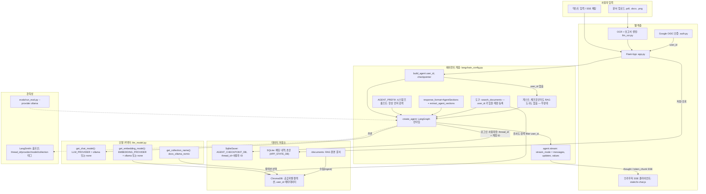

# PS_Agent: AI 기반 보고서 작성 보조 에이전트

**RAG (Retrieval Augmented Generation) 및 LLM (Large Language Model) 기반 포트폴리오 프로젝트**

## 1. 프로젝트 개요 (Project Overview)

-   본 프로젝트는 사용자의 자기소개서(대학 입학용, 직장 지원용) 작성 및 전문적인 보고서 생성을 돕는 AI 에이전트입니다.
-   엔진은 **Ollama로 서빙하는 로컬 모델 `qwen3:4b`** 이며, 외부 AI API에 의존하지 않습니다. 공급자는 `LLM_PROVIDER` / `EMBEDDING_PROVIDER` 환경 변수로 전환하며, `none`을 지정하면 AI 기능을 명시적으로 끌 수 있습니다.
-   에이전트는 **LangGraph 기반 `langchain.agents.create_agent`** 로 구성되며, RAG (Retrieval Augmented Generation) 파이프라인을 통해 문서 기반 질의응답 및 콘텐츠 생성을 지원합니다. 폐기 예정(deprecated)인 `langchain_classic.initialize_agent`는 더 이상 사용하지 않습니다.
-   다양한 입력 방식(텍스트, 문서 파일)을 지원하여 사용자 편의성을 높였습니다.

## 2. 주요 기능 (Main Features)

-   **AI 기반 채팅 상담:**
    -   자기소개서 및 보고서 작성 관련 일반적인 질문에 대한 답변 및 가이드 제공.
    -   LangGraph 에이전트를 통한 대화형 상호작용.
    -   **대화 메모리:** LangGraph `SqliteSaver` 체크포인터가 로그인 사용자의 대화 스레드를 유지합니다 (`thread_id` = 인증된 사용자 ID). 비로그인 게스트는 상태를 저장하지 않습니다.
-   **RAG 기반 문서 질의응답 및 콘텐츠 생성:**
    -   사용자가 제공하는 문서(`documents` 폴더 내 PDF, TXT 파일)를 ChromaDB 벡터 스토어에 저장 및 인덱싱.
    -   임베딩은 Ollama `nomic-embed-text`를 사용합니다 (768차원).
    -   `search_documents` 도구가 **한 번만 검색하고, 중복 청크를 제거한 뒤, 출처(`[source: ...]`)를 붙여** 원문 발췌를 그대로 반환합니다. 검색 결과는 항상 `filter={"user_id": ...}` 로 계정 범위가 제한됩니다.
-   **다중 입력 방식 지원:**
    -   **문서 업로드 및 분석 (OCR):**
        -   PDF, TXT, DOCX, 이미지(PNG, JPG) 파일 업로드 지원.
        -   Tesseract OCR (이미지) 및 pypdf/python-docx (문서)를 통한 텍스트 추출.
        -   추출된 텍스트를 기반으로 LLM을 활용하여 HTML 형식의 보고서 자동 생성 (한국어).
-   **관측 및 평가:**
    -   LangSmith 추적을 옵트인으로 지원하며, 실행마다 공급자·모델·컬렉션 메타데이터를 남깁니다.
    -   `evals/` 아래에 16개 골든 케이스로 구성된 재현 가능한 평가 하네스를 제공합니다.
-   **데이터 관리:**
    -   SQLite DB를 사용하여 채팅 내역 및 자기소개서 초안 저장.

## 3. 기술 스택 (Tech Stack)

-   **언어 (Language):** Python 3.13
-   **웹 프레임워크 (Web Framework):** Flask
-   **LLM 프레임워크 (LLM Framework):** LangChain 1.x + **LangGraph** (`langchain.agents.create_agent`)
-   **LLM 및 임베딩 (LLM & Embedding):** `llm_model.py`의 `get_chat_model()` / `get_embedding_model()` 커넥터가 담당하며, 공급자 이름은 이 모듈 밖에 등장하지 않습니다.
    -   채팅 (`LLM_PROVIDER`): `ollama` (기본값, `qwen3:4b`) 또는 `none` (비활성화)
    -   임베딩 (`EMBEDDING_PROVIDER`): `ollama` (기본값, `nomic-embed-text`) 또는 `none` (비활성화)
-   **에이전트 메모리 (Memory):** `langgraph-checkpoint-sqlite`의 `SqliteSaver`
-   **벡터 데이터베이스 (Vector Database):** ChromaDB (임베딩 공급자별 컬렉션 분리)
-   **관측성 (Observability):** LangSmith (옵트인 추적) 및 `evals/` 평가 하네스
-   **문서 처리 (Document Processing):**
    -   OCR: Tesseract OCR, Pillow
    -   PDF: pypdf
    -   DOCX: python-docx
-   **데이터베이스 (Database):** SQLite
-   **기타 (Others):** `dotenv` (환경변수 관리)

## 4. 시스템 아키텍처 및 작동 방식 (System Architecture & How it Works)



1.  **데이터 수집 및 전처리 (Data Ingestion & Preprocessing):**
    -   **문서:** `./documents` (또는 `RAG_DOCUMENTS_DIR`) 폴더의 PDF, TXT 파일들이 로드되어 텍스트로 변환되고 청크(chunk) 단위로 분할됩니다. 각 청크에는 소유 계정을 나타내는 `user_id` 메타데이터가 기록됩니다.
    -   **OCR:** 사용자가 업로드한 이미지/PDF/DOCX 파일에서 텍스트가 추출됩니다.
2.  **임베딩 및 벡터 저장 (Embedding & Vector Storage - RAG Core):**
    -   분할된 청크들은 활성 임베딩 공급자의 모델로 임베딩되어 ChromaDB에 저장됩니다.
    -   컬렉션 이름은 `get_collection_name()`이 임베딩 공급자와 모델로부터 생성합니다 (`docs_ollama_nomic`). 같은 모델의 다른 표기(`models/` 접두사, `:latest` 접미사)는 하나로 정규화되므로, 하나의 임베딩 공간이 두 컬렉션으로 쪼개지지 않습니다.
3.  **사용자 질의 및 컨텍스트 검색 (User Query & Context Retrieval - RAG Core):**
    -   에이전트는 `search_documents` 도구를 호출하고, 이 도구는 **한 번만** 유사도 검색을 수행합니다 (`filter={"user_id": ...}`).
    -   중복 본문을 제거한 뒤 `[source: 파일명]` 머리말을 붙인 원문 발췌를 그대로 반환합니다. 이 경로에는 모델의 판단이 개입하지 않으므로, 4B 모델이 틀릴 여지 자체가 없습니다.
4.  **LLM을 통한 답변/콘텐츠 생성 (Response/Content Generation via LLM):**
    -   LangGraph 런타임이 도구 호출 루프를 돌리고, `AGENT_PREFIX` 시스템 프롬프트에 따라 **답변 전에 항상 먼저 검색**합니다.
    -   최종 답변의 네 개 섹션은 `extract_agent_sections()`가 추출합니다: `structured_response` → 메시지 본문의 JSON → 레거시 `[CHAT]` 마커 순서입니다.
5.  **결과 제공 (Output):**
    -   `agent.stream(..., stream_mode=["messages", "updates", "values"])`가 생성한 이벤트를 `thought` / `token_chunk` SSE 이벤트로 변환해 전달합니다. 전송 규약(wire contract)은 변경되지 않았으므로 `static/lc-chat.js`는 수정되지 않았습니다.
    -   생성된 텍스트 답변, HTML 보고서 등이 Flask 웹 인터페이스를 통해 사용자에게 제공됩니다.

### 임베딩 공급자를 바꾸면 반드시 재수집(re-ingestion)해야 합니다

-   임베딩 모델을 바꾸면 차원이 같더라도 임베딩 공간이 달라집니다. Chroma는 차원만 검사하므로 서로 무관한 벡터를 하나의 컬렉션에 **오류 없이 조용히** 받아들인 뒤 비교합니다. 결과는 예외가 아니라 **엉뚱한 이웃 문서**입니다. 과거 `text-embedding-004`(768차원)와 `nomic-embed-text`(768차원)가 정확히 이 충돌을 일으켰습니다.
-   이 조용한 충돌을 막기 위해 컬렉션 이름에 공급자와 모델을 인코딩했습니다. 따라서 `EMBEDDING_PROVIDER`를 바꾸면 **새 컬렉션**이 만들어집니다.
-   그 결과 **기존 지식 베이스는 재수집 전까지 비어 있는 것처럼 보입니다.** 실패도 경고도 없이 검색 결과가 0건일 뿐입니다.
-   마이그레이션 이전의 레거시 `langchain` 컬렉션은 디스크에 그대로 남아 있으며, 옮겨지지 않은 채 어디에서도 참조되지 않습니다. 필요한 문서는 다시 수집해야 합니다.

## 5. 평가 결과와 배운 점 (Evaluation Results & Findings)

`evals/`는 3개의 합성 픽스처 문서 위에 16개의 골든 케이스(답변 가능 14 + 답변 불가 2)를 정의한 평가 하네스입니다. 채점 항목 대부분은 모델이 아니라 코드가 판정합니다 (정답 포함 여부, `search_documents` 호출 여부, 거절 문구 여부). 근거성(groundedness)만 모델이 판정하며, 답변 가능한 14개 케이스에만 적용됩니다.

### 핵심 발견: 조건부 도구 지시는 작은 모델에게 통하지 않는다

첫 측정에서 `qwen3:4b`는 16개 중 **4개**에서만 `search_documents`를 호출했습니다. 그런데 실패한 12개는 **전부 환각이 아니라 거절**이었고, 정답을 맞힌 4개는 정확히 **검색을 수행한 그 4개**였습니다. 즉 **검색 자체는 한 번도 문제가 아니었습니다.**

원인은 시스템 프롬프트였습니다. 기존 문구는

> `"Use search_documents when the user asks about the local document database"`

라는 **조건문**이었습니다. 그런데 "최소 GPA가 얼마인가요?" 같은 질문은 '문서'를 언급하지 않습니다. 4B 모델은 지시를 문자 그대로 받아들여 조건이 충족되지 않았다고 판단하고, 자기 지식으로 답하거나 아예 거절했습니다. 더 큰 모델은 의도를 추론해서 넘어가지만, 4B는 넘어가지 않습니다.

프롬프트를 **"항상 먼저 검색하고, 검색 결과가 없을 때에만 모른다고 답하라"** 는 무조건 지시로 바꾸자, **같은 16개 케이스**가 다음과 같이 움직였습니다.

| 지표 (metric) | 변경 전 (before) | 변경 후 (after) |
| --- | --- | --- |
| 정확도 (correctness, 코드 판정) | 4/16 | **15/16** |
| `search_documents` 호출 | 4/16 | **16/16** |
| 근거성 (groundedness, 모델 판정) | 4/14 | **14/14** |
| 총 실행 시간 (wall clock) | 765초 | 249초 (판정 생략) / 488초 (판정 포함) |

독립적인 두 번의 실행에서 모두 15/16으로 재현되었고, 실패한 한 케이스도 동일했습니다 (`unanswerable-legal-head` — 모델이 단호하게 거절하는 대신 픽스처 내용을 근거로 추론을 시도합니다).

> **일반화 가능한 교훈:** 작은 모델은 조건부 도구 사용 지시를 문자 그대로 해석한다. **검색을 조건이 아니라 무조건으로 만들어라.**

### 그 외 측정된 사실 (Other measured findings)

-   **4B에서 `structured_response`는 신뢰할 수 없습니다.** 실제 4필드 스키마(`AgentSections`)와 전체 시스템 프롬프트를 함께 사용했을 때 3회 실행 중 **0회** 채워졌습니다. 모델은 스키마에 맞는 유효한 JSON을 구조화 출력 도구 호출 대신 **메시지 본문으로** 내보냅니다. 따라서 `extract_agent_sections()`의 폴백은 안전장치가 아니라 **Qwen 요청을 실제로 지탱하는 주 경로**입니다.
    -   `ProviderStrategy`도 시도했으나 폐기했습니다. `structured_response`는 안정적으로 채워지지만, Ollama의 `format=json_schema`가 모든 생성을 스키마로 강제하는 탓에 **모델이 도구 호출을 낼 수 없게 되어 RAG 도구 자체가 도달 불가능**해집니다.
-   **`ChatOllama`의 `reasoning`은 설정하지 않은 채로 두어야 합니다.** `reasoning=True`는 구조화 출력 도구 호출을 3/3 억제했고, `reasoning=False`는 사고 과정 산문이 `content`로 새어 나옵니다. 추적에서 사고 과정을 보고 싶다면 `OLLAMA_REASONING=true`로 구조화 출력과 맞바꿀 수 있습니다.
-   **`qwen3`에서는 `token_chunk` SSE 이벤트가 한 번도 발생하지 않았습니다.** 원시 스트림이 항상 스키마 JSON이기 때문입니다. `token_chunk` 분기는 `app.py`에 그대로 존재하지만 qwen3 경로에서는 조건이 성립하지 않습니다. 진행 중 UI는 `thought` 이벤트가 담당합니다.
-   평가 하네스는 **실패한 케이스가 있으면 0이 아닌 종료 코드**를 반환하고(CI에 그대로 붙일 수 있습니다), 픽스처는 임시 `RAG_PERSIST_DIR`에 전용 `user_id`로 수집되고 종료 시 삭제되므로, 실제 지식 베이스는 건드리지 않습니다.

## 6. 주요 코드 파일 설명 (Key Code Files)

-   `app.py`: Flask 애플리케이션 실행, 라우팅, SSE 스트리밍, 체크포인터 수명 관리.
-   `langchain_config.py`: `create_agent` 기반 에이전트 구성(`build_agent`), `search_documents` RAG 도구, `AGENT_PREFIX` 시스템 프롬프트, `AgentSections` 스키마와 `extract_agent_sections()`, ChromaDB 초기화 및 문서 수집/인덱싱, LangSmith 추적 메타데이터.
-   `llm_model.py`: 공급자 기반 모델 커넥터(`get_chat_model`, `get_embedding_model`)와 임베딩 공급자별 컬렉션 이름(`get_collection_name`). 공급자 이름이 등장하는 유일한 모듈입니다.
-   `llm_prompt.py`: **레거시 프롬프트.** 채팅 에이전트의 시스템 프롬프트는 `langchain_config.py`의 `AGENT_PREFIX`로 대체되었으며, 이 파일은 현재 `llm_ocr.analyze_document()`의 문서 분석 경로에서만 사용됩니다.
-   `llm_ocr.py`: 이미지, PDF, DOCX 파일에서 텍스트를 추출하고, LLM을 이용해 HTML 보고서 생성.
-   `auth.py` / `quota.py`: Google OIDC 로그인, 계정/게스트 경계, 일일 AI 요청 할당량.
-   `html_sanitizer.py`: 생성된 보고서 HTML의 Bleach 허용 목록 기반 정제.
-   `evals/dataset.py`: 16개 골든 케이스(순수 데이터, import 없음).
-   `evals/run_eval.py`: 공급자별 평가 실행기.
-   `evals/fixtures/`: 평가용 합성 문서 3종.
-   `chroma_db/`: ChromaDB 벡터 데이터 저장소.
-   `documents/`: RAG 시스템에 사용될 원본 문서 저장 폴더.
-   `sqlite_db/`: 애플리케이션 상태 DB(`app_state.db`)와 에이전트 체크포인트 DB(`checkpoints.db`).
-   `templates/`: Flask HTML 템플릿 (chatbot.html, document.html, statistics.html).
-   `static/lc-chat.js`: SSE 채팅 클라이언트. 전송 규약이 유지되었으므로 이번 마이그레이션에서 수정되지 않았습니다.

## 7. 실행 방법 (How to Run)

### 7.1 환경 변수 설정

프로젝트 루트에 `.env` 파일을 만들고 필요한 값을 넣습니다. 비밀 값은 저장소에 커밋하지 않습니다.

**모델 공급자 (Model providers)**

| 변수 | 기본값 | 설명 |
| --- | --- | --- |
| `LLM_PROVIDER` | `ollama` | 채팅 모델 공급자. `ollama` 또는 `none`. |
| `EMBEDDING_PROVIDER` | `ollama` | 임베딩 공급자. `ollama` 또는 `none`. **변경 시 재수집 필요** (4장 참고). |
| `OLLAMA_MODEL` | `qwen3:4b` | Ollama 채팅 모델. |
| `OLLAMA_EMBED_MODEL` | `nomic-embed-text` | Ollama 임베딩 모델. |
| `OLLAMA_BASE_URL` | `http://localhost:11434` | Ollama 서버 주소. |
| `OLLAMA_TEMPERATURE` | `0.7` | Qwen3는 greedy 디코딩(0)에서 품질이 떨어지고 같은 말을 반복합니다. 0으로 두지 마세요. |
| `OLLAMA_REASONING` | (미설정) | 설정하지 않는 것이 기본입니다. `true`로 두면 추적 가시성을 얻는 대신 구조화 출력을 잃습니다. |

**저장소 및 애플리케이션 (Storage & app)**

| 변수 | 기본값 | 설명 |
| --- | --- | --- |
| `APP_STATE_DB` | `sqlite_db/app_state.db` | 채팅 내역·초안 SQLite DB. |
| `AGENT_CHECKPOINT_DB` | `sqlite_db/checkpoints.db` | LangGraph 체크포인터 DB. 애플리케이션 상태 DB와 스키마가 다르므로 분리되어 있습니다. |
| `RAG_PERSIST_DIR` | `./chroma_db` | ChromaDB 영속 디렉터리. |
| `RAG_DOCUMENTS_DIR` | `./documents` | RAG 원본 문서 폴더. |
| `SECRET_KEY` | — | Flask 세션 키. 운영 환경에서는 장기 보관되는 긴 난수를 사용합니다. |
| `GOOGLE_OIDC_CLIENT_ID` / `GOOGLE_OIDC_CLIENT_SECRET` / `GOOGLE_OIDC_REDIRECT_URI` | — | Google 로그인 설정. 리디렉션 URI 기본값은 `http://localhost:5005/auth/callback`. |
| `QUOTA_IP_SALT` | — | 게스트 할당량 계산용 IP 해시 솔트. |
| `DAILY_AI_REQUEST_LIMIT` | `20` | 일일 AI 요청 한도. |

**LangSmith 추적 (기본 비활성)**

| 변수 | 설명 |
| --- | --- |
| `LANGSMITH_TRACING` | `1/true/yes/on` 중 하나일 때만 활성화됩니다. 빈 값이면 꺼진 상태입니다. |
| `LANGSMITH_API_KEY` | LangSmith API 키. |
| `LANGSMITH_PROJECT` | 프로젝트 이름 (미지정 시 `default`). |

추적이 켜지면 실행마다 `thread_id`, `llm_provider`, `llm_model`, `embedding_provider`, `collection` 메타데이터와 `provider:` / `model:` 태그가 기록됩니다.

> **개인정보 주의:** 추적을 켜면 전체 프롬프트, 검색된 문서 원문, 모델 답변이 LangSmith로 업로드됩니다. 이 애플리케이션은 사용자의 자기소개서와 업로드 파일을 다루므로, 제3자에게 개인정보를 전송해도 되는 환경에서만 활성화하십시오.

Google 계정과 계정별 문서 작업공간을 사용하려면 Google Cloud Console에서 OAuth 동의 화면과 Web application 클라이언트를 설정한 뒤, 승인된 리디렉션 URI에 `http://localhost:5005/auth/callback`을 등록합니다. 운영 환경에서는 HTTPS 리디렉션 URI가 필요합니다.

로그인하지 않은 사용자는 세션 안에서만 초안을 유지하고 AI 요청은 하루 20회로 제한되며, RAG 도구와 대화 메모리가 제공되지 않습니다. Google 로그인 사용자는 자신의 SQLite 초안·채팅 기록과 Chroma 문서만 사용할 수 있으며, 다른 계정의 문서는 검색하거나 삭제할 수 없습니다.

### 7.2 필수 라이브러리 설치

```bash
pip install -r requirements.txt
```

Tesseract OCR은 시스템 패키지로 별도 설치되어 있어야 합니다.

### 7.3 Ollama 준비 (기본 공급자)

```bash
# https://ollama.com 에서 설치한 뒤
ollama pull qwen3:4b            # 채팅 모델
ollama pull nomic-embed-text    # 로컬 임베딩 (EMBEDDING_PROVIDER=ollama 인 경우)
ollama serve                    # http://localhost:11434
```

> **기본 설정은 완전히 로컬입니다.** 채팅과 임베딩 모두 Ollama를 사용하므로 외부 AI API 키가 필요하지 않습니다. Google OIDC 로그인만 별도의 자격 증명을 사용합니다.

### 7.4 문서 준비 (RAG용)

`documents` 폴더에 RAG에서 참조할 PDF 또는 TXT 파일을 넣습니다. 로그인 후 웹 UI의 업로드 기능으로도 지식 베이스에 문서를 추가할 수 있습니다.

### 7.5 애플리케이션 실행

```bash
python app.py
```

웹 브라우저에서 `http://localhost:5005`로 접속합니다. 구성 상태는 `GET /health`에서 확인할 수 있으며, `GET /health?probe=llm`은 Ollama 서버 도달 가능 여부까지 확인합니다.

### 7.6 평가 실행 (Evaluation)

```bash
python -m evals.run_eval --provider ollama     # 로컬 qwen3:4b

python -m evals.run_eval --provider ollama --no-judge   # 모델 판정 근거성 생략 (빠름)
python -m evals.run_eval --provider ollama --limit 3    # 앞 N개 케이스만
```

실패한 케이스가 있으면 0이 아닌 종료 코드를 반환합니다. 실행 중에는 임시 영속 디렉터리와 전용 `user_id`를 사용하므로 실제 지식 베이스는 변경되지 않습니다.

### 7.7 테스트 실행

```bash
python -m pytest tests/ -q
```

## 8. 향후 개선 방향 (Potential Future Improvements)

-   현재 통합 우선순위와 상태는 [`docs/integration-roadmap.md`](docs/integration-roadmap.md)에서 관리합니다.
-   더 다양한 문서 포맷 지원 (e.g., .pptx, .xls).
-   프롬프트 기반 `GET /chat?message=...`를 POST 스트리밍으로 전환하고 취소·타임아웃을 도입 (로드맵 5번, 미착수).
-   평가 픽스처를 청크 하나보다 크게 키워 검색 품질을 실제 점수로 읽을 수 있게 만들기.
-   더 큰 로컬 모델(예: 8B 이상)에서 `structured_response` 신뢰도 재측정.
-   프롬프트 엔지니어링 최적화 및 LLM 모델 파인튜닝 고려.
-   Streamlit 또는 Gradio를 이용한 인터페이스 개선 또는 대안 UI 제공.
-   비동기 처리 강화를 통한 동시 사용자 응답성 향상.
