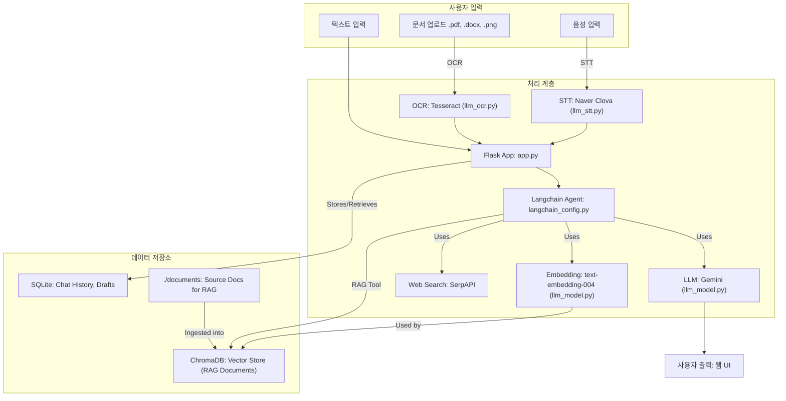

# PS_Agent: AI 기반 보고서 작성 보조 에이전트

**RAG (Retrieval Augmented Generation) 및 LLM (Large Language Model) 기반 포트폴리오 프로젝트**

## 1. 프로젝트 개요 (Project Overview)

-   본 프로젝트는 사용자의 자기소개서(대학 입학용, 직장 지원용) 작성 및 전문적인 보고서 생성을 돕는 AI 에이전트입니다.
-   Google의 Gemini LLM (`gemini-1.5-flash` 또는 유사 모델)을 핵심 엔진으로 사용하며, Langchain 프레임워크를 통해 RAG (Retrieval Augmented Generation) 파이프라인을 구축하여 문서 기반 질의응답 및 콘텐츠 생성을 지원합니다.
-   다양한 입력 방식(텍스트, 문서 파일, 음성)을 지원하여 사용자 편의성을 높였습니다.

## 2. 주요 기능 (Main Features)

-   **AI 기반 채팅 상담:**
    -   자기소개서 및 보고서 작성 관련 일반적인 질문에 대한 답변 및 가이드 제공.
    -   Langchain 에이전트를 통한 대화형 상호작용.
-   **RAG 기반 문서 질의응답 및 콘텐츠 생성:**
    -   사용자가 제공하는 문서(`documents` 폴더 내 PDF, TXT 파일)를 ChromaDB 벡터 스토어에 저장 및 인덱싱.
    -   Google `text-embedding-004` 모델을 사용하여 문서 임베딩.
    -   사용자 질문에 대해 관련 문서를 검색하고, Gemini LLM이 검색된 정보를 바탕으로 답변 생성.
-   **다중 입력 방식 지원:**
    -   **문서 업로드 및 분석 (OCR):**
        -   PDF, TXT, DOCX, 이미지(PNG, JPG) 파일 업로드 지원.
        -   Tesseract OCR (이미지) 및 PyPDF2/python-docx (문서)를 통한 텍스트 추출.
        -   추출된 텍스트를 기반으로 Gemini LLM을 활용하여 HTML 형식의 보고서 자동 생성 (한국어).
    -   **음성 입력 (STT):**
        -   Naver Clova Speech Recognition API를 이용한 음성-텍스트 변환.
        -   변환된 텍스트를 기반으로 LLM을 통한 요약 또는 추가 처리.
-   **외부 정보 검색:**
    -   SerpAPI를 연동하여 웹 검색 기능 제공.
-   **데이터 관리:**
    -   SQLite DB를 사용하여 채팅 내역 및 자기소개서 초안 저장.

## 3. 기술 스택 (Tech Stack)

-   **언어 (Language):** Python
-   **웹 프레임워크 (Web Framework):** Flask
-   **LLM 및 임베딩 (LLM & Embedding):**
    -   Google Gemini Flash (e.g., `gemini-1.5-flash` as specified in `llm_model.py` as `gemini-2.0-flash`, likely `gemini-1.5-flash`)
    -   Google `text-embedding-004`
-   **LLM 프레임워크 (LLM Framework):** Langchain
-   **벡터 데이터베이스 (Vector Database):** ChromaDB
-   **문서 처리 (Document Processing):**
    -   OCR: Tesseract OCR, Pillow
    -   PDF: PyPDF2
    -   DOCX: python-docx
-   **음성 처리 (Speech Processing):**
    -   STT: Naver Clova Speech Recognition API
    -   Audio Recording: `sounddevice`, `soundfile`
-   **데이터베이스 (Database):** SQLite
-   **기타 (Others):** SerpAPI (웹 검색), `dotenv` (환경변수 관리)

## 4. 시스템 아키텍처 및 작동 방식 (System Architecture & How it Works)



1.  **데이터 수집 및 전처리 (Data Ingestion & Preprocessing):**
    -   **문서:** `./documents` 폴더의 PDF, TXT 파일들이 로드되어 텍스트로 변환되고 청크(chunk) 단위로 분할됩니다.
    -   **OCR:** 사용자가 업로드한 이미지/PDF/DOCX 파일에서 텍스트가 추출됩니다.
    -   **STT:** 사용자의 음성 입력이 Naver STT를 통해 텍스트로 변환됩니다.
2.  **임베딩 및 벡터 저장 (Embedding & Vector Storage - RAG Core):**
    -   분할된 문서 청크들은 Google `text-embedding-004` 모델을 통해 임베딩 벡터로 변환됩니다.
    -   생성된 벡터들은 ChromaDB에 저장되어 검색 가능한 인덱스를 구축합니다.
3.  **사용자 질의 및 컨텍스트 검색 (User Query & Context Retrieval - RAG Core):**
    -   사용자의 텍스트 입력 (채팅, STT 변환 텍스트 등)은 동일한 임베딩 모델을 사용하여 벡터로 변환됩니다.
    -   ChromaDB에서 사용자 질의 벡터와 유사도가 높은 문서 청크(컨텍스트)를 검색합니다.
4.  **LLM을 통한 답변/콘텐츠 생성 (Response/Content Generation via LLM):**
    -   Langchain 에이전트는 사용자 질의, 검색된 컨텍스트, 채팅 히스토리, 그리고 `llm_prompt.py`에 정의된 시스템 프롬프트를 Gemini LLM에 전달합니다.
    -   LLM은 주어진 정보를 바탕으로 답변을 생성하거나, 문서 요약 보고서(OCR의 경우) 등을 생성합니다.
    -   필요시 SerpAPI를 통해 외부 정보를 검색하여 답변을 보강합니다.
5.  **결과 제공 (Output):**
    -   생성된 텍스트 답변, HTML 보고서 등이 Flask 웹 인터페이스를 통해 사용자에게 제공됩니다.

## 5. 주요 코드 파일 설명 (Key Code Files)

-   `app.py`: Flask 애플리케이션 실행, 라우팅, 핵심 로직 담당.
-   `langchain_config.py`: Langchain 에이전트, RAG 도구, Retriever, 메모리 설정. ChromaDB 초기화 및 문서 로딩/인덱싱.
-   `llm_model.py`: Google Gemini LLM 및 임베딩 모델 초기화.
-   `llm_prompt.py`: LLM의 역할, 응답 형식, 도구 사용법 등을 정의하는 시스템 프롬프트.
-   `llm_ocr.py`: 이미지, PDF, DOCX 파일에서 텍스트를 추출하고, LLM을 이용해 HTML 보고서 생성.
-   `llm_stt.py`: Naver Clova API를 이용한 음성-텍스트 변환 기능.
-   `chroma_db/`: ChromaDB 벡터 데이터 저장소.
-   `documents/`: RAG 시스템에 사용될 원본 문서 저장 폴더.
-   `sqlite_db/`: 채팅 내역, 자기소개서 초안 저장 SQLite DB.
-   `templates/`: Flask HTML 템플릿 (chatbot.html, document.html, audio.html).

## 6. 실행 방법 (How to Run)

1.  **환경 변수 설정:**
    -   프로젝트 루트에 `.env` 파일을 생성하고 다음 API 키 및 자격 증명을 입력합니다:
        ```
        GOOGLE_API_KEY="YOUR_GOOGLE_API_KEY"
        SERPAPI_API_KEY="YOUR_SERPAPI_API_KEY"
        client_id="YOUR_NAVER_CLIENT_ID"
        client_secret="YOUR_NAVER_CLIENT_SECRET"
        ```
2.  **필수 라이브러리 설치:**
    -   (프로젝트에 `requirements.txt` 파일이 있다면) `pip install -r requirements.txt` 명령을 실행합니다.
    -   `requirements.txt`가 없다면, 주요 라이브러리 (`flask`, `langchain`, `langchain-google-genai`, `langchain-community`, `langchain-chroma`, `pytesseract`, `pillow`, `pypdf2`, `python-docx`, `sounddevice`, `soundfile`, `requests`, `python-dotenv`, `werkzeug`, `google-generativeai`, `soundfile`, `numpy`) 등을 설치해야 합니다. Tesseract OCR 자체도 시스템에 설치되어 있어야 합니다.
3.  **문서 준비 (RAG용):**
    -   `documents` 폴더를 생성하고 (이미 있다면 비워도 됩니다), RAG 시스템에서 참조할 PDF 또는 TXT 파일들을 넣어둡니다.
4.  **애플리케이션 실행:**
    -   터미널에서 `python app.py` 명령을 실행합니다.
5.  **서비스 접속:**
    -   웹 브라우저를 열고 `http://localhost:5005` 주소로 접속합니다.

## 7. 향후 개선 방향 (Potential Future Improvements)

-   더 다양한 문서 포맷 지원 (e.g., .pptx, .xls).
-   사용자별 문서 관리 및 인증 기능 추가.
-   Langchain Expression Language (LCEL)을 활용한 체인 구성 고도화.
-   프롬프트 엔지니어링 최적화 및 LLM 모델 파인튜닝 고려.
-   Streamlit 또는 Gradio를 이용한 인터페이스 개선 또는 대안 UI 제공.
-   비동기 처리 강화를 통한 동시 사용자 응답성 향상.
