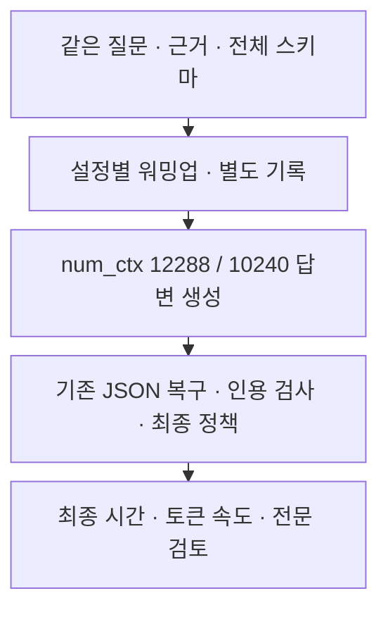

# 컨텍스트 실행 예산 시험 결과

> 보관 위치 변경 (2026-10-13): 시험용 worktree와 브랜치를 정리했다. 후보 코드와 실행 상태는 압축 보관했으며, 아래 측정 원자료는 유지했다. [정리 내역과 복원 방법](unsuccessful-experiments-cleanup-2026-10-13.md)을 참고한다.

기록일: 2026-10-11. 결정: **컨텍스트 10,240 후보를 지연 개선 설정으로 적용하지 않는다.**

## 1. 판단

같은 모델의 `num_ctx`를 12,288에서 10,240으로 줄였다. 모델이 보고한 GPU 할당량은 294 MiB 줄었지만, 최종 생성·검사 시간의 중앙값은 1회차 3.2%, 2회차 0.9% 늘었다. 두 회차 모두 사전 기준인 10% 개선을 충족하지 못했다.

**메모리 절약은 확인했지만 지연 개선은 확인하지 못했다.** 출력 생성 속도도 두 번째 회차에서 사실상 같았다. 이 결과를 모든 컨텍스트 설정이나 다른 하드웨어의 한계로 확대하지 않는다.

서비스 코드·설정은 변경하지 않았다. 기존 검사를 마친 최종 답변만 표시하는 정책을 유지한다. 이 검사는 모든 문장의 법률적 정확성을 보증하지 않는다.

## 2. 시험 조건

| 항목 | 조건 |
|---|---|
| 현재 코드 | `d03fd466` + 현재 작업 파일 425개를 그대로 복사 |
| 격리 공간 | `.worktrees/context-budget`, `perf/context-budget` |
| 장치 | RTX 4060 Laptop, VRAM 8 GB |
| 모델 | Ollama 0.16.2, qwen3:4b, Q4_K_M; digest 동일 |
| 비교 변수 | 모든 답변 호출의 num_ctx: 12288 / 10240 |
| 고정 조건 | think false, temperature 0.2, 출력 2048, 전체 LegalAnswer 스키마 |
| 입력 | 질문, 제공 근거 5개, 프롬프트, 고정 분석·검색 결과 동일 |
| 문항 | 개발 80문항 중 0/20/40/60 + 과거 최장 입력 43 + 재시도 사례 2 |
| 반복 | 6문항 × 2방식 × 2회차 = 측정 24턴, 실제 모델 호출 28회 |
| 워밍업 | 별도 26번 문항, 블록별 1턴씩 총 4턴·4호출 제외 |
| 순서 | 기존→후보→후보→기존; 2회차 문항 순서 역전 |
| seed | 같은 회차·문항 쌍은 동일; 후속 호출의 seed도 동일 규칙 |

처음 검토한 8192 후보는 과거 최초 입력 최대 6647 + 출력 예산 2048을 담지 못해 **추론 실행 전에** 제외했다. 질문이나 근거를 줄이지 않고 10240 후보를 선택했다.

각 블록의 워밍업 후 컨텍스트 할당을 확인했다. 측정 턴 안에서 발생한 재시도와 로드 시간은 모두 포함했다. 강제 캐시 초기화, 모델 언로드, 서버 재시작은 수행하지 않았다. Flash Attention과 GPU 레이어 수는 이번 실행에서 새로 확인하지 않았다. API의 `size`와 `size_vram`은 각 블록에서 같았다.

[설계](superpowers/specs/2026-10-11-context-budget-design.md), [계획](superpowers/plans/2026-10-11-context-budget.md), [사전 판정 기준](../data/eval/reports/chat_pipeline/context-budget-2026-10-11/PREREG.json)을 실행 전에 기록했다. 측정 코드와 입력은 [manifest](../data/eval/reports/chat_pipeline/context-budget-2026-10-11/manifest.json)으로 고정했다.

## 3. 시간과 출력 속도

아래 시간은 **답변 생성 + 기존 검사·최종 정책**이다. 질문 분석, 실제 검색, Flask/SSE 전달, 브라우저 표시 시간은 포함하지 않는다. 오류나 불리한 턴을 집계에서 제외하지 않았다.

| 회차 | 설정 | 턴 | 중앙값(초) | p90(초) | 실제 호출 | 턴별 출력 토큰 중앙값 | 호출별 생성 tokens/sec 중앙값 |
|---|---|---:|---:|---:|---:|---:|---:|
| 1 | 기존 12288 | 6 | 15.56 | 55.95 | 7 | 737 | 56.22 |
| 1 | 후보 10240 | 6 | 16.06 | 56.69 | 7 | 737 | 54.16 |
| 2 | 기존 12288 | 6 | 12.54 | 60.23 | 7 | 551.5 | 54.54 |
| 2 | 후보 10240 | 6 | 12.65 | 56.68 | 7 | 551.5 | 54.53 |

6턴의 nearest-rank p90은 최대값이다. 일반 사용자 집단의 p90으로 해석하지 않는다. 턴별 출력 토큰은 재시도도 더하며, tokens/sec는 호출마다 `eval_count / (eval_duration / 1e9)`로 계산한다. 두 집계의 분모는 다르다.

모든 설정·회차에서 오류·거부·인용 재생성·인용 제거는 각각 0건이다. 최초 출력 2048토큰 한도 도달과 JSON 복구는 각 그룹에서 1턴씩 발생했다. 모두 2번 문항이며 컨텍스트를 줄여도 추가 호출은 사라지지 않았다.

2회차 p90은 60.23→56.68초로 줄었다. 그러나 그 쌍은 첫 출력부터 내용이 달랐고 복구 출력도 973→796토큰으로 짧아졌다. 이를 디코더 속도 개선의 독립 근거로 사용하지 않는다.

## 4. 메모리와 입력 보존

워밍업 직후 API가 보고한 모델 GPU 할당량이다. 실제 전체 GPU 사용량과 구분한다.

| 회차 | 설정 | API 컨텍스트 | API GPU 할당(MiB) | 장치 온도(°C) |
|---|---|---:|---:|---:|
| 1 | 기존 | 12288 | 4525.2 | 56 |
| 1 | 후보 | 10240 | 4231.2 | 67 |
| 2 | 후보 | 10240 | 4231.2 | 69 |
| 2 | 기존 | 12288 | 4525.2 | 69 |

두 방식의 차이는 294 MiB다. 온도·전력·클록을 실험적으로 고정하지 않았고 장치 온도도 달랐다. 작은 시간 차이를 컨텍스트의 확정 효과로 주장하지 않는다. 재현 가능한 10% 속도 개선이 없었다는 판단으로 범위를 제한한다.

- 최초 입력 카운터는 **12/12쌍에서 같았다**. 최대 6647토큰이다.
- 측정 28호출과 워밍업 4호출 모두 보고된 입력 + 요청 출력 예산이 해당 컨텍스트 이하였다.
- 실제 첫 요청은 num_ctx만 달랐다. 후속 요청은 기존 복구·검사 경로에서 만들어졌고 모두 원래 출력 예산을 유지했다.
- 전체 제공 근거, 요청, 원자료, 기존 정책 재생을 확인했다. 이것은 **이 입력들의 카운터 기반 확인**이며, 모든 향후 대화의 내부 토큰 보존을 독립적으로 검증한 것은 아니다.

Ollama는 큰 컨텍스트가 더 많은 메모리를 요구한다고 설명한다. 따라서 컨텍스트 감소를 속도 향상으로 미리 가정하지 않았다. [Context length 공식 문서](https://docs.ollama.com/context-length)와 [Chat API의 카운터·시간 정의](https://docs.ollama.com/api/chat)를 참고했다.

## 5. 전체 답변 검토

**11/12쌍은 최종 8필드, 모든 완성 초안과 검사 결과가 같다.** 같은 내용은 필드 전체의 동일성을 확인한 뒤 한 번 읽었다. 나머지 2회차 2번 문항은 두 방식의 전문과 모든 완성 초안 차이를 각각 읽었다. 모든 문항의 질문·참고 답변·전체 제공 근거 5개도 확인했다. 이유는 [review.jsonl](../data/eval/reports/chat_pipeline/context-budget-2026-10-11/review.jsonl)에 `AI reviewed (Codex)`로 기록했다.

| 상대 품질 판정 | 쌍 수 | 해석 |
|---|---:|---|
| pass | 11 | 동일 내용, 후보에서 새 손실 없음 |
| uncertain | 1 | 달라진 법률 설명의 의미 보존을 확정하지 못함 |
| fail | 0 | 새 중요 저하를 확정한 사례 없음 |

2회차 2번 문항은 두 방식 모두 원심의 비례원칙 판단을 대법원 판단과 혼용한다. 후보는 제재수단의 긴요성을 추가했지만 대상을 “공익을 제거하기 위한” 제재라고 썼다. 공익 침해 상태의 제거를 뜻한 오기인지 법적 목적을 잘못 이해한 것인지 확정하지 못했다. 이 불확실성으로 품질 기준도 통과하지 못했다.

기존 방식에도 오류가 있다. 0번은 원심 선고일·사건을 대법원 판결처럼 표시하고, 20번은 취소와 담합·입찰참가 제한 문제를 충분히 구분하지 못한다. 40번은 일반 교도소의 판례와 군수형자의 규정을 혼용한다. 60번은 구체적 거래조건의 묵시적 편입과 별도 위탁계약 당사자 구분을 빠뜨린다. 이 공유 오류를 후보의 신규 오류로 세지 않았다.

이 검토는 **상대적인 내용 보존 확인**이다. 전문가의 법률 검토나 현행 법률 정확성 인증은 아니다. 참고 답변의 문구도 제공 근거와 충돌하면 그대로 강제하지 않았다.

## 6. 사전 기준 판정

| 기준 | 결과 |
|---|---|
| 두 회차 중앙값 10% 이상 개선 | 미충족: 각각 3.2%, 0.9% 증가 |
| p90·호출·오류·거부·인용 재생성·제거 증가 없음 | 1회차 p90 증가로 미충족; 호출과 오류 관련 수는 동일 |
| 같은 최초 입력 카운터와 모든 호출의 예산 여유 | 이 표본에서 충족 |
| 새 중요 손실·불확실 없음 | 미충족: 1쌍 uncertain |
| 서비스 적용 | 수행하지 않음 |

## 7. 검증과 보존

실제 32호출의 요청·seed·순서·스키마·출력 예산을 확인하고 기존 코드로 28턴의 정책을 재생했다. 모든 최종 답변·근거·검사·정책 결과가 일치했다. [재생 결과](../data/eval/reports/chat_pipeline/context-budget-2026-10-11/measurement-verification.json)

전체 백엔드의 **630 passed, 3 skipped** 기록은 직전 시험의 결과를 재사용했다. 이번에 전체 테스트를 다시 실행한 결과가 아니다. 현재 source/config/test 248개 파일의 바이트가 그 기록의 기준과 같음을 확인했다. 새 실행기 동작은 이번 요청 감사와 정책 재생으로 별도 확인했다. [회귀 근거](../data/eval/reports/chat_pipeline/context-budget-2026-10-11/regression.json)

첫 샌드박스 실행은 `/api/tags` 접근에서 `Operation not permitted`로 끝났다. 추론은 시작되지 않았다. 같은 고정 명령을 정상 승인 절차로 샌드박스 밖에서 실행했다. 실패 기록을 속도 표에 혼합하지 않았다.

기존 root/worktree 파일 425개와 기존 실행 상태 9개를 보존했다. root에는 설계·계획·이 결과 문서만 추가했다. HEAD·index·기존 변경·원자료 해시·문서 링크를 감사한다. [최종 감사](../data/eval/reports/chat_pipeline/context-budget-2026-10-11/final-audit.json)

## 8. 다음 판단

이 후보는 메모리 절약 설정으로는 신호가 있지만 **지연 개선 후보로 확대하지 않는다**. 현재 모델의 긴 출력과 추가 생성이 여전히 오래 걸린다. 검사를 줄이지 않고 지연을 낮추려면 출력 생성 처리량을 바꾸는 별도 실행 방식의 비교가 남는다. 그 비교는 설치·메모리·모델 형식을 확인하는 별도 설계로 진행해야 한다.
