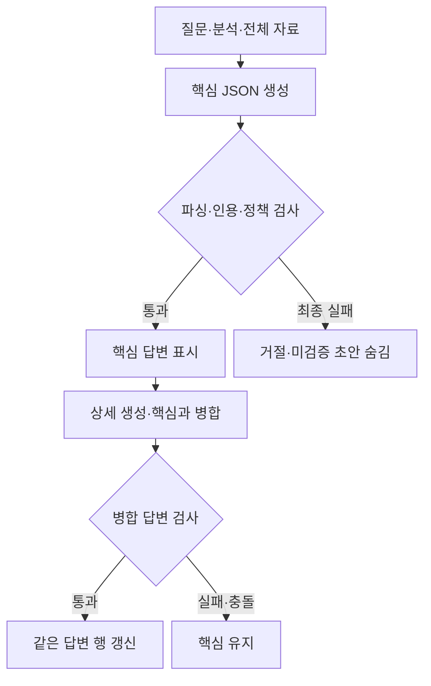

# 검증된 핵심 답변 우선 표시 시험

> 보관 위치 변경 (2026-10-13): 시험용 worktree와 브랜치를 정리했다. 후보 코드와 실행 상태는 압축 보관했으며, 아래 측정 원자료는 유지했다. [정리 내역과 복원 방법](unsuccessful-experiments-cleanup-2026-10-13.md)을 참고한다.

## 1. 결정

**현재 후보는 채택하지 않는다.** 핵심 답변을 먼저 전달하는 코드는 동작했다. 그러나 실제 모델에서 첫 답변이 더 느려졌고, 답변 제공률과 내용 품질도 기준을 충족하지 못했다.

후보 코드는 `.worktrees/core-first`에 보관한다. 운영 소스와 기존 작업 파일은 보존한다. 커밋과 운영 활성화는 하지 않았다. 부분 복구 후보는 이번 시험에 포함하지 않았다.

## 2. 구조

핵심 답변은 결론, 이유, 적용 조건, 예외, 확인할 사실, 인용, 불확실성, 신뢰도를 포함한다. 핵심이 완성되고 기존 검사를 통과한 뒤 표시한다. 상세는 같은 전체 자료와 고정된 핵심을 사용한다.

핵심 단계에서 인용 제거 정책이 선택되면 표시하지 않고 거절한다. 상세 실패나 연결 해제 뒤에는 마지막 표시 가능한 핵심을 한 번 저장한다. 기존 `/v1/chat`은 비교 경로로 유지하며, 시험용 `/v1/chat/staged`와 `LEGAL_STAGED_CHAT=1`을 추가했다.

## 3. 측정 범위

- 질문 6개를 기존·후보 방식으로 2회 비교했다. 측정은 24턴, 제외한 예열은 4턴이다.
- 순서는 기존 → 후보 → 후보 → 기존이다. 두 번째 회차에서는 질문 순서를 뒤집었다.
- 질문, 대화 이력, 분석, 전체 자료 5개를 고정했다. 기존의 첫 요청은 직전 시험의 기존 요청과 직렬화 결과까지 같았다.
- 모델은 기존 `qwen3:4b`, Q4_K_M이다. 문맥 12,288, 호출당 출력 상한 2,048, 온도 0.2, `think=false`를 유지했다.
- 전체 GPU 37개 레이어, Flash Attention, f16 KV, batch 512, parallel 1을 서버 로그로 확인했다. 실제 호출은 측정 41개와 예열 9개, 총 50개다.
- 별도 소유 서버 4개를 11435 포트에서 실행·종료했다. 운영 모델은 수동 해제하거나 재시작하지 않았다. 각 측정 블록 전에 운영 서버가 비어 있는지 확인했다.

시간은 **고정된 분석·검색 결과 이후의 생성·검사·이벤트 전달 구간**이다. 브라우저에서 검색을 포함한 전체 응답 시간으로 해석하면 안 된다. 첫 답변은 완성된 답변이 프로그램의 검사를 통과하고 전달된 시점이다.

## 4. 시간과 제공률

단위는 초다. 첫 답변 중앙값과 p90은 답변을 제공한 턴만 계산한다. 전체 완료 시간은 거절 턴도 포함한다.

| 회차·방식 | 첫 답변 제공 | 첫 답변 중앙값 | 첫 답변 p90 | 전체 완료 중앙값 | 전체 완료 p90 |
|---|---:|---:|---:|---:|---:|
| 1회 기존 | 6/6 | 14.35 | 53.75 | 14.35 | 53.75 |
| 1회 후보 | 5/6 | 30.09 | 36.03 | 64.02 | 140.01 |
| 2회 기존 | 6/6 | 12.47 | 56.71 | 12.47 | 56.71 |
| 2회 후보 | 5/6 | 30.35 | 68.44 | 61.73 | 99.48 |

후보의 첫 답변 중앙값은 각각 **109.7%, 143.4% 증가**했다. 전체 완료 중앙값은 **346.1%, 395.1% 증가**했다. 후보의 1회 p90 감소에는 핵심을 제공하지 못한 140.01초 턴이 제외돼 있다. 이 수치를 개선으로 판단하지 않는다.

두 회차 모두 대북전단 질문(index 2)에서 핵심 제공에 실패했다. 1회는 4개 호출 뒤 인용 불일치가 남아 거절됐다. 2회는 2개 호출이 모두 출력 상한에서 잘려 81.94초 뒤 거절됐다. 미완성·미검증 초안은 표시하지 않았다.

| 회차·방식 | 실제 호출 | 턴당 총 출력 토큰 중앙값 | 길이 종료 호출 | 인용 재생성 턴 | strip 선택 턴 |
|---|---:|---:|---:|---:|---:|
| 1회 기존 | 7 | 660 | 1 | 0 | 0 |
| 1회 후보 | 14 | 2,989 | 2 | 1 | 1 |
| 2회 기존 | 7 | 539 | 1 | 0 | 0 |
| 2회 후보 | 13 | 2,823 | 3 | 0 | 0 |

총 출력 토큰은 복구·실패 호출도 포함한다. 핵심의 필수 조건·예외 설명이 길어졌고 상세에서 같은 설명을 반복했다. 생성량과 호출 수가 함께 늘었다. 핵심을 표시한 10턴의 상세는 모두 완료됐지만, 이것이 내용의 정확성을 보장하지는 않는다.

`strip 선택`은 내부 정책 선택 횟수다. 실제로 인용을 제거한 핵심을 표시한 횟수는 0이다. 모든 호출의 입력 토큰과 출력 상한 합은 문맥 범위 안에 있었고, 서버의 입력 절단·문맥 이동도 없었다.

## 5. 내용 검토

검토자는 **AI reviewed (Codex)**다. 12쌍의 전체 자료, 기존 답변, 후보 핵심·최종, 완료 초안, 검사 기록, 미완성 출력을 읽었다. 해시는 검토 대상과 기록을 연결한다. 독립적인 사람의 법률 검증을 대신하지 않는다.

결과는 **fail 10쌍, uncertain 2쌍, pass 0쌍**이다. fail에는 핵심 미제공도 포함한다. 10개 표시 답변이 모두 새 사실 오류라는 뜻은 아니다.

| 질문 | 주요 판단 |
|---|---|
| 과로·심근경색 | 1회에서 인과관계 입증 실패 사건을 인정 사례로 반대로 설명했다. 2회는 이를 고쳤지만 개인 요인의 배제 조건이 자료의 업무 악화 인정 원칙을 좁히는지 불확실하다. |
| 허위 입찰 자료 | 취소 통지와 법원의 판단을 혼동했다. 단순 오기·공정성 영향 부재를 다루는 실제 판단과 다른 설명을 만들고, 참가자격 제한을 낙찰예정자 취소로 확대했다. |
| 군 교육훈련 | 1회는 선정 금지의 의무 강도가 불명확하다. 2회는 ‘선정하여서는 아니 된다’를 ‘제외할 수 있다’로 약화하고 선정 후 사유를 선정 금지의 예외로 넣었다. |
| 닭·오리 신고 | 식별 표시의 천재지변 예외를 월별 신고의 예외로 표시했다. 2회 reasoning은 구분했지만 exceptions 배열은 여전히 반대로 표시돼 핵심 내부에서 모순됐다. |
| 분양·임대 수익 | 2회에서 ‘보장 약속을 받지 않았다’는 확인서를 ‘약속을 받았다’로 뒤집었다. 당사자 주장과 법원의 판단, 직원과 사용자 관계도 혼동했다. |
| 대북전단 | 두 회차 모두 완성·통과한 핵심이 없어 제공률 기준을 실패했다. 원시 초안의 내용 문제는 표시 오류와 구분해 기록했다. |

기존 답변에도 사건번호 오인, 판결 주체 혼동, 자료보다 넓은 일반화가 있었다. 기존 방식의 비교 우위가 기존 답변의 법률적 정확성을 입증하지는 않는다.

현재 검증기는 JSON·인용·정책을 검사한다. 판결 취지를 반대로 설명하거나 다른 법적 절차의 예외를 가져오는 의미 오류를 모두 검출하지 못한다. 상세 모델의 `consistency=consistent`도 의미 검증의 증거로 삼지 않는다.

## 6. 구현 검사와 환경

- 새 백엔드 회귀: **643 passed, 3 skipped**.
- 독립 `/tmp/core-first-web` 환경의 새 웹 회귀: **142 passed, 12 subtests passed**. 후속 검사에서는 운영 모델 호출을 막았다.
- 기존 live 임베딩 검사는 bge-m3의 실제 1,024차원과 테스트의 768차원 기대값이 달라 실패했다. 원본과 후보의 해당 테스트·연결 코드가 같음을 확인하고 실패 기록을 보존했다. 이 파일만 후속 웹 회귀에서 제외했다.
- 초기 웹 검사로 로드된 운영 임베딩 모델은 자동 해제가 끝날 때까지 읽기 전용으로 기다렸다. 성능 측정은 이후에 시작했다.
- JSON 미완성, 인용 재생성, 상세 실패·충돌, 연결 해제, 사용자 격리, 자료 전달, 화면 한 행 갱신 계약을 검사했다.
- 실제 TCP에서 상세에 인위적 지연을 넣어 핵심이 먼저 수신됨을 확인했다. 이는 전송 구조 검사이며 모델 속도 수치가 아니다.
- 50개 실제 호출의 요청·파싱·정책·표시 결과를 기록에서 재생했다. 캐시 로그도 50개 호출과 모두 대응했다.

## 7. 결과와 다음 경계

입력 보존 기준은 통과했다. 속도·제공률·내용 품질 기준은 실패했다. 이번 핵심 우선 후보를 운영에 적용하지 않는다.

부분 복구는 별도 후보로 시험한다. 현재 구조의 실패를 모든 코드 변경의 한계로 일반화하지 않는다. 다음 후보는 기존 정상 답변 경로를 유지하면서 실패한 필드만 복구해 실제 생성량과 재시도 비용이 줄어드는지 비교해야 한다.

## 8. 증거

[사전 설계](superpowers/specs/2026-10-12-core-first-design.md) · [실행 계획](superpowers/plans/2026-10-12-core-first.md)

[시간·호출 지표](../data/eval/reports/chat_pipeline/core-first-2026-10-12/metrics.json) · [전체 검토](../data/eval/reports/chat_pipeline/core-first-2026-10-12/review.jsonl) · [품질 결정](../data/eval/reports/chat_pipeline/core-first-2026-10-12/quality.json)

[호출 재생](../data/eval/reports/chat_pipeline/core-first-2026-10-12/measurement-verification.json) · [캐시 대응](../data/eval/reports/chat_pipeline/core-first-2026-10-12/cache-usage.json) · [새 회귀](../data/eval/reports/chat_pipeline/core-first-2026-10-12/regression.json) · [기존 live 실패](../data/eval/reports/chat_pipeline/core-first-2026-10-12/existing-web-failure.json) · [최종 보존 감사](../data/eval/reports/chat_pipeline/core-first-2026-10-12/final-audit.json)
