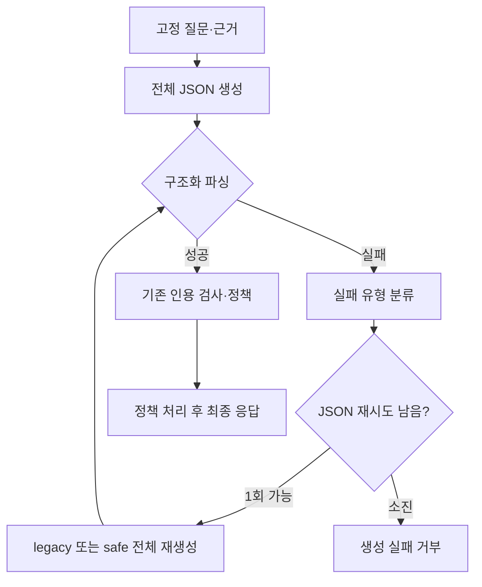

# 답변 반복 억제와 구조화 복구 실험

> 보관 위치 변경 (2026-10-13): 시험용 worktree와 브랜치를 정리했다. 후보 코드와 실행 상태는 압축 보관했으며, 아래 측정 원자료는 유지했다. [정리 내역과 복원 방법](unsuccessful-experiments-cleanup-2026-10-13.md)을 참고한다.

작성일: 2026-10-10. 측정·검토 종료일: 2026-10-11.

## 결과

**세 후보를 모두 채택하지 않는다.** 반복 억제는 긴 대기를 줄였지만 결론 점수와 의미 보존 기준을 통과하지 못했다. 복구 변경은 긴 대기를 줄이지 못했고 새 생성 실패가 있었다. 병합은 더 느렸고 새 의미 오류도 있었다.

후보 구현은 격리 worktree에 보관했다. 공유 코드와 서비스 기본값은 변경하지 않았다. 반복 억제 OFF / 복구 legacy를 유지한다. 검증되지 않은 생성 중간 본문을 사용자에게 표시하는 기능은 추가하지 않았다.

이번 실험은 구현과 비교를 완료한 기록이다. 사용자의 첫 답변 대기 문제를 해결한 결과는 아니다.

## 측정 범위

2026-10-10에 실험을 시작했다. 현재 공유 체크아웃의 미커밋 코드를 포함한 기준을 별도 worktree에 복사했다. HEAD만으로 기준을 구성하지 않았다.

고정된 80개 질문, 분석 결과, 검색 근거와 참고 답변을 사용했다. 질문마다 네 설정의 순서를 회전했다. 설정마다 워밍업 1개를 제외했다. 진단 28턴과 pilot 56턴도 주 비교에 합산하지 않는다.

측정 구간은 고정 분석·근거 입력부터 답변 생성과 기존 인용 정책 처리가 끝날 때까지다. 실제 질문 분석·검색과 웹 전달·렌더링 시간을 측정하는 구간은 아니다. 거부와 오류의 대기 시간도 집계에 포함한다.

| 설정 | 반복 억제 | 구조화 복구 |
|---|---|---|
| 기준 | OFF | legacy |
| 반복 억제 | ON | legacy |
| 복구 변경 | OFF | safe |
| 병합 | ON | safe |

모델은 `qwen3:4b` Q4_K_M, context 12288, 출력 한도 2048, temperature 0.2, think OFF를 사용했다. 생성과 평가 작업은 같은 GPU lock 아래에서 순차 실행한다. Ollama 데몬을 재시작하거나 모델을 강제로 unload하지 않았다. Flash Attention은 이전 기록에서 ON이었으나 이번 실행에서는 다시 확인하지 못했다.

## 구현 범위

반복 억제 프롬프트는 같은 주장·인용의 반복만 줄이도록 지시한다. 서로 다른 조건·예외·기간·자격·주체·기관과 불확실성은 유지한다. 문장 수나 목록 수를 제한하지 않는다.

구조화 실패에는 `truncated`, `syntax`, `schema`, `unknown` 분류와 종료 사유를 추가했다. 기존 예외 문자열과 원문 속성은 유지했다. native 분류를 우선하며, EOF 문자열은 분류가 `unknown`인 backend에서만 보조 판단에 사용한다.

safe 복구는 잘린 출력을 이어 붙이지 않고 전체 답변을 다시 생성한다. 실패 본문에 없는 사실이나 필드를 만들어 채우도록 지시하지 않는다. 정상 생성, 기존 schema, 검증 정책과 plain 응답 경로는 유지한다.

JSON 재시도는 생성 작업마다 최대 1회다. 인용 재생성은 턴마다 최대 1회다. 서로 다른 두 한도를 합쳐 턴당 호출 2회라고 설명하지 않는다. 두 생성 작업이 모두 JSON 재시도를 쓰면 모델 호출은 최대 4회가 된다.

진단에서는 완전한 JSON의 마지막 쉼표 오류를 재현하지 못했다. 로컬 형식 수정 helper와 전용 integration test는 조건에 따라 생략했다. 잘린 문자열을 임의로 닫는 기능은 추가하지 않았다.

## 평가 방법과 해석

기존 core와 core-v1 strict는 같은 참고 결론 캐시를 사용한다. 본문 전체로 평가하며 `summary`만 읽거나 앞부분을 자르지 않는다. 이 점수는 참고 답변 결론과의 일치다. 법률 정확성이나 모든 필수 조건의 충족을 뜻하지 않는다.

별도의 의미 검토에는 로컬 `qwen3:8b`에 baseline/후보 전체 8개 필드, 질문, 참고 답변과 제공 근거 전체를 입력했다. 기록의 reviewer는 `AI reviewed (qwen3:8b)`다. Codex 심층 검토 기록은 `AI reviewed (Codex)`로 구분한다. 전문가의 독립 평가라고 표현하지 않는다.

처음에는 Codex 검토 대상으로 과거 27문항과 지정 14문항의 합집합 32문항, 결론 점수가 바뀐 문항과 자동 검토에서 표시한 문제를 정했다. 자동 검토가 실제 회귀를 놓친 뒤 범위를 확대했다. 최종적으로 세 후보의 80쌍을 모두 직접 대조했다. 총 240개 기록이며 이유를 각 기록에 남겼다. 이전 실패를 새 출력에 자동으로 적용하지 않는다. 기준부터 틀린 내용은 기존 오류로 분리한다. 다른 필드에 조건이 있으면 전체 누락으로 쓰지 않지만, 무조건적 요약이 조건부 분석과 충돌하면 기록한다.

복구만 바꾼 설정의 첫 생성 프롬프트는 기준과 같다. 첫 호출에서 완료된 두 답변의 차이는 safe 재시도 효과로 귀속할 수 없다. temperature 0.2의 생성 변동과 구분해야 한다. 재시도가 실제 활성화된 횟수와 그 결과를 별도로 보고한다.

응답 8개 필드 확인은 Pydantic 직렬화 결과의 계약이다. 원시 모델 JSON이 항상 8개 필드를 명시하거나 schema 순서대로 출력했다는 뜻은 아니다.

기존 검증은 조문·사건번호와 제공 근거의 인용 관계를 검사한다. 검사 통과만으로 조건·예외·판단 방향을 포함한 모든 본문 의미가 검증된 것은 아니다. 이 실험은 기존 최종 응답 표시 경계를 유지하며 의미 검토를 별도 평가로 수행한다.

## 주 비교 속도

모든 표는 설정마다 80턴이다. 응답 생성 실패도 포함했다. p90은 nearest-rank로 계산했다. 단위는 초다.

| 지표 | 기준 | 반복 억제 | 복구 변경 | 병합 |
|---|---:|---:|---:|---:|
| 중앙값 | 16.36 | 17.57 | 15.01 | 19.64 |
| p90 | 30.26 | 28.24 | 28.34 | 35.28 |
| 최대 | 61.20 | 60.87 | 81.97 | 69.58 |
| 45초 초과 | 2 | 1 | 2 | 4 |
| 최종 답변 | 80 | 80 | 79 | 80 |
| 생성 실패 거부 | 0 | 0 | 1 | 0 |
| 모델 호출 | 85 | 81 | 83 | 86 |
| length 종료 호출 | 2 | 1 | 3 | 3 |
| JSON 재시도 턴 | 2 | 1 | 2 | 3 |
| 인용 재생성 턴 | 3 | 0 | 1 | 3 |
| 인용 제거 턴 | 0 | 0 | 0 | 0 |
| 출력 토큰 중앙값¹ | 760 | 812 | 692.5 | 933 |

¹ 턴 안의 모든 호출을 합산한 토큰 수다. 마지막 성공 호출만 센 값이 아니다.

반복 억제의 긴 대기는 2건에서 1건으로 줄었다. 이번 주 비교에서 50% 감소 및 2건 이하 조건을 충족했다. 중앙값은 7.38% 늘었다. 반복 실행의 조건은 별도이며, 이 한 번의 중앙값 변화만으로 두 실행의 5% 기준을 판정하지 않는다.

복구 변경은 중앙값이 8.24% 줄었지만 45초 초과 건수는 그대로다. index 15는 두 호출 모두 2048토큰에 도달하여 81.97초 뒤 거부됐다. 빠른 단일 호출 표본의 차이를 safe 재시도 효과로 해석할 수 없다.

병합은 중앙값이 20.01% 늘었고, 긴 대기도 2건에서 4건으로 늘었다.

### 호출 수와 긴 대기

| 지표 | 기준 | 반복 억제 | 복구 변경 | 병합 |
|---|---:|---:|---:|---:|
| 1회 호출 턴 | 75 | 79 | 77 | 74 |
| 1회 호출 중앙값 | 16.03 | 17.47 | 14.84 | 18.77 |
| 1회 호출 p90 | 29.03 | 28.24 | 28.03 | 29.50 |
| 여러 호출 턴 | 5 | 1 | 3 | 6 |
| 여러 호출 중앙값 | 32.89 | 60.87 | 58.30 | 56.01 |

45초 초과 턴은 모두 여러 호출을 거쳤다. 그렇다고 모든 여러 호출 턴이 45초를 넘은 것은 아니다. 생성 시간은 턴 시간에서 설정별 중앙값 약 83.5~87.2%를 차지했다.

### 구조화 실패 원문

실제 schema와 native 오류 분류를 원문에 다시 적용했다. 총 9개 실패 호출 모두 `truncated`였다. 완전한 JSON의 `syntax` 실패나 `schema` 실패는 관측되지 않았다. 9개 원문 모두 `AI reviewed (Codex)`로 구조를 검토했고 실제 실패 호출 키와 일치했다. 이 검토는 법률 의미 평가와 별도다.

대부분은 analysis나 uncertainty의 반복으로 문자열이 중간에서 끝났다. 병합 index 75는 긴 인용문 여섯 개가 출력 예산을 사용했고 citations 목록 뒤 쉼표에서 끝났다. 완성된 객체의 불필요한 마지막 쉼표 사례로 처리하지 않았다. 남은 필드와 객체 종료가 생성되지 않았으므로 로컬 형식 수정 대상으로 채택하지 않았다.

재생성을 촉발한 인용 문제는 조문 파생번호나 다른 사건번호가 해당 source와 맞지 않은 경우다. 기준 3턴, 복구 변경 1턴, 병합 3턴 모두 두 번째 생성 뒤 기존 정책을 통과했다. 그 통과가 본문 전체의 의미 정확성을 보장하지는 않는다.

## 테스트와 변경 범위

고정된 후보 소스에서 backend 전체 테스트는 632개 통과, 3개 skip이었다. 표시 경계에 관련된 웹 테스트 3개 파일은 36개 통과했다. 웹 전체 suite를 실행했다고 표현하지 않는다. backend 경고 4개는 기존 Starlette/httpx 사용 중단 안내 2개와 Qdrant mock/server 버전 차이 2개다.

후보 설정은 별도 `.worktrees/answer-recovery`에 있다. 기본값은 반복 억제 OFF, 구조화 복구 legacy다. 공유 체크아웃에 후보 구현을 적용하지 않았다. 로컬 형식 수정 helper와 그 전용 integration test는 실제 사례 조건을 충족하지 않아 만들지 않았다. 기존 재생성·제거·거부 및 최종 응답 표시 테스트는 실행했다.

## 참고 결론 일치

각 채점 방식에서 네 설정의 80턴을 모두 처리했다. 채점 오류는 0건이다. 답변이 없는 복구 변경 index 15도 분모에 포함했다.

| 지표 | 기준 | 반복 억제 | 복구 변경 | 병합 |
|---|---:|---:|---:|---:|
| core | 50/80 | 47/80 | 45/80 | 49/80 |
| core-v1 strict | 41/80 | 36/80 | 34/80 | 39/80 |
| core 변화 | — | -3건 | -5건 | -1건 |
| strict 변화 | — | -5건 | -7건 | -2건 |

사전 기준은 두 점수 중 하나라도 3/80을 넘게 하락하면 채택을 보류하는 것이다. 반복 억제와 복구 변경은 이 기준을 통과하지 못한다. 병합은 결론 점수 기준을 통과하지만 긴 대기 기준은 통과하지 못하고, 직접 대조한 답변에도 새 의미 오류가 있다.

## 직접 검토한 회귀 예시

문항 순번은 0부터 시작한다. 다음 표의 판정은 `AI reviewed (Codex)`이며, 같은 질문의 baseline과 후보 전체 8필드 및 실제 제공 근거를 대조한 결과다.

| 순번 | 후보 | 새로 확인한 문제 | 기존 오류와의 구별 |
|---|---|---|---|
| 40 | 반복 억제 | 선정해서는 안 되는 대상을 summary에서 제외할 수 있는 대상으로 바꿈 | analysis의 올바른 조건이 있어도 무조건적 summary와 충돌함 |
| 67 | 세 후보 | 전문기관에 교육을 위탁할 수 있다는 설명을 위탁해야 한다는 의무로 바꿈 | 퇴직연금사업자라는 다른 선택지를 baseline도 누락한 것은 기존 오류로 분리함 |
| 31 | 복구 변경 | 피해자 과실 부분의 공제를 피고 과실 부분의 공제로 바꿈 | baseline의 보험자 대위 한도와 일반 치료비 혼동은 별도 기존 오류임 |
| 5 | 병합 | 제공 근거의 조문 번호와 다른 내용을 직접 인용으로 연결함 | 인용문 존재와 조문 번호 존재만으로 그 연결이 옳다고 볼 수 없음 |
| 38 | 병합 | 사례 계산식을 일반 구상금 공식으로 제시하고 실제 지급 보험금 상한을 제거함 | baseline에도 계산 오류가 있으나 실제 지급액 상한은 명시됨 |

pass는 새 회귀를 확인하지 않았다는 뜻이다. baseline부터 있던 오류까지 수정됐다는 뜻은 아니다. uncertain은 자료나 표현의 적용 범위를 확정하지 못한 기록이며 채택 통과로 처리하지 않는다.

자동 의미 검토에는 원문 전체를 입력했다. 모델이 모든 차이를 실제로 검출했다는 뜻은 아니다. 초기 반복 억제 index 0과 2는 자동 검토가 pass로 표시했지만 직접 비교에서는 각각 주된 원인과 부수 원인의 혼동, 당사자·하급심 입장과 최종 판단의 혼동을 확인했다. 자동 검토의 pass를 의미 정확성 인증으로 사용하지 않는다.

## 전체 의미 검토 결과

| 검토 | 지표 | 반복 억제 | 복구 변경 | 병합 |
|---|---|---:|---:|---:|
| Codex 직접 대조 | pass | 21 | 26 | 26 |
| Codex 직접 대조 | fail | 52 | 46 | 46 |
| Codex 직접 대조 | uncertain | 7 | 8 | 8 |
| Codex 직접 대조 | 합계 | 80 | 80 | 80 |
| 로컬 qwen3:8b | 완료 | 79 | 78 | 80 |
| 로컬 qwen3:8b | pass | 78 | 77 | 80 |
| 로컬 qwen3:8b | uncertain | 1 | 1 | 0 |
| 로컬 qwen3:8b | 미해결 형식 오류 | 1 | 2 | 0 |

로컬 평가의 반복 억제 71번, 복구 변경 16·39번은 동일한 고정 설정으로 두 번 시도했으나 모두 `StructuredOutputError`가 났다. 현재 미해결 키는 3개이며, 과거 오류 행은 총 6개다. 원문에 오류 메시지나 본문을 추가로 저장하지 않아 이 예외의 세부 파싱 원인까지 확정하지 않는다. 오류를 pass로 바꾸거나 로컬 검토 240개 완료라고 기록하지 않았다. 세 쌍 모두 Codex가 직접 검토했다.

로컬 pass 중 Codex가 fail로 판정한 쌍은 반복 억제 50개, 복구 변경 46개, 병합 46개다. 이는 이 실험의 두 AI 검토 결과가 다르다는 뜻이다. 전문가 정답에 대한 오탐·미탐률로 해석하지 않는다. Codex 판정에는 전체 답변·제공 근거와 기존 오류를 구분한 이유가 있다. 로컬 결과만으로 채택하면 확인된 회귀를 놓칠 수 있었다.

추가 사례로 병합 73번은 직위해제 사유 소멸 후 직위를 부여하지 않은 상태에서 면직할 수 있다고 설명했다. 제공 판례는 같은 상황의 면직을 위법으로 판단한다. 기존 baseline의 잘못된 3개월 기한과 별개의 새 회귀다.

## 채택 판단

| 후보 | 긴 대기 기준: 주 비교 | 결론 점수 기준 | 의미 보존 | 결정 |
|---|---|---|---|---|
| 반복 억제 | 2→1건, 주 비교 조건 충족 | strict -5건으로 실패 | 새 회귀 확인 | 채택하지 않음 |
| 복구 변경 | 2→2건, 감소 조건 실패 | core -5건·strict -7건으로 실패 | 새 회귀 확인 | 채택하지 않음 |
| 병합 | 2→4건, 두 조건 실패 | -1건·-2건으로 통과 | 새 회귀 확인 | 채택하지 않음 |

선택할 후보가 없으므로 역순 80문항 재비교와 웹 48턴 비교는 사전 규칙에 따라 실행하지 않았다. 이 조건부 작업을 완료한 측정처럼 표현하지 않는다. 단위·회귀 테스트 통과는 실험 기능의 계약을 확인하며, 채택 성능과 답변 정확도 통과를 뜻하지 않는다.

## 재현 자료와 한계

- [사전 기준](../../data/eval/reports/chat_pipeline/answer-recovery-2026-10-10/PREREG.md), [변경 결정](../../data/eval/reports/chat_pipeline/answer-recovery-2026-10-10/AMENDMENTS.md).
- [기준 상태·해시](../../data/eval/reports/chat_pipeline/answer-recovery-2026-10-10/baseline-manifest.json), [생성 소스·입력 manifest](../../data/eval/reports/chat_pipeline/answer-recovery-2026-10-10/main-01/manifest.jsonl), [실행 환경](../../data/eval/reports/chat_pipeline/answer-recovery-2026-10-10/runtime.json).
- [평가 모델](../../data/eval/reports/chat_pipeline/answer-recovery-2026-10-10/evaluation-model.json), [평가 스크립트 고정](../../data/eval/reports/chat_pipeline/answer-recovery-2026-10-10/evaluation-freeze.json), [평가 코드·캐시 해시](../../data/eval/reports/chat_pipeline/answer-recovery-2026-10-10/evaluation-dependencies.json).
- [최종 집계·판정](../../data/eval/reports/chat_pipeline/answer-recovery-2026-10-10/final-quality.json), [구조화 실패 원문 검토](../../data/eval/reports/chat_pipeline/answer-recovery-2026-10-10/main-01/failed-output-review.jsonl).
- Codex 전체 이유: [반복 억제](../../data/eval/reports/chat_pipeline/answer-recovery-2026-10-10/main-01/main/guard/codex-review.jsonl), [복구 변경](../../data/eval/reports/chat_pipeline/answer-recovery-2026-10-10/main-01/main/recovery/codex-review.jsonl), [병합](../../data/eval/reports/chat_pipeline/answer-recovery-2026-10-10/main-01/main/combined/codex-review.jsonl).

생성 모델 digest는 `359d7dd4bcdab3d86b87d73ac27966f4dbb9f5efdfcc75d34a8764a09474fae7`이다. 평가 모델은 `qwen3:8b` Q4_K_M이며 digest는 `500a1f067a9f782620b40bee6f7b0c89e17ae61f686b92c24933e4ca4b2b8b41`이다. core/strict의 context는 8192, 출력 한도는 300이다. 의미 검토의 context는 16384, 출력 한도는 2048이다. 모두 temperature 0, think OFF로 평가했다.

생성 소스·프롬프트·입력은 주 비교 전에 고정했다. 평가 의존 파일 5개의 해시는 주 비교 생성 중, 채점 시작 전에 수집했다. 생성 시작 전부터 평가 의존 파일을 모두 고정했다는 주장과 구분한다. 채점 전후 참고 캐시와 최종 감사의 소스 해시는 일치했다. Flash Attention의 현재 설정은 확인하지 못했다.

원문과 쌍별 검토는 private 실험 폴더에 보관했다. 문항은 기존 frozen 입력의 80개다. 실험 폴더 날짜나 코퍼스 이름만으로 새 코퍼스 전체 평가를 했다고 해석하지 않는다. 모델 변동, 단일 주 비교, 제공 근거의 범위와 AI 검토의 한계가 있다.

## 변경 보존 감사

[최종 감사](../../data/eval/reports/chat_pipeline/answer-recovery-2026-10-10/final-audit.json)는 PASS다. 공유 체크아웃의 기존 미커밋 코드와 기존 실행 상태는 보존했다. 계획·설계 문서를 결과에 맞게 갱신하고 이 결과 문서를 추가했다.

보호 파일 5개는 root와 worktree 모두 기준 해시와 같다. 고정된 생성 소스·입력 145개, 평가 스크립트 2개와 평가 의존 파일 5개의 해시도 같다. 두 체크아웃의 `git diff --check`, HEAD 유지, stage 없음과 결과 문서 링크·코드 블록 경계를 확인했다. 설명되지 않은 새 경로나 삭제는 없다. 후보를 적용하거나 commit하지 않았다.

## 다음 설계에 사용할 근거

이번 실행에서 45초를 넘은 턴은 모두 여러 모델 호출을 사용했다. 다음 제안은 **같은 최초 실패 본문을 사용해 legacy와 safe 재시도를 대조**하는 것이다. 최초 생성의 변동을 분리하고, 조건·예외를 보존하는 복구가 실제로 추가 호출 시간을 줄이는지 확인할 수 있다.

첫 답변 대기 목표를 판단하려면 채택 기준을 통과한 후보가 생긴 뒤 분석·검색·SSE 전달을 포함한 웹 측정을 다시 해야 한다. 모델 변경, 출력 한도 변경과 필드별 생성은 별도 설계 대상이다. 이번 실행에는 추가하지 않았다.
