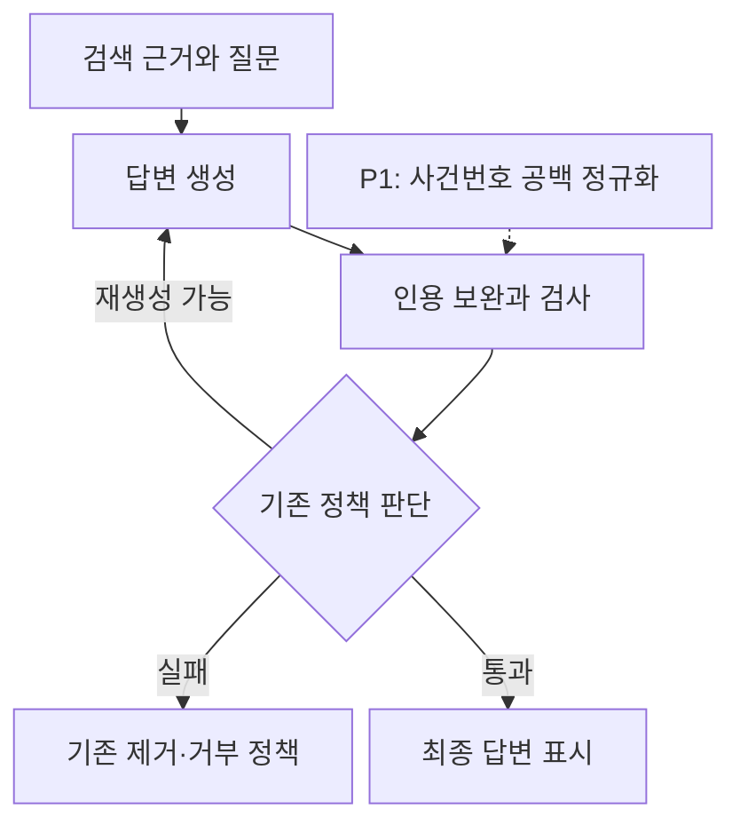
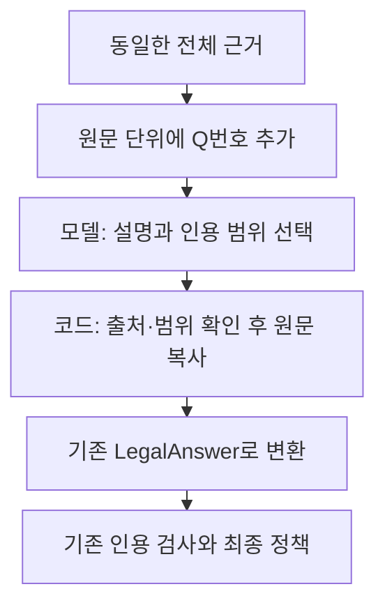

# 인용 처리 지연 개선 결과

> 보관 위치 변경 (2026-10-13): 시험용 worktree와 브랜치를 정리했다. 후보 코드와 실행 상태는 압축 보관했으며, 아래 측정 원자료는 유지했다. [정리 내역과 복원 방법](unsuccessful-experiments-cleanup-2026-10-13.md)을 참고한다.

## 1. 결정

| 항목 | 결과 | 적용 범위 |
| --- | --- | --- |
| P1. 사건번호 가로 공백 정규화 | 통과 | 현재 작업 폴더에 반영 |
| P2. 원문 범위 선택 후 코드에서 인용문 복사 | 적용 기준 미통과 | 격리 worktree의 평가 후보로 보관 |

P1은 불필요한 재생성을 일으키는 인용 검사 오탐을 수정한다. P2는 두 회차에서 속도 개선이 재현되지 않았다. 답변 내용에도 새로운 오류가 있었다. 따라서 P2를 서비스 경로에 적용하지 않는다.

이번 결과로 전체 사용자 대기 시간이 해결되었다고 판단할 수는 없다. P1의 시간 효과는 기존 호출 기록을 이용한 반사실적 계산이다. P2는 분석과 검색을 고정한 생성·검사 구간 실험이다. 웹에서 새 질문을 입력하고 첫 답변을 받는 시간은 이번에 측정하지 않았다.

## 2. 처리 구조

검증을 거치기 전의 생성 텍스트를 먼저 보여주는 방식은 도입하지 않았다. 최종 응답 스키마와 기존 재시도·제거·거부 정책을 유지했다.

인용 검사 통과는 출처와 참조를 확인했다는 의미다. 답변의 법적 해석이나 결론까지 검증했다는 의미는 아니다. P2에서는 자동 검사에 통과했지만 내용 검토에서 실패한 답변이 있었다.

## 3. P1: 사건번호 공백 처리

### 변경

`99다 40418`, `99 다40418`, `99다40418`을 같은 사건번호로 비교한다. 허용하는 공백은 일반 공백, 탭, 줄 바꿈 없는 공백, 전각 공백이다.

연도·사건 종류·일련번호의 기존 범위를 유지한다. 줄바꿈을 이어 붙이거나 다른 사건 종류를 같은 것으로 처리하지 않는다. 근거 헤더, 원문, 이전 대화 참조, 인용 보완 경로에서 같은 추출 규칙을 사용한다.

공개 `CASE_PATTERN`과 `CASE_RE`는 기존 형태를 유지한다. 검색 토큰화와 평가 코드의 정규식 반환 형식을 보존하기 위한 조치다. 공백 허용은 사건번호 추출 함수에 추가했다.

| 파일 | 변경 내용 |
| --- | --- |
| `src/legal_rag/textutil/refs.py` | 공백이 있는 사건번호 추출 및 정규화 |
| `src/legal_rag/verification/verifier.py` | 헤더와 이전 대화의 사건번호 비교 일치 |
| `src/legal_rag/verification/backfill.py` | 헤더 매칭 및 같은 사건의 중복 보완 방지 |
| `tests/legal_rag/unit/test_case_spacing.py` | 16개 회귀 테스트 |

### 저장 답변 재검사

기존 432턴에서 최종 답변과 완성 초안 789개를 수집했다. 새 모델 호출 없이 같은 답변과 같은 근거를 수정 전후 검사기에 넣었다.

| 결과 | 개수 |
| --- | ---: |
| 검사 결과와 인용 목록이 모두 동일 | 782 |
| 같은 출처·사건의 null 인용 중복만 제거 | 6 |
| 공백으로 발생한 검사 실패 해소 | 1 |
| 합계 | 789 |

7개 변경을 모두 `AI reviewed (Codex)`로 검토하고 사유를 기록했다. 원래 답변 본문과 근거는 변경하지 않았다. 다른 사건, 다른 출처, 알 수 없는 출처를 허용하지 않는 테스트도 통과했다.

알려진 실패 사례의 S2에는 `대법원 2001. 6. 15. 선고 99다 40418`이 있었다. 기존 검사기는 답변의 `99다40418`을 근거에서 찾지 못했다. 수정 후에는 같은 사건번호로 인식했다.

그 사례의 첫 완성 초안을 실제 Orchestrator에 재생하자, 검사 정책이 추가 생성 없이 답변을 반환했다. 기존 기록에서는 모델 호출이 2회였고 재생에서는 1회였다. 기존 두 번째 호출은 **25.41초**였다. 이는 이 사례에서 피할 수 있었던 과거 호출 시간이며, 새 추론이나 전체 서비스 속도 개선 측정값이 아니다. 이전 실험 전용 설정 두 항목은 현재 Settings에 없으므로 재생 입력에서 제외했다. 재생에는 모델 추론이나 해당 실험의 보호 프롬프트를 사용하지 않았다.

## 4. P2: 원문 범위 선택 실험

### 후보 구조

후보는 `quote` 문자열 대신 내부 `quote_start`, `quote_end`를 생성한다. 코드는 같은 출처 안의 연속 범위만 허용하고 원문 substring을 복사한다. 잘못된 범위는 기존 JSON 복구 경로에 전달한다. 최종 외부 응답은 기존 LegalAnswer 형식이다.

후보 코드와 15개 테스트는 `.worktrees/citation-latency`에만 보관한다. 기본 모델 연결이나 서비스 설정에는 연결하지 않았다.

### 측정 조건

- 기존 개발 문항 중 8개를 결과 생성 전에 선택했다: `1, 15, 26, 40, 55, 56, 63, 75`.
- 두 방식 × 8문항 × 2회차로 **32턴**을 측정했다. 별도 warmup **4턴**은 제외했다.
- 두 방식 모두 P1을 적용했다. 기존 분석 결과, 검색 결과, 전체 근거를 고정했다.
- 문항별 seed를 맞추고 순서를 번갈아 실행했다. 2회차에서는 각 쌍의 순서를 뒤집었다.
- 모델은 `qwen3:4b`, Q4_K_M, Ollama `0.16.2`이다. context 12,288, temperature 0.2, 출력 한도 2,048, think=false를 사용했다.
- 생성별 JSON 재시도 1회와 턴별 인용 재생성 1회를 유지했다. 실패도 집계 대상으로 고정했다.
- 입력, 첫 요청 payload, 실행기, 후보 코드, 설정을 해시로 고정했다. 실제 요청·raw 응답·완성 초안·최종 8필드·검사 기록을 보관했다.
- GPU 계층 배치와 Flash Attention 활성 여부는 이번 실행에서 새로 확인하지 않았다.

사전 속도 기준은 **두 회차 모두 중앙값 10% 이상 감소, p90 증가 없음, 호출·거부·오류 증가 없음**이다. 품질 기준은 16쌍 전체 검토에서 새 중대한 오류나 확인 불가 판정이 없어야 한다. 8개 표본의 p90은 nearest-rank 방식에서 최댓값이다.

### 전체 처리 시간

시간은 고정 분석·검색을 통과한 뒤 생성, 인용 검사, 재시도, 최종 정책까지 포함한다.

| 회차 | 방식 | 중앙값 | p90 | 실제 모델 호출 | 거부 / 오류 |
| --- | --- | ---: | ---: | ---: | ---: |
| 1 | 기존 인용문 생성 | 26.54초 | 61.39초 | 10 | 0 / 0 |
| 1 | 원문 범위 선택 | 15.48초 | 61.91초 | 10 | 0 / 0 |
| 2 | 기존 인용문 생성 | 14.71초 | 29.47초 | 8 | 0 / 0 |
| 2 | 원문 범위 선택 | 22.76초 | 63.16초 | 9 | 0 / 0 |

1회차 중앙값은 **41.70% 감소**했지만 p90이 증가했다. 2회차 중앙값은 **54.74% 증가**했고 호출도 늘었다. 두 회차 모두 사전 속도 기준을 통과하지 못했다.

| 회차 | 최초 호출 중앙값: 기존 / 후보 | 최초 출력 토큰 중앙값: 기존 / 후보 | length 종료 호출: 기존 / 후보 | 인용 재생성 턴: 기존 / 후보 |
| --- | ---: | ---: | ---: | ---: |
| 1 | 26.54 / 15.47초 | 1,274 / 672 | 2 / 1 | 0 / 1 |
| 2 | 14.70 / 22.75초 | 669.5 / 1,018.5 | 0 / 1 | 0 / 0 |

후보 16턴 중 실제 비어 있지 않은 최종 인용문을 복사한 것은 **2턴, 6개 인용문**이다. 나머지는 인용문을 선택하지 않았다. 복사한 인용문은 해당 출처의 정확한 substring이었다. 따라서 후보의 시간 차이를 원문 복사 자체의 효과로 분리해 해석할 수 없다. 번호 추가, 내부 스키마, 안내문, 설명 길이와 재시도 변화가 함께 작용했다.

### 내용 검토

16쌍 모두 질문, 참고 답변, 전체 제공 근거, 두 방식의 최종 8필드, 앞선 완성 초안, 후보의 범위 선택을 검토했다. 이유는 `AI reviewed (Codex)`로 기록했다. 법률 전문가 검토는 아니다. 참고 답변에만 있고 검색 근거에 없는 전제는 정답으로 강제하지 않았다.

| 판정 | 1회차 | 2회차 | 합계 |
| --- | ---: | ---: | ---: |
| 상대 비교 통과 | 0 | 1 | 1 |
| 실패 | 7 | 6 | 13 |
| 확인 불가 | 1 | 1 | 2 |

기존 방식에도 오류가 있었다. 공유하는 오류를 후보에서 새로 생긴 오류로 세지 않았다. 상대 비교 통과 1개 역시 일반 법적 정확도를 인증하지 않는다.

대표적인 새 오류는 다음과 같다.

- 문항 40: `선정해서는 아니 된다`를 요약과 행동에서 `제외할 수 있다`로 완화했다. 두 회차에 반복되었다.
- 문항 75: 임원 손해배상 근거를 제공 원문의 제33조 대신 제32조 제4항으로 반복했다.
- 문항 56, 1회차: 15명 위원 구성과 5개 자격 유형을 혼동해 요약에서 5명으로 설명했다.
- 문항 55, 1회차: 정확히 복사한 검사·표시 관련 원문을 수입이익금 부과 근거로 연결했다. 정확한 복사가 내용상 뒷받침을 보장하지 않았다.
- 문항 1, 2회차: 제공 근거에 없는 일반적인 세무서 검토·승인 절차를 추가했다.

## 5. 검증과 변경 범위

| 검증 | 결과 |
| --- | --- |
| P1 수정 전 회귀 재현 | 처음 작성한 15개 테스트 실패 확인 |
| P1 최종 집중 검사 | 40 passed |
| P1 백엔드 전체 | 630 passed, 3 skipped |
| P2 후보 포함 백엔드 전체 | 645 passed, 3 skipped |
| 통합 후 현재 폴더 백엔드 전체 | 631 passed, 2 skipped |
| 웹 표시·인용 관련 3개 파일 | 37 passed |

웹 검증은 `test_chat_streaming.py`, `test_citation_guard.py`, `test_document_citation_notice.py` 범위다. 전체 웹 테스트 통과를 뜻하지 않는다. 백엔드는 기존 Python 3.11 환경, 웹은 기존 Python 3.13 환경을 사용했다. 의존성을 새로 설치하지 않았다.

백엔드 전체 테스트는 샌드박스에서 API health 테스트에 멈춰 두 시도를 중단했다. 같은 코드의 정상 실행 환경에서는 전체 검증이 완료되었다. 샌드박스 중단을 통과로 세지 않았다. 웹의 첫 Python 3.11 실행은 해당 환경에 OCR 의존성이 없어 수집에 실패했다. 기존 웹 환경에서 재실행해 통과했다.

통합 전 원본 해시를 확인하고 P1의 4개 파일만 복사했다. 기존 설정·웹 앱·생성 정책·다른 작업 파일, 이전 세 실행 상태, HEAD와 stage를 보존했다. 서비스 재시작과 커밋은 하지 않았다. 평가 기록은 권한을 제한한 별도 디렉터리에 저장했다.

## 6. 근거와 다음 판단

평가 디렉터리: `data/eval/reports/chat_pipeline/citation-latency-2026-10-11/`

- [P1 검사 및 변경 검토](../../data/eval/reports/chat_pipeline/citation-latency-2026-10-11/p1-gate.json)
- [P2 사전 기준](../../data/eval/reports/chat_pipeline/citation-latency-2026-10-11/pilot-PREREG.json)
- [P2 측정 집계](../../data/eval/reports/chat_pipeline/citation-latency-2026-10-11/pilot-metrics.json)
- [16쌍 전체 검토](../../data/eval/reports/chat_pipeline/citation-latency-2026-10-11/pilot-review.jsonl)
- [통합 백엔드 검증](../../data/eval/reports/chat_pipeline/citation-latency-2026-10-11/integrated-backend.txt)
- [최종 보존 감사](../../data/eval/reports/chat_pipeline/citation-latency-2026-10-11/final-audit.json)
- [설계](../superpowers/specs/2026-10-11-citation-latency-design.md) · [실행 계획](../superpowers/plans/2026-10-11-citation-latency.md)

평가 기록은 로컬의 ignored 파일이다. 문서만 커밋하면 다른 환경에 원본 기록이 포함되지는 않는다.

P1의 실제 서비스 효과는 새 질문의 전체 지연과 인용 재생성 빈도로 별도 측정해야 한다. P2는 이번 형태로 확대 적용하지 않는다. 8개 개발 문항에 대한 결과이므로 전체 질문 분포의 평균 지연이나 법적 정확도로 일반화하지 않는다.
