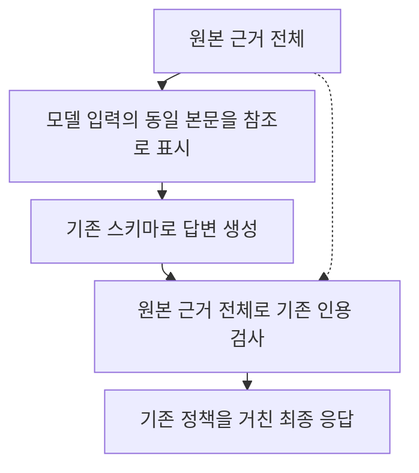

# 입력 근거 중복 제거 시험 결과

> 보관 위치 변경 (2026-10-13): 시험용 worktree와 브랜치를 정리했다. 후보 코드와 실행 상태는 압축 보관했으며, 아래 측정 원자료는 유지했다. [정리 내역과 복원 방법](unsuccessful-experiments-cleanup-2026-10-13.md)을 참고한다.

## 1. 결정

**현재 후보는 서비스에 적용하지 않는다.** 본문 전체가 같은 근거를 참조 표기로 바꾸면 입력은 줄어든다. 이번 시험에서는 속도 개선이 두 회차에 재현되지 않았고, 변경 문항의 답변 내용도 통과하지 못했다.

| 실제 입력이 바뀐 문항 10 | 기존 | 중복 제거 후보 | 전체 시간 변화 |
| --- | ---: | ---: | ---: |
| 1회차 | 11.64초 | 23.32초 | 100.29% 증가 |
| 2회차 | 10.74초 | 9.81초 | 8.69% 감소 |

각 방식은 이 문항에서 회차당 모델을 1회 호출했다. 두 회차 모두 10% 이상 빨라져야 한다는 사전 기준을 통과하지 못했다. 회차당 변경 문항이 1개이므로, 기준 통과 여부만으로 일반적인 성능을 판단할 수는 없다.

이 결과는 **전체 원문 일치만 처리하는 첫 후보**에 대한 것이다. 부분 중복·의미 중복·대화 기록 압축의 효과는 측정하지 않았다. 실제 웹 질문의 첫 최종 답변 시간도 이번에 새로 측정하지 않았다.

## 2. 후보의 처리 방식

S4와 S5 본문이 정확히 같으면 S4의 Text를 유지하고 S5의 Text에 S4 원문을 읽도록 표시한다. 각 source ID, 헤더, 순서와 원래 문서 연결은 유지한다. 서로 다른 문서를 같은 문서로 합치지 않는다.

텍스트 계획의 `texts`, `aliases`로 출처별 원문을 정확히 복원한다. 검사기와 최종 응답에는 원본 EvidenceBundle 전체를 전달한다. 기존 시스템 프롬프트, 외부 응답 스키마, 생성별 JSON 재시도 1회, 턴별 인용 재생성 1회와 표시 정책은 유지한다.

본문은 byte 단위로 일치해야 한다. 최소 100자이며 참조 표기가 더 짧을 때만 처리한다. 공백을 정상화하거나 문장을 요약하지 않는다. 부분 일치는 같은 판례라도 인용 번호나 문장 연결이 달라 그대로 둔다. 중복 없는 입력은 기존 payload와 정확히 같게 전달한다.

후보 코드와 테스트는 `.worktrees/evidence-dedup`에 보관한다. root의 코드와 서비스 설정에는 연결하지 않았다.

## 3. 80문항 사전 점검

기존 frozen 개발 입력 80개의 첫 5개 hits를 기존 ContextBuilder(본문 한도 1,500자)로 렌더링했다. 후보가 출처별 원문을 모두 정확히 복원하는지 확인했다. 이전 인용 처리 시험의 8문항과도 근거가 같았다.

| 항목 | 결과 |
| --- | ---: |
| 원문 복원 통과 | 80 / 80문항 |
| 모델 입력 변경 | 1 / 80문항 |
| 기존 입력과 완전히 동일 | 79 / 80문항 |
| 전체 근거 표현 문자 수 | 591,472 → 590,661자 |
| 전체 문자 수 감소 | 811자, 0.137% |
| 문항별 근거 표현 길이 중앙값 | 7,864 → 7,864자 |

변경 문항10의 S4·S5는 서로 다른 문서지만 본문 전체 905자가 같았다. source 헤더를 유지한 참조 표기로 바꾸자 근거 표현은 **6,722 → 5,911자**, **12.06%** 줄었다. 나머지 79문항은 그대로다. 이 문자 수는 근거 표현만의 길이이며 모델 요청 전체 토큰 수와는 다르다.

## 4. 실제 추론 비교

### 조건

- 결과 생성 전에 문항 `[2, 10, 42, 76]`을 고정했다. 10은 전체 중복, 나머지 3개는 부분 중복이 있으나 후보가 바꾸지 않는 A/A 대조다.
- 두 방식 × 4문항 × 2회차로 **16턴**을 측정했다. 준비 실행 **4턴**은 제외했다.
- 기존 P1 사건번호 정규화가 반영된 현재 코드를 두 방식의 기준으로 사용했다.
- 같은 분석·검색·원본 근거를 고정하고 문항별 seed를 맞췄다. 실행 순서를 번갈아 배치하고 2회차에는 각 쌍의 순서를 뒤집었다.
- Ollama `0.16.2`, `qwen3:4b` Q4_K_M을 사용했다. 모델 digest는 기존 기록과 일치했다. context 12,288, temperature 0.2, output 2,048, think=false, full 스타일을 유지했다.
- GPU lock을 사용했다. 서비스 재시작이나 강제 unload는 하지 않았다. GPU 계층 배치와 Flash Attention 활성 여부는 새로 확인하지 않았다.
- 후보·실행기·입력·첫 요청 payload·설정을 추론 전에 해시로 고정했다. 실패를 포함하고 결과를 보고 재측정하지 않는 기준을 정했다.

전체 시간에는 고정 분석·검색, 생성, 인용 보완·검사, 모든 재시도와 최종 정책을 포함한다. 분석·검색이 실제 모델과 인덱스를 실행하는 웹 전체 지연은 아니다.

### 변경 문항의 입력과 생성

| 회차 | 방식 | 입력 토큰 | 출력 토큰 | prefill | decode | 전체 시간 |
| --- | --- | ---: | ---: | ---: | ---: | ---: |
| 1 | 기존 | 5,628 | 596 | 0.34초 | 10.86초 | 11.64초 |
| 1 | 중복 제거 | 5,039 | 1,171 | 1.55초 | 21.12초 | 23.32초 |
| 2 | 기존 | 5,628 | 475 | 1.79초 | 8.53초 | 10.74초 |
| 2 | 중복 제거 | 5,039 | 521 | 0.10초 | 9.25초 | 9.81초 |

입력은 두 회차 모두 **589토큰, 약 10.47%** 줄었다. 1회차에서는 출력이 길어져 시간이 늘었다. 2회차는 전체 시간이 조금 줄었지만 출력 토큰과 decode 시간은 늘었다.

prefill 값은 Ollama가 보고한 `prompt_eval_duration`이다. 입력 토큰 수 감소가 같은 비율의 계산 시간 감소를 뜻하지 않는다. 캐시 상태와 실행 순서의 영향을 분리하지 못했다. 출력 길이까지 달라졌으므로 전체 시간 차이를 입력 압축 자체의 효과로 분리할 수 없다.

### 네 문항 전체 집계

| 회차 | 방식 | 중앙값 | p90 | 실제 모델 호출 | length 종료 | 인용 재생성 | 거부 / 오류 |
| --- | --- | ---: | ---: | ---: | ---: | ---: | ---: |
| 1 | 기존 | 13.23초 | 50.91초 | 5 | 1 | 0 | 0 / 0 |
| 1 | 중복 제거 | 17.69초 | 50.43초 | 5 | 1 | 0 | 0 / 0 |
| 2 | 기존 | 19.02초 | 55.98초 | 5 | 1 | 0 | 0 / 0 |
| 2 | 중복 제거 | 13.60초 | 55.87초 | 5 | 1 | 0 | 0 / 0 |

4개 표본의 p90은 nearest-rank 방식의 최댓값이다. 16턴은 실제 모델 호출 20회를 사용했다. length로 잘린 문항2의 JSON 복구 호출도 전체 시간과 호출 수에 포함했다. 준비 실행의 호출은 이 집계에서 제외했다.

전체 중앙값은 1회차에 33.79% 증가하고 2회차에 28.49% 감소했다. **이 표의 3/4은 입력이 바뀌지 않은 A/A 대조 문항이다.** 전체 집계를 중복 제거의 효과로 해석하지 않는다.

### A/A 대조에서 확인한 변동

문항2는 두 회차 모두 최종 8필드가 같았다. 문항42와76은 두 회차 모두 같은 첫 요청 payload와 seed를 사용했지만 최종 내용이 달랐다. 첫 요청 schema와 옵션, 시스템 프롬프트, 근거도 같았다.

이 차이를 중복 제거가 일으켰다고 말할 수는 없다. 동일 입력에서도 생성 내용과 출력 길이가 달라질 수 있음을 관찰한 결과다. paired seed만으로 내용이나 시간의 동일성을 보장하지 않았다. 대조 문항의 변동으로 시간을 사후 보정하지도 않았다.

## 5. 전체 내용 검토

8쌍 모두 질문, reference, 제공된 전체 근거, 양쪽 최종 8필드, 앞선 완성 초안과 source 참조 계획을 읽고 검토했다. 측정 턴에는 앞선 완성 초안이 없었다. 잘린 raw 출력은 원자료에 보관했다. 모든 판정에 **AI reviewed (Codex)**와 구체적인 사유를 기록했다. 법률 전문가 검토는 아니다.

| 구분 | 상대 보존 통과 | 실패 | 확인 불가 |
| --- | ---: | ---: | ---: |
| 변경 문항10, 두 회차 | 0 | 2 | 0 |
| 입력이 같은 A/A 대조, 6쌍 | 2 | 0 | 4 |
| 전체 | 2 | 2 | 4 |

통과 2쌍은 같은 최종 답변을 유지했다는 상대 비교 판정이다. 기존 방식에도 내용 오류가 있었다. 공유 오류를 후보에서 새로 생긴 오류로 세지 않았다. A/A 확인 불가 4쌍은 입력 변경이 없는 상황에서 내용이 달랐다는 의미이며 압축의 인과적 오류로 세지 않았다.

변경 문항의 질문은 적립 순이익금의 사용 조건이다. 검색 근거에는 은행의 적립 의무, 다른 기관의 목적 제한·재난 인건비 예외, 지방공사의 손실 보전·사채 상환 규정이 함께 있었다. 어느 기관인지 추가 확인해야 한다.

- 1회차 후보는 다른 법령의 사용 조건이 근거에 없다고 설명했다. S2·S4에는 조건이 있었다. 은행 적립금을 자본금 보호 목적으로 사용할 수 있다는 허용도 제공 조문에서 확인되지 않았다.
- 2회차 후보는 은행법 제40조를 사용 허용 근거로 삼고 금융위원회에 사용 목적을 보고·공고해야 한다는 절차를 추가했다. 지방공사의 이익 배당·정관 적립 규정도 은행 설명에 섞었다.
- 기존 방식은 두 회차 모두 자본금 총액 도달 여부에 따른 사용·금지 조건을 만들어 냈다. 이를 후보의 새 오류로 세지 않았다.

reference의 군인공제회법 제17조의3은 검색 근거에 없었다. reference를 재현하도록 없는 조문을 강제하지 않았다.

모든 최종 응답은 기존 인용 검사와 정책을 거쳐 반환되었다. 자동 검사 통과가 답변의 법적 해석까지 검증했다는 뜻은 아니다. 이번 내용 검토도 그 차이를 보여준다.

## 6. 기능 검증과 보존

| 검증 | 결과 |
| --- | --- |
| 원문·source·헤더·대조 payload·wrapper 계약 | 15 passed |
| 후보 포함 백엔드 전체 | 645 passed, 3 skipped |
| 웹 표시·인용 관련 3개 파일 | 37 passed |
| frozen 원문 복원 | 80 / 80 통과 |

백엔드는 기존 Python 3.11, 웹은 기존 Python 3.13 환경을 사용했다. 새 의존성을 설치하지 않았다. 웹 범위는 `test_chat_streaming.py`, `test_citation_guard.py`, `test_document_citation_notice.py`이며 전체 웹 테스트를 뜻하지 않는다.

초기 테스트 자료에서 enum 값과 답변 필수 필드가 맞지 않아 실패했다. 자료를 수정한 뒤 기능 미구현으로 실패하는 핵심 11개 검사를 확인했고, 최종 15개와 전체 suite를 통과했다. 초기 실패 기록도 남겼으며 통과로 세지 않았다.

백엔드 전체 검증은 이전에 샌드박스에서 API 테스트가 멈췄던 점을 고려하여 정상 실행 환경에서 수행했다. 로컬 Ollama 연결은 샌드박스에서 차단되어 승인된 정상 실행 환경으로 재실행했다. 차단 시에는 추론을 시작하지 않았으므로 측정 결과를 교체한 것은 아니다.

현재 작업 폴더의 기존 419개 파일과 이전 7개 실행 상태를 해시로 보존했다. 후보의 source와 테스트는 격리 worktree에만 남긴다. root에는 이 시험의 새 설계·계획·보고서만 복사한다. HEAD와 stage를 보존하고 커밋하지 않았다.

## 7. 근거와 한계

평가 폴더: `data/eval/reports/chat_pipeline/evidence-dedup-2026-10-11/`

- [80문항 scan 및 복원 결과](../../data/eval/reports/chat_pipeline/evidence-dedup-2026-10-11/scan.json)
- [사전 판정 기준](../../data/eval/reports/chat_pipeline/evidence-dedup-2026-10-11/pilot-PREREG.json)
- [고정 manifest](../../data/eval/reports/chat_pipeline/evidence-dedup-2026-10-11/pilot-manifest.json)
- [실제 결과](../../data/eval/reports/chat_pipeline/evidence-dedup-2026-10-11/pilot-results.jsonl) · [측정 집계](../../data/eval/reports/chat_pipeline/evidence-dedup-2026-10-11/pilot-metrics.json)
- [8쌍 전체 검토](../../data/eval/reports/chat_pipeline/evidence-dedup-2026-10-11/pilot-review.jsonl)
- [백엔드 검증](../../data/eval/reports/chat_pipeline/evidence-dedup-2026-10-11/backend-complete.txt) · [웹 검증](../../data/eval/reports/chat_pipeline/evidence-dedup-2026-10-11/web.txt)
- [최종 보존 감사](../../data/eval/reports/chat_pipeline/evidence-dedup-2026-10-11/final-audit.json)
- [설계](../superpowers/specs/2026-10-11-evidence-dedup-design.md) · [계획](../superpowers/plans/2026-10-11-evidence-dedup.md)

원시 입력·응답은 private ignored 파일이다. 문서만 커밋하면 원자료는 다른 환경에 포함되지 않는다.

원문 복원 가능성은 모델이 참조 표기를 정확히 이해했다는 증명이 아니다. 변경 문항1개와 개발용 소표본만으로 일반 속도나 법적 정확도를 판단할 수 없다. 이번 후보로는 전체 입력 감소량이 작고 속도·내용 보존도 통과하지 못했으므로, 지연 개선 수단으로 채택하지 않는다.
