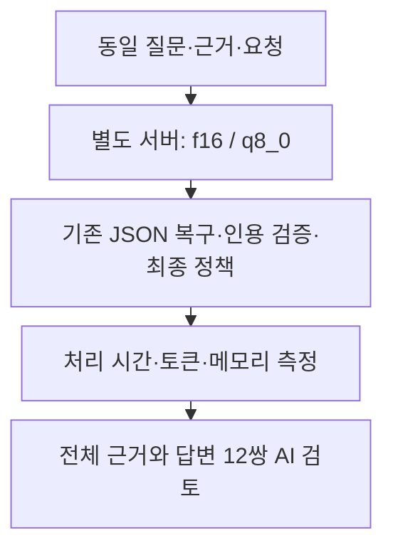

# KV 캐시 정밀도 시험 결과 — 2026-10-11

> 보관 위치 변경 (2026-10-13): 시험용 worktree와 브랜치를 정리했다. 후보 코드와 실행 상태는 압축 보관했으며, 아래 측정 원자료는 유지했다. [정리 내역과 복원 방법](unsuccessful-experiments-cleanup-2026-10-13.md)을 참고한다.

## 판정

**`q8_0`을 적용하지 않는다.** 메모리 사용량은 줄었지만, 반복 가능한 지연 개선과 답변 품질 보존 기준을 통과하지 못했다. 운영 설정과 코드의 기존 변경 사항은 유지했다.

- 입력 보존: 통과. 첫 요청 본문은 설정 간 동일하다. paired prompt count도 12쌍 모두 같다.
- 속도: 실패. 중앙값은 1차 **6.40% 증가**, 2차 **5.15% 감소**했다. 두 차례 모두 10% 이상 감소해야 한다는 기준에 미달했다.
- 품질: 실패. 12쌍 AI 검토에서 **5 pass, 6 fail, 1 uncertain**이었다. pass는 기준 대비 보존 판정이다. 법률 정확성 인증이 아니다.

## 시험 범위

질문 6개를 두 차례 비교했다. 총 **24회 처리 / 실제 모델 호출 29회**를 측정했다. 별도 예열 **4회 / 호출 7회**는 제외했다. 분석·검색은 고정한 스냅샷을 사용했다. 생성 시작부터 기존 최종 정책을 적용한 처리 반환까지 측정했다. 브라우저 대기 시간, 실시간 검색·분석, 서비스 전체의 응답 시간은 이 수치에 포함되지 않는다.

고정 조건은 `qwen3:4b` Q4_K_M, 컨텍스트 12288, 출력 제한 2048, temperature 0.2, 전체 스키마와 기존 검증 정책이다. 양쪽 모두 Flash Attention을 사용하고 37개 레이어를 GPU에서 실행했다. 같은 쌍에는 같은 seed를 적용했다. 모델 digest는 `359d7dd4bcdab3d86b87d73ac27966f4dbb9f5efdfcc75d34a8764a09474fae7`이다.

1차는 f16→q8_0, 2차는 q8_0→f16 순서다. 2차 질문 순서를 뒤집었다. 각 블록은 새로 소유한 `127.0.0.1:11435` 서버와 예열로 시작했다. 초기 로드와 예열은 제외하고, 측정 중 JSON 복구·인용 재생성 시간은 포함했다.

## 처리 시간과 생성량

| 회차 | 캐시 | 중앙값, 초 | p90, 초 | 디코딩 tokens/s 중앙값 | 턴별 출력 토큰 중앙값 | 실제 호출 | 답변/거절 |
| --- | --- | ---: | ---: | ---: | ---: | ---: | ---: |
| 1차 | `f16` | 13.60 | 123.50 | 54.67 | 613.0 | 9 | 6/0 |
| 1차 | `q8_0` | 14.47 | 27.69 | 52.49 | 618.5 | 6 | 6/0 |
| 2차 | `f16` | 15.02 | 81.28 | 54.83 | 695.0 | 7 | 5/1 |
| 2차 | `q8_0` | 14.24 | 52.87 | 52.68 | 616.0 | 7 | 6/0 |

6개 표본의 nearest-rank p90은 최대 처리 시간이다. 2차 f16은 한 질문을 거절했다. 이 표는 거절을 포함한 **처리 시간**이며, 모든 요청에서 유효한 첫 답변을 받는 데 걸린 시간이 아니다. 전송 오류는 양쪽 모두 0회였다.

`q8_0`의 디코딩 속도는 두 차례 약 4% 낮았다. 출력 내용·길이와 재시도 횟수가 바뀌었으므로, 일부 요청의 단축을 엔진 자체의 속도 향상으로 해석할 수 없다. 첫 raw 텍스트와 최종 답변이 동일한 쌍은 각각 0/12와 0/12였다.

긴 질문 인덱스 2에서는 다음 변화가 있었다.

| 회차 | f16 | q8_0 |
| --- | --- | --- |
| 1차 | 123.50초, 4호출, 인용 재생성·제거 후 답변 | 27.69초, 1호출, 답변 |
| 2차 | 81.28초, 2호출 모두 출력 제한에서 잘림, 거절 | 52.87초, 2호출, 복구 후 답변 |

이 질문의 지연은 줄었지만 후보 답변의 판단 이유와 효력 설명에서 오류를 확인했다. 호출 성공과 정확한 답변 제공을 같은 결과로 취급하지 않았다.

## 메모리와 입력 보존

Ollama `/api/ps`가 보고한 `size_vram`은 **4525.2 → 3763.2 MiB**, 약 **762.0 MiB 감소**했다. 이는 모델과 실행 캐시 등의 보고량이며, 캐시만의 실측치나 GPU 전체 사용량은 아니다. `nvidia-smi` 스냅샷도 따로 저장했다.

첫 호출 prompt count는 모든 쌍에서 같았다. 가장 긴 첫 입력은 6647토큰이었다. 측정·예열의 모든 36호출에서 보고된 prompt count + 2048이 12288 이하였다. 로그에 입력 잘림이나 context shifting은 없었다. 이 확인은 엔진 내부 토큰 전체의 독립 비교를 뜻하지 않는다. 후속 요청은 첫 출력과 검증 결과가 바뀌면 달라진다.

설정 근거: [Ollama FAQ](https://docs.ollama.com/faq#how-can-i-set-the-quantization-type-for-the-k-v-cache). 캐시 양자화는 메모리를 줄이며 정확도 영향은 모델과 작업에 따라 다르다. 실제 실행 로그의 `Operation:commit`, `KvCacheType`, `FlashAttention`과 GPU 레이어를 확인했다. 환경 변수 지정만으로 적용을 판정하지 않았다.

## 전체 답변 검토

각 질문·참고 답변·제공 근거 5개 전체와 양쪽 최종 8개 필드, 완료 초안, 자동 검사 결과를 읽었다. 참고 답변도 제공 근거와 충돌할 수 있으므로 그대로 정답으로 강제하지 않았다. 이유는 원본 해시에 연결해 저장했다.

| 회차 | 인덱스 | 판정 | 이유 |
| --- | ---: | --- | --- |
| 1차 | 0 | fail | AI reviewed (Codex): S1/S5는 기존 질병에 과로가 겹쳐 유발·악화해도 인과관계를 인정한다. 후보 analysis/summary는 이를 보존하지만 uncertainty에서 과로가 심근경색의 주된 원인인지에 따라 달라진다고 새로 좁힌다. 본문과 충돌하는 중요 조건 변경이다. 양쪽 모두 S2의 원심 84구1178을 대법원 사건으로 잘못 인용한다. 기준의 S1/S5 원심 날짜 오인과 후보의 근거 없는 의학적 검사 단정도 별도 한계로 기록한다. |
| 1차 | 20 | fail | AI reviewed (Codex): 양쪽 analysis가 질문을 반복하고 citations가 비어 있어 기준도 충분한 답변이 아니다. 후보는 기준의 공정한 경쟁 침해 우려 조건을 허위·부정 작성 또는 공정성 침해로 바꿔 대안 조건으로 단정하고 confidence를 medium에서 high로 높인다. S1에는 단순 오기·공정성 침해 우려 없음으로 취소를 다툰 사례가 포함되어 있어 이 구분을 건너뛴 단정은 보존으로 인정하기 어렵다. 후보의 조치 제안이 담합 신고 혼동을 줄인 점은 인정한다. |
| 1차 | 40 | pass | AI reviewed (Codex): S1제85조의 선정 금지 3사유와 선정해서는 안 된다는 효과가 양쪽 analysis/summary에 유지된다. 후보는 교육생 정의의 근거 한계를 드러내고 기준의 추가 제한 없음 단정을 줄인다. additional_information_needed에서 교육생 확인이 빠졌으나 본문 조건은 유지된다. 양쪽이 S2/S4 일반 수형자 헌법소원 재량 설명을 군수형자에 그대로 연결한 공통 한계는 남아 있으며 절대 정확성 통과를 뜻하지 않는다. |
| 1차 | 60 | fail | AI reviewed (Codex): 기준 summary는 공동불법행위책임 또는 사용자책임과 계약 명시성·착오 여부를 구별한다. 후보는 이를 분양대행사 또는 시행사가 계약을 체결한 경우와 당사자 귀책 여부로 줄이고 두 책임 근거 및 착오 구분을 잃었다. S1의 영업사원 불법행위자·회사 사용자 공동 책임은 계약당사자 여부만으로 설명되지 않는다. 양쪽 analysis의 실질 설명 부족과 인용 공백, S4 광고 내용의 묵시적 계약 편입 조건 미설명은 공통 한계다. |
| 1차 | 43 | pass | AI reviewed (Codex): 농장경영자·닭/오리·매월·농림축산식품부장관·의무 효과가 양쪽 모든 핵심 필드에 유지된다. 후보는 S1제8조의2제2항과 S2의 접수 조항을 실제 제공 문구로 인용하고 기한·양식의 추가 확인 필요를 유지한다. S2 접수 위탁 목록을 신고 절차가 정해짐으로 표현한 과장은 기록하되 구체 절차·기한을 만들어내지 않아 질문의 의무 판단에 새로운 중요 손실은 확인하지 못했다. 전체 법률 정확성 인증은 아니다. |
| 1차 | 2 | fail | AI reviewed (Codex): S1/S2는 단순한 표현 방법 규제가 아니라는 점, 위험의 증명 부족, 법인격 소멸로 구성원 행위를 막을 수 없다는 점을 설명한다. 후보는 원심 측 S5의 북한 군사 도발 예방에 직접 유효하다는 설명을 결론과 summary에 넣고 당해 처분을 표현 방법 규제로 단정했다. 추가 정보의 공익을 제거한다는 문구도 잘못됐다. 기준도 최종 답변에서 비례 원칙 위반 없음으로 잘못 설명하며, 초안에서 재생성하면서 표현·결사의 설명을 잃고 source_id 불일치로 인용이 제거됐다. 기준의 기존 오류를 인정하더라도 후보의 새로운 판결 이유 혼동은 중요 회귀다. |
| 2차 | 0 | pass | AI reviewed (Codex): S1/S5의 과로가 기존 질병에 겹쳐 유발·악화하면 인정 가능한 기준이 후보 analysis에 유지된다. 후보 summary는 짧지만 analysis와 추가 증거 확인으로 조건을 보완하고 과로를 주된 원인으로 요구하지 않는다. 기준의 S2를 실제 인과관계 인정 사례로 잘못 설명한 부분은 후보에서 줄어든다. 양쪽 명명된 사건 인용 부재와 후보의 일반 기준 아님 표현의 모호함은 한계지만 새 중요 조건 손실로 확정하지 않았다. |
| 2차 | 20 | pass | AI reviewed (Codex): 양쪽은 해당 입찰 심사기준과 구체 증거 확인 필요, 공정한 경쟁에 관한 조건부 판단 및 medium confidence를 유지한다. 후보는 사실 확인을 요청하는 방향으로 일부 조치를 개선한다. 양쪽 analysis가 질문 반복이고 citations가 없으며 낙찰예정 취소와 담합·입찰참가 제한의 구분이 불충분한 공통 오류는 남는다. 이 판정은 기준 대비 보존이며 독립 정확성 통과가 아니다. |
| 2차 | 40 | uncertain | AI reviewed (Codex): 선정 금지 3사유는 양쪽 analysis/summary/행동/추가 확인에서 유지된다. 그러나 후보 uncertainty는 실제 적용에 소장 재량이 개입하여 사례에 따라 달라진다고 덧붙여 기준의 제한 사유가 없는 경우에만 선정 가능하다는 설명보다 금지 효과를 흐린다. 사실인정 또는 다른 선정 요건의 재량인지 금지 자체의 예외인지 구별하지 않아 안전한 보존을 확정하지 못했다. S2/S4 일반 교도소 재량을 군수형자에 연결하는 공통 혼동도 남는다. |
| 2차 | 60 | fail | AI reviewed (Codex): 후보는 S1의 회사 측 면책 주장, S2의 원고 공동불법행위·사용자책임 주장, S3/S5의 원고 주장을 각각 법원 이름의 근거 인용으로 제시하면서 주장과 판결을 구별하지 않는다. S1에서는 해당 면책 주장을 실제로 배척하고 회사와 영업사원의 공동 책임을 인정했으므로 첫 인용은 정반대 방향으로 읽힐 위험이 있다. 기준에 있던 사용자책임의 쟁점도 후보 본문에서 사라졌다. 후보 S4 묵시적 편입 인용은 적절하지만 다른 중요 역할 혼동을 상쇄하지 못한다. 기준의 경우가 많다는 빈도 단정과 분석 부족은 기존 한계다. |
| 2차 | 43 | pass | AI reviewed (Codex): 제8조의2 제2항의 신고 주체·닭/오리·매월·장관·의무가 양쪽 analysis/summary/행동에 유지된다. 후보는 세부 기한·방법의 제3항 위임을 더 분명히 연결하며 실제 날짜나 예외를 추가하지 않는다. 추가 확인 필요와 high confidence의 적용 범위도 유지된다. 인용은 최종 정책에서 같은 근거로 보충됐다. |
| 2차 | 2 | fail | AI reviewed (Codex): 기준은 두 호출이 모두 2048에서 잘려 최종 답변을 거절했고 완료 초안이 없다. 후보는 복구 후 응답했으나 S1의 단순위헌으로 효력 상실을 금지 범위 제한으로 바꾸고, S1/S4의 공익 침해라고 쉽게 단정할 수 없다는 판단을 공익 침해 없음으로 확정한다. 표현·결사 가치와 S2의 제재 효과 부족 설명도 빠졌다. 답변 성공이 늘었어도 근거와 다른 답변을 표시하므로 안전한 품질 보존으로 볼 수 없다. |

기준 답변에도 법원·원심 날짜 혼동, 분석 대신 질문 반복, 인용 공백과 판단 이유 오류가 있었다. 후보의 회귀와 기준의 기존 오류를 따로 기록했다. 자동 인용 검증의 통과는 답변 전체의 법적 의미가 정확하다는 보증이 아니다.

## 실행과 원본 보존 확인

- 저장한 24회 측정과 4회 예열을 오프라인 재생했다. **모든 36호출의 요청·seed·파싱·완료 초안·검증 결과·최종 정책을 다시 확인했다.**
- 기존 회귀 시험의 **630 passed / 3 skipped** 결과는 248개 소스·설정·테스트 파일이 바이트 단위로 같을 때만 재사용했다. 새로 전체 pytest를 실행했다는 뜻이 아니다. 이번 실행 조건은 실제 inference와 별도 재생 검증으로 확인했다.
- 소유한 서버 4개만 실행·종료했다. 시험 모델을 각 서버에서 해제했고 포트가 비었음을 확인했다. 운영 `/api/ps`는 시작과 종료에 모두 빈 목록이었다.
- 기존 모델 블롭과 키 파일을 수정하지 않았다. 별도 모델 메타데이터와 원본 블롭 참조를 사용했고 다운로드·prune은 금지했다.
- 원본 428개 파일, 이전 실행 상태 10개, 외부 읽기 전용 파일 9개의 해시 보존을 최종 감사에서 확인했다. root에는 이 결과·설계·계획 문서만 추가했다. staging과 commit은 하지 않았다.

## 한계와 다음 판단

같은 개발 질문 6개를 재사용한 소규모 시험이다. 무작위 표본·독립 holdout·사람의 법률 검토가 없다. paired seed가 같아도 실행 정밀도에 따라 출력이 달라졌다. 온도 스냅샷은 65, 68, 69, 69°C였으며 온도를 고정하지 않았다. 장치별 반복 가능한 효과를 일반화하지 않는다.

현재 장치에서 메모리 여유를 늘리는 효과는 확인했지만, 정확도를 유지하면서 지연을 줄이는 후보로는 남기지 않는다. 기존 운영 설정을 유지한다.

## 근거 파일

- [사전 기준](../../data/eval/reports/chat_pipeline/kv-cache-2026-10-11/PREREG.json), [고정 입력 및 실행 해시](../../data/eval/reports/chat_pipeline/kv-cache-2026-10-11/manifest.json)
- [측정 원본](../../data/eval/reports/chat_pipeline/kv-cache-2026-10-11/results.jsonl), [예열 원본](../../data/eval/reports/chat_pipeline/kv-cache-2026-10-11/warmup.jsonl), [지표](../../data/eval/reports/chat_pipeline/kv-cache-2026-10-11/metrics.json)
- [AI 검토](../../data/eval/reports/chat_pipeline/kv-cache-2026-10-11/review.jsonl), [품질 판정](../../data/eval/reports/chat_pipeline/kv-cache-2026-10-11/quality.json), [내용 비교](../../data/eval/reports/chat_pipeline/kv-cache-2026-10-11/content-comparison.json)
- [요청 및 최종 정책 재생 검증](../../data/eval/reports/chat_pipeline/kv-cache-2026-10-11/measurement-verification.json), [서버 생명주기](../../data/eval/reports/chat_pipeline/kv-cache-2026-10-11/lifecycle.jsonl), [엔진 설정 확인](../../data/eval/reports/chat_pipeline/kv-cache-2026-10-11/engine-confirmations.jsonl)
- [회귀 증거 재사용](../../data/eval/reports/chat_pipeline/kv-cache-2026-10-11/regression.json), [최종 감사](../../data/eval/reports/chat_pipeline/kv-cache-2026-10-11/final-audit.json)
- [설계](../superpowers/specs/2026-10-11-kv-cache-design.md), [계획](../superpowers/plans/2026-10-11-kv-cache.md)
