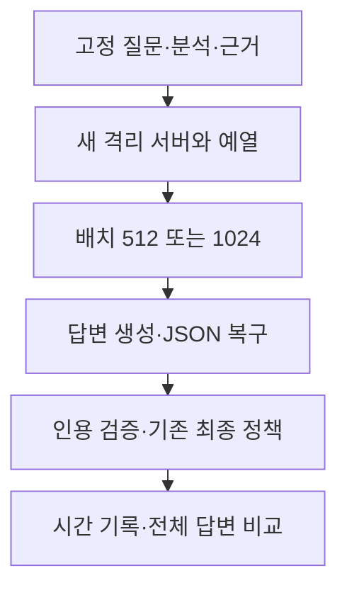

# 입력 처리 배치 시험 결과 — 2026-10-11

> 보관 위치 변경 (2026-10-13): 시험용 worktree와 브랜치를 정리했다. 후보 코드와 실행 상태는 압축 보관했으며, 아래 측정 원자료는 유지했다. [정리 내역과 복원 방법](unsuccessful-experiments-cleanup-2026-10-13.md)을 참고한다.

## 1. 결론

`num_batch`를 512에서 1024로 올리는 후보를 채택하지 않는다. 두 회차의 속도 기준과 제공 근거에 대한 상대 품질 기준을 함께 적용했다. 운영 코드와 설정은 변경하지 않았다.

이번 수치는 고정된 검색·분석 결과에서 답변 생성과 기존 최종 정책을 끝낼 때까지의 시간이다. 브라우저의 첫 표시 시간이나 검색을 포함한 전체 요청 시간을 측정한 것은 아니다.

## 2. 시험 조건

- 모델: 같은 `qwen3:4b` Q4_K_M 가중치. f16 KV 캐시, Flash Attention ON, GPU 37/37 레이어, parallel 1.
- 컨텍스트 12288, 출력 2048, temperature 0.2, 전체 출력 스키마. 질문·참고 답변·5개 근거·프롬프트·JSON 복구·인용 검증·최종 정책을 유지했다.
- 질문 인덱스 0·20·40·60·43·2, 예열 26. 6문항×2설정×2회차=24회 측정. 새 서버별 예열 4회는 통계에서 제외했다.
- 1차는 512→1024, 2차는 1024→512. 2차 질문 순서는 역전했다. 각 쌍의 seed는 같고 첫 요청 본문의 유일한 차이는 `options.num_batch`다.
- 같은 모델과 seed를 사용해도 배치 설정을 바꾸면 출력 토큰과 문장이 달라질 수 있다. 실제 완성 답변을 각각 검토했다.

Ollama v0.16.2의 [옵션 정의](https://github.com/ollama/ollama/blob/v0.16.2/api/types.go)와 [runner 연결](https://github.com/ollama/ollama/blob/v0.16.2/llm/server.go)을 확인했다. 기본값 512인 `num_batch`는 로드 요청의 `BatchSize`에 전달된다. 이번 서버의 실제 commit 로그에서도 각각 512와 1024를 확인했다.

## 3. 시간과 호출

| 회차 | 배치 | 최종 처리 중앙값 | p90 | 첫 입력 평가 중앙값 | 디코딩 중앙값 | 출력 토큰 중앙값 | 실제 호출 |
|---|---:|---:|---:|---:|---:|---:|---:|
| 1 | 512 | 14.648초 | 52.887초 | 1.941초 | 55.96 tokens/s | 671.5 | 7 |
| 1 | 1024 | 16.082초 | 52.784초 | 1.968초 | 54.86 tokens/s | 736 | 7 |
| 2 | 512 | 15.340초 | 55.138초 | 1.983초 | 54.03 tokens/s | 701 | 8 |
| 2 | 1024 | 22.889초 | 59.585초 | 1.974초 | 54.18 tokens/s | 1072 | 8 |

- 1차 중앙값 변화: **+9.79%**. 속도 기준: **실패**.
- 2차 중앙값 변화: **+49.21%**. 속도 기준: **실패**.

속도 통과에는 두 회차 모두 중앙값 10% 이상 감소가 필요하다. p90·호출·전송 오류·거절·인용 재생성·인용 제거도 늘지 않아야 한다. 문항 6개에서 nearest-rank p90은 최댓값이다. 디코딩 속도는 실제 호출별 `eval_count/eval_duration`의 중앙값이다. 출력량은 복구·재생성 호출을 합친 문항별 토큰 수다.

| 회차 | 배치 | 최종 answer/rejected/error | 출력 상한 종료 호출 | 인용 재생성 문항 | 인용 제거 문항 |
|---|---:|---|---:|---:|---:|
| 1 | 512 | 6/0/0 | 1 | 0 | 0 |
| 1 | 1024 | 6/0/0 | 1 | 0 | 0 |
| 2 | 512 | 6/0/0 | 1 | 1 | 1 |
| 2 | 1024 | 6/0/0 | 1 | 1 | 0 |

측정 호출은 총 30회, 제외한 예열 호출은 8회다. 모든 시간에는 해당 문항의 실제 복구·재생성 호출이 포함된다. 예열에서 발생한 복구도 원본에 남겼지만 측정 통계에는 넣지 않았다.

### 입력 평가와 메모리

`prompt_eval_count`에는 재사용된 접두부가 포함된다. 이를 입력 평가 시간으로 나눠 실제 처리한 새 입력 토큰의 처리량이라고 표시하지 않았다. 서버 cache slot 로그의 `prompt/used/remaining`을 모든 실제 호출과 순서대로 대조했다. 문항별 접두부 재사용량과 출력 차이 때문에 이 소규모 실행으로 배치의 순수 입력 처리 효과를 분리할 수 없다.

| 회차 | 배치 | 첫 호출 재사용 토큰 범위 | 첫 호출 새 평가 토큰 범위 | Ollama 보고 VRAM |
|---|---:|---:|---:|---:|
| 1 | 512 | 810–814 | 5025–5837 | 4525.2 MiB |
| 1 | 1024 | 810–814 | 5025–5837 | 4628.2 MiB |
| 2 | 512 | 810–814 | 5023–5837 | 4525.2 MiB |
| 2 | 1024 | 810–814 | 5023–5837 | 4628.2 MiB |

모든 블록에서 f16 캐시, Flash Attention, 전체 GPU 실행과 컨텍스트 12288을 확인했다. CPU offload나 입력 잘림·context shifting은 관찰되지 않았다. 각 쌍의 첫 prompt count는 같았다. 예열을 포함한 모든 호출에서 보고된 prompt count+2048은 컨텍스트 이내였다. 이 확인은 내부 토큰 전체가 같다는 독립 증명이 아니다.

## 4. 제공 근거에 대한 상대 품질 검토

질문·참고 답변·5개 근거 전체는 직전 KV 시험과 같은 내용임을 사전 비교했다. 변경되지 않은 입력의 전체 읽기를 재사용하고, 이번에 생성된 12쌍의 최종 8필드·완료 초안·검사 결과는 새로 읽었다. 각 이유는 `AI reviewed (Codex)`로 기록하고 입력과 두 최종 답변의 해시를 연결했다. 자동 인용 검사 통과는 인용 대상의 존재를 확인한 결과이며, 문장 의미의 법적 타당성을 보증하지 않는다.

검토 결과: pass 4, fail 5, uncertain 3. **상대 품질 기준 실패**. pass도 이번 제공 근거에 대한 비교 판정이며 실제 법률 정확도 인증은 아니다.

| 회차 | 문항 | 판정 | AI reviewed + 이유 |
|---|---|---|---|
| 1 | 0 — 과로와 기왕증 | fail | AI reviewed (Codex): 양쪽 analysis는 과로가 기존 질병에 겹쳐 유발·악화한 경우도 인정된다는 기준을 유지한다. 그러나 후보는 S1의 1990.4.19와 S5의 1987.5.18 원심 날짜를 대법원 사건의 날짜로 새로 표시하고 S2 원심 84구1178도 대법원 사건처럼 인용한다. 기준에도 S2를 경찰관 인과관계 인정 사례로 오인한 오류가 있으나 후보가 추가한 잘못된 판결 날짜는 별도의 중요 회귀다. |
| 1 | 20 — 공사실적 자료와 낙찰 취소 | uncertain | AI reviewed (Codex): 후보 summary는 사실과 다른 내용과 공정성 침해 우려를 함께 요구해 기준의 핵심 조건을 유지한다. 양쪽 analysis는 질문 반복이다. 후보는 S1의 취소 통보 경위, S3의 담합에 대한 6개월 입찰참가 제한, S4의 계약 해제·제재 조항을 인용하면서 낙찰예정자 취소와 구별하지 않는다. S1에는 단순 오기와 공정성 침해 우려 없음으로 취소를 다툰 후속 판단도 있어 통보 자체를 적법성 근거로 볼 수 없다. 추가 인용이 적절한 조건 근거인지 확정하지 못해 보존 통과로 인정하지 않았다. |
| 1 | 40 — 군 수용자 직업훈련 | pass | AI reviewed (Codex): 제85조의 조사/징벌, 교육생 선정, 질병/신체조건이라는 3사유와 선정 금지 효과가 analysis/summary에 유지된다. 후보의 행동과 추가 확인 항목도 이 조건에 연결된다. 기준의 직접 인용은 후보에서 줄었지만 핵심 내용과 출처는 유지된다. S2/S4 일반 수형자 재량 판례를 군수형자에 연결하는 공통 혼동은 해결되지 않았으며 상대 보존 통과가 독립 정확성을 뜻하지 않는다. |
| 1 | 60 — 분양 안내와 손해배상 | fail | AI reviewed (Codex): 기준도 구체 조건 미명시와 협조의무를 넓게 설명하는 한계가 있다. 후보는 공동불법행위책임을 본문에서 잃고, 분양대행사나 시행사가 책임을 지는 경우가 많다는 빈도와 충분한 명시·설명이 책임을 줄인다는 일반 조건을 새로 단정한다. 제공 근거의 다양한 당사자 관계와 S1의 회사 면책 주장 배척을 이 일반화로 대체할 수 없다. 후보 uncertainty의 확정 불가 문구도 summary의 단정을 해소하지 못한다. |
| 1 | 43 — 닭·오리 사육 현황 보고 | pass | AI reviewed (Codex): 농장경영자·닭/오리·매월·장관·신고 의무는 양쪽 analysis/summary/행동에 유지된다. 후보는 더 짧지만 제8조의2 제2항과 제12조 근거를 유지하고 세부 기한·방법을 추가 확인 대상으로 둔다. 정확한 날짜·예외·양식을 만들어내지 않았다. 직접 인용 감소는 이 질문의 필수 의미 손실로 보지 않았다. |
| 1 | 2 — 대북전단과 공익 침해 | fail | AI reviewed (Codex): 헌법재판소 결정으로 조항의 효력이 상실됐다는 제공 근거를 금지 범위가 제한됐다는 설명으로 바꿨습니다. 직접적이고 구체적인 공익 침해를 쉽게 단정할 수 없다는 판단도 공익 침해가 발생하지 않는다는 단정으로 바뀌었습니다. 표현·결사의 자유와 단체의 공적 역할에 관한 기존 답변의 근거가 빠졌고 신뢰도는 medium에서 high로 올라갔습니다. 기존 답변에도 단체 해산의 실효성 설명이 부족했지만, 이 변경은 별도의 의미 오류입니다. |
| 2 | 0 — 과로와 기왕증 | uncertain | AI reviewed (Codex): 기왕증에 과로가 겹쳐 유발·악화되면 인과관계가 인정될 수 있다는 중심 법리는 두 답변에서 유지됐고 후보의 인용문도 제공 내용과 대응합니다. 다만 후보 uncertainty가 과로 영향을 정량적으로 분석할 수 있는 의학적 기준이 필요하다고 새로 제시했습니다. 제공 근거는 개별 의학적·업무 증거에 의한 인과관계 판단을 설명하므로 이런 정량 기준을 필요한 조건처럼 제시할 근거를 확인할 수 없습니다. 두 답변의 84구1178을 대법원 사례로 묶은 오류와 기준 답변의 근거 없는 심혈관 질환 빈도 표현은 기존 오류로 분리했습니다. 이 새 추가 조건 때문에 통과를 확정하지 않았습니다. |
| 2 | 20 — 공사실적 자료와 낙찰 취소 | uncertain | AI reviewed (Codex): 두 답변 모두 analysis가 질문 반복에 그치고 공정한 경쟁 침해 우려라는 중심 조건은 유지했습니다. 후보는 기준 답변의 담합 제재 조문 단정을 줄였지만 S1의 취소 통보, S2의 배상 문장, S3의 담합 참가자격 제한, S4의 계약 해제·해지를 새 인용으로 묶었습니다. 이 인용들은 낙찰예정자 자격 취소의 적법 조건을 직접 입증하지 않으며 S1의 오기·공정성 위험 부정에 관한 후속 판단을 설명하지 않습니다. 서로 다른 처분과 절차를 구분하지 않아 새 인용의 적합성을 확인할 수 없고 통과로 판정하지 않았습니다. |
| 2 | 40 — 군 수용자 직업훈련 | pass | AI reviewed (Codex): analysis와 summary에서 조사·징벌 집행, 교육생 선정, 질병·신체조건으로 훈련 감당 불가의 세 가지 선정 금지 사유와 강행 표현을 모두 유지했습니다. 추가 확인도 같은 세 사유에 대응합니다. 일반 수형자에 관한 S2·S4를 군수형자 선정 재량에 연결한 문제와 제84조 자격 요건을 설명하지 않은 점은 기준 답변에도 있어 기존 오류로 분리했습니다. 새 중요한 의미 손실이 확인되지 않은 상대 비교 통과입니다. |
| 2 | 60 — 분양 안내와 손해배상 | fail | AI reviewed (Codex): 후보는 S1의 직원 계약확인서 서명을 손해배상 책임의 근거로 연결하고, S2·S3의 당사자 주장과 서로 다른 당사자 관계를 일반적인 계약 해제·배상 판단으로 합쳤습니다. S4를 광고 내용 미포함으로 위약금 감액이 필요하다는 근거로 설명한 것도 제공 내용과 다릅니다. summary가 조건 차이만 있으면 피고 B가 배상해야 한다는 단정으로 바뀌어 기망·사용자 관계 등 조건을 잃었습니다. 기준 답변의 근거 없는 빈도 표현과 추상적 분석은 기존 오류이며 후보의 새 오독과 분리했습니다. |
| 2 | 43 — 닭·오리 사육 현황 보고 | pass | AI reviewed (Codex): 후보는 농장경영자·닭과 오리·매월·농림축산식품부장관 신고라는 S1 제8조의2 제2항의 핵심 의무를 유지했습니다. 재생성 뒤 제12조의2 인용 오류가 해소됐으며 구체적인 신고 기한과 방법은 추가 확인으로 남겼습니다. 기준 답변이 제1항의 식별번호 표시 생략 예외를 제2항의 월별 신고 생략으로 옮긴 오류는 후보에 없습니다. S2를 제12조 제2항으로 지칭한 것은 제공 조각의 세부 항을 확인하기 어렵고 기준 답변에도 있어 기존 문제로 분리했습니다. 상대 비교 통과이며 절차·세부 항의 정확도 보증은 아닙니다. |
| 2 | 2 — 대북전단과 공익 침해 | fail | AI reviewed (Codex): 후보 analysis는 질문과 근거 번호를 소개하는 데 그쳐 이유를 설명하지 않습니다. 기준 답변에 있던 단체의 공적·사회적 역할과 헌법상 표현·결사의 자유라는 주요 판단 근거가 빠졌습니다. 제재의 긴요성을 요약에 넣었지만 이 누락을 보완하지 못합니다. 처분의 공정성에 대한 재심 요청이라는 절차도 제공 근거로 확인되지 않습니다. 두 답변의 공익 침해 부정 단정 및 기준 답변의 효력 상실 조항 설명 누락은 기존 오류로 분리했습니다. |

최종 답변이 완전히 같은 쌍은 0/12, 첫 원문 출력이 같은 쌍은 0/12다. 기존 답변부터 있던 오류도 위 이유에 구분했다. 기준 답변의 오류를 후보의 회귀로 계산하지 않았다. 새 중요 오류나 uncertain이 있으면 품질 기준을 통과시키지 않았다.

## 5. 검증과 보존

- 사전 입력 비교와 파일 바인딩을 확인했다. 실제 요청·순서·seed·파서·스키마·초안·인용 검사·기존 최종 정책을 원본 호출 기록으로 새로 재생했다.
- 회귀 시험을 새로 실행하지 않았다. 이전 `630 passed / 3 skipped` 증거를 현재 root와 worktree의 동일한 소스·설정·시험 파일 248개 해시로 연결해 재사용했다. 이번 런타임 측정과 정책 재생은 별도의 새 증거다.
- 측정 전후 해시 비교에서 root 파일 431개, 기존 실행 상태 11개, 원본 모델·키·실행 파일 9개의 보존을 확인했다. 최종 감사는 통과했다. 예상 root 추가 경로는 이번 결과·설계·계획 문서 3개다. stage와 commit은 하지 않았다.
- 서버 4개는 별도 모델 메타데이터와 포트 11435를 사용했다. 원본 블롭은 읽기 전용으로 참조했다. 모델 다운로드·prune은 하지 않았다. 소유한 모델을 해제하고 프로세스를 종료했다. 운영 포트 11434의 모델 목록은 측정 전후 모두 비어 있었다.

## 6. 해석과 후속 방향

검증을 줄이거나 출력 상한을 낮추지 않은 상태에서 입력 배치 증가를 시험했다. 결과는 이 GPU·모델·Ollama 버전·개발 문항에 한정된다. 여섯 문항과 두 반복은 제품 지연 분포나 법률 정확도를 추정하기에 부족하다. 별도 holdout과 인간 전문가 검토도 없다.

입력 평가 중앙값은 약 2초로 거의 같았고 디코딩 속도도 비슷했다. 후보의 출력 토큰 중앙값은 1차 약 9.6%, 2차 약 52.9% 증가했다. 일부 문항은 출력 상한이나 인용 오류로 추가 호출이 발생했다. 이 결과에서는 출력량과 복구 호출의 변화가 큰 지연 요인이었다.

입력 배치 1024는 이번 기준을 충족하지 못했다. 현재의 배치와 검증 정책을 유지한다. 다음 후보를 평가하려면 실제 시간의 큰 부분을 차지하는 출력 생성·복구 호출을 함께 고려해야 한다. 엔진 교체나 더 빠른 모델은 가중치·출력 변화와 설치 범위를 별도로 설계해야 한다.

## 증거

- [사전 설계](../superpowers/specs/2026-10-11-prefill-batch-design.md), [실행 계획](../superpowers/plans/2026-10-11-prefill-batch.md)
- [지표](../../data/eval/reports/chat_pipeline/prefill-batch-2026-10-11/metrics.json), [측정 원본](../../data/eval/reports/chat_pipeline/prefill-batch-2026-10-11/results.jsonl), [제외 예열](../../data/eval/reports/chat_pipeline/prefill-batch-2026-10-11/warmup.jsonl)
- [전체 비교 검토](../../data/eval/reports/chat_pipeline/prefill-batch-2026-10-11/review.jsonl), [품질 판정](../../data/eval/reports/chat_pipeline/prefill-batch-2026-10-11/quality.json), [내용 비교](../../data/eval/reports/chat_pipeline/prefill-batch-2026-10-11/content-comparison.json)
- [정책 재생](../../data/eval/reports/chat_pipeline/prefill-batch-2026-10-11/measurement-verification.json), [입력 캐시 대조](../../data/eval/reports/chat_pipeline/prefill-batch-2026-10-11/cache-usage.json), [회귀 증거 바인딩](../../data/eval/reports/chat_pipeline/prefill-batch-2026-10-11/regression.json)
- [실제 엔진 설정](../../data/eval/reports/chat_pipeline/prefill-batch-2026-10-11/engine-confirmations.jsonl), [서버 생명주기](../../data/eval/reports/chat_pipeline/prefill-batch-2026-10-11/lifecycle.jsonl), [최종 감사](../../data/eval/reports/chat_pipeline/prefill-batch-2026-10-11/final-audit.json)
