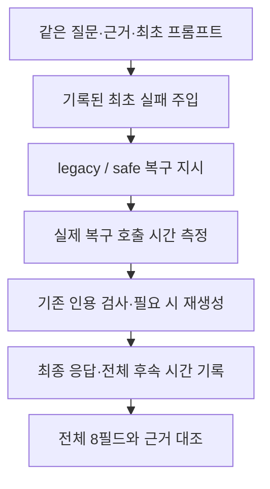

# 같은 최초 실패 입력의 복구 비교

> 보관 위치 변경 (2026-10-13): 시험용 worktree와 브랜치를 정리했다. 후보 코드와 실행 상태는 압축 보관했으며, 아래 측정 원자료는 유지했다. [정리 내역과 복원 방법](unsuccessful-experiments-cleanup-2026-10-13.md)을 참고한다.

기록일: 2026-10-11. 판정: **`safe` 복구 후보를 채택하지 않는다.**

같은 최초 실패에서 비교해도 `safe`는 두 회차 모두 더 느렸다. 전체 의미 검토에서도 새 오류와 판단 불가 사례가 있었다. 이번 작업은 측정과 검토를 완료한 것이다. 사용자의 첫 답변 대기 시간을 해결한 결과는 아니다.

## 1. 비교 목적과 범위

[이전 비교](answer-recovery-latency-2026-10-10.md)는 첫 생성의 변동을 포함했다. 이번 비교는 기록된 최초 실패를 주입해 복구 단계의 차이를 확인했다. 질문, 분석, 검색 근거, 최초 프롬프트, 실패 예외를 쌍마다 같게 유지했다. 모델 요청에서 바꾼 항목은 마지막 복구 지시다.

이전 주 비교에서 첫 호출이 실패한 **8건 전부**를 사용했다. 고유 질문은 **6개**, 고유 최초 프롬프트는 **7개**다. 같은 질문의 다른 실험군 기록도 포함한다. 8개 독립 질문을 시험한 결과로 해석하면 안 된다. 두 번째 호출의 실패를 새로운 최초 실패로 추가하지 않았다.

기록된 잘린 본문은 오류 확인 자료다. 기존 계약대로 모델에 본문을 추가하지 않고 전체 JSON을 다시 생성했다. 기존 `Orchestrator`와 `Generator`, JSON 재시도, 인용 검사·재생성·거부 정책을 사용했다.

## 2. 실행 조건

| 항목 | 조건 |
|---|---|
| 측정 | 8건 × 2방식 × 2회차 = 32턴 |
| 워밍업 | 회차별 방식당 1턴, 총 4턴을 사전 규칙대로 제외 |
| 실제 모델 호출 | 측정 35회, 워밍업 8회, 합계 43회 |
| 모델 | `qwen3:4b`, 4.0B, Q4_K_M |
| Ollama | 0.16.2 |
| 생성 | context 12288, 출력 한도 2048, temperature 0.2, think OFF |
| 순서 | 쌍별 선후를 번갈아 배치하고 2회차에서 반대로 실행 |
| seed | 쌍 안에서 동일, 회차마다 변경. 실험 요청에만 설정 |
| 실행 | 새 격리 worktree, 기존 GPU lock 아래 순차 실행 |

모델 digest는 `359d7dd4bcdab3d86b87d73ac27966f4dbb9f5efdfcc75d34a8764a09474fae7`이다. 첫 추론 전에 소스, 실행기, 입력, 예상 복구 요청을 고정했다. 측정 뒤에도 해시와 요청 일치를 확인했다.

측정 후 장치 조회에서는 RTX 4060 Laptop GPU가 확인됐다. 이 조회는 실행 중 GPU layer 배치의 증거가 아니다. 이번 실행에서 GPU layer 배치와 Flash Attention 설정은 새로 확인하지 못했다. 서비스 재시작과 강제 model unload는 하지 않았다.

## 3. 시간 결과

단위는 초다. 각 행은 8턴이다. 실패·거부도 분모에 포함했다. p90은 nearest-rank 방식이며, 이 표본 수에서는 **최댓값과 같다**.

### 3.1 첫 실제 복구 호출

| 회차 | 방식 | 중앙값 | p90 | 출력 토큰 중앙값 |
|---|---|---:|---:|---:|
| 1 | legacy | 14.49 | 21.69 | 731.5 |
| 1 | safe | 31.69 | 40.63 | 1,557 |
| 2 | legacy | 16.85 | 21.78 | 750.5 |
| 2 | safe | 25.47 | 34.44 | 1,310 |

`safe`의 중앙값은 1회차 **118.7%**, 2회차 **51.2% 증가**했다. 출력 토큰 중앙값도 증가했다. 이를 인과관계의 단독 증명으로 보지는 않는다. 첫 복구 호출의 load duration 최댓값은 각 군에서 0.068초 미만이었다.

사전 기준은 두 회차 모두 중앙값 10% 이상 감소와 p90 비증가였다. **두 회차 모두 실패했다.**

### 3.2 최초 실패 뒤 전체 정책 처리

| 회차 | 방식 | 중앙값 | p90 | 실제 호출 | 최종 답변 / 거부 / 오류 |
|---|---|---:|---:|---:|---:|
| 1 | legacy | 14.49 | 21.69 | 8 | 8 / 0 / 0 |
| 1 | safe | 31.69 | 40.63 | 8 | 7 / 1 / 0 |
| 2 | legacy | 17.12 | 38.66 | 9 | 8 / 0 / 0 |
| 2 | safe | 26.71 | 97.90 | 10 | 8 / 0 / 0 |

이 시간은 기록된 실패를 주입한 직후부터 최종 정책 처리까지다. 실제 최초 생성, 실제 검색, Flask/SSE 및 화면 표시 시간을 포함하지 않는다. **사용자의 첫 답변 대기 시간이나 TTFT로 표시하지 않는다.**

| 사건 | 기록 |
|---|---|
| 1회차 `recovery-55`, safe | 복구 호출이 2048 토큰에서 잘렸다. 완성 답변 없이 거부했다. 약 40.63초. |
| 2회차 `baseline-26`, safe | 첫 복구의 인용 source 불일치 → 인용 재생성의 length 종료 → JSON 재시도. 실제 3회 호출, 약 97.90초. |
| 2회차 `combined-63`, legacy | 인용 검사 뒤 재생성으로 실제 2회 호출, 약 38.66초. `99다 40418`이 근거에 있으나 `99다40418` 검사에서 부재로 잡혔다. 공백 정규화의 오탐이며 새 판례 조작으로 분류하지 않았다. |

측정 중 length 종료는 legacy 0회, safe 2회였다. 인용 재생성이 발생한 턴은 각 방식 1개였다. 측정에서 인용 제거 정책은 양쪽 모두 0턴이었다. 워밍업에서는 1회차 safe 1턴에 기존 인용 제거 정책이 적용됐다. 워밍업 4턴은 시간이 길거나 추가 호출이 있어도 모두 사전 규칙대로 제외했다.

## 4. 전체 의미 검토

검토자: **AI reviewed (Codex)**. 두 회차의 16쌍 모두 질문, 참고 답변, 제공된 전체 근거, 가능한 경우 첫 복구 초안, 최종 8필드를 읽었다. 양쪽에 이미 있던 오류와 `safe`에서 새로 생긴 오류를 구분했다.

| 판정 | 쌍 수 |
|---|---:|
| pass | 0 |
| fail | 14 |
| uncertain | 2 |

이 판정은 `safe`의 의미 보존에 대한 비교다. legacy가 정확하다는 뜻이 아니다. 제공 코퍼스 안의 대조이며 현재 법률의 유효성 확인이나 전문가의 법률 정확성 인증은 아니다. 참고 답변의 조문이 검색 근거에 없으면 참고 답변을 그대로 쓰는 것을 요구하지 않았다.

대표 사유는 다음과 같다.

| 사례 | 검토 사유 |
|---|---|
| `recovery-15`, 2회차 | safe summary가 제공 사건의 부가가치세 면제를 과세 가능으로 뒤집었다. 교육세 판단과 부가가치세 판단도 구분해야 한다. |
| `baseline-75`, 1회차 | 이사회 책임을 추가하면서 반대 의사 표시 예외를 빠뜨렸다. 서로 다른 법률의 임원 책임 범위도 섞었다. |
| `guard-63`, 2회차 | 내부 입찰 규정에 일반 규범성이 없다는 근거를 담합 손해배상 전반의 불가능으로 확대했다. |
| `combined-1`, 두 회차 | 특정 의제매입세액공제 절차를 일반 법인세 공제 절차로 연결했다. 기존 답변에도 공제 유형 혼용 오류가 있었다. |
| `recovery-55`, 2회차 | 근거 부족이라는 제한은 유지했지만, 근거 없이 세법·수입세법을 확인 대상으로 지정했다. |
| `recovery-15`, 1회차 | 일부 기존 오류는 개선했다. 다만 리스 회계 분류에 따른 부가가치세 차이는 제공 근거로 확인하지 못해 uncertain이다. |
| `recovery-55`, 1회차 | safe의 완성 답변이 없어 전체 8필드의 쌍 비교는 uncertain이다. 잘린 raw는 사용자 답변으로 취급하지 않았다. |

기존 인용 검사를 통과한 답변에서도 의미 오류가 확인됐다. 검사 통과와 법률 의미의 정확성은 별도 판단이다. 이번 실험에서는 기존 표시 경계와 검사를 변경하지 않았다.

## 5. 판정과 보존

**속도 기준과 의미 보존 기준을 통과하지 못했다.** `safe`를 서비스 기본 복구 방식으로 적용하지 않는다. 기존 기본값, 2048 토큰 한도, 재시도 한도, 응답 스키마와 표시 정책을 유지했다.

root, 이전 `answer-recovery` worktree 및 새 worktree의 기준 파일을 해시로 대조했다. 기존 미커밋 변경과 이전 실행 상태는 보존했다. 새 작업의 실행 상태만 완료했다. 이번 측정에서는 서비스 코드를 수정하거나 테스트 스위트를 새로 실행하지 않았다. 커밋·스테이징도 하지 않았다.

다음 최적화는 이번 후보의 채택을 전제로 삼을 수 없다. 별도 계획에서 평상시 첫 생성의 출력 길이·근거 선택 또는 인용 오탐 비용을 다룰 수 있다. 각 변경에는 같은 품질 기준과 실제 사용자 대기 시간의 측정이 필요하다.

## 6. 근거 파일

- [사전 설계](../superpowers/specs/2026-10-11-recovery-fixed-failure-design.md), [실행 계획](../superpowers/plans/2026-10-11-recovery-fixed-failure.md)
- [사전 판정 규칙](../../data/eval/reports/chat_pipeline/recovery-fixed-failure-2026-10-11/PREREG.json), [고정 manifest](../../data/eval/reports/chat_pipeline/recovery-fixed-failure-2026-10-11/manifest.json)
- [측정 집계](../../data/eval/reports/chat_pipeline/recovery-fixed-failure-2026-10-11/metrics.json), [실행 모델 정보](../../data/eval/reports/chat_pipeline/recovery-fixed-failure-2026-10-11/runtime.json)
- [32턴 기록](../../data/eval/reports/chat_pipeline/recovery-fixed-failure-2026-10-11/results.jsonl), [제외한 워밍업](../../data/eval/reports/chat_pipeline/recovery-fixed-failure-2026-10-11/warmup.jsonl)
- [16쌍 AI 검토와 사유](../../data/eval/reports/chat_pipeline/recovery-fixed-failure-2026-10-11/codex-review.jsonl), [보존 감사](../../data/eval/reports/chat_pipeline/recovery-fixed-failure-2026-10-11/audit.json)

원문·payload를 포함한 실험 기록은 private 파일이다. 결과 문서에 질문과 근거 전체를 복제하지 않았다.
