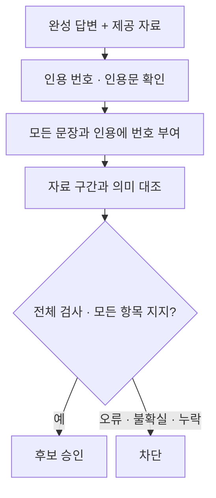

# 답변 의미 검증 시험 결과

> 보관 위치 변경 (2026-10-13): 시험용 worktree와 브랜치를 정리했다. 후보 코드와 실행 상태는 압축 보관했으며, 아래 측정 원자료는 유지했다. [정리 내역과 복원 방법](unsuccessful-experiments-cleanup-2026-10-13.md)을 참고한다.

계획 식별일: 2026-10-12. 모델 시험일: 2026-10-13.

## 결정

**이번 후보는 운영에 적용하지 않는다.** 인용문 검사와 문장별 검사 범위 확인은 구현했다. 모델은 요건이 빠진 오류 답변을 승인했고, 근거가 있는 대조 문장도 자주 차단했다. 긴 검사 결과의 출력 실패와 추가 지연도 남았다.

기존 생성기·API·Flask 화면·운영 설정은 이번 작업에서 바꾸지 않았다. 후보는 `.worktrees/semantic-verification`에 보존했다. 커밋과 병합은 하지 않았다.

## 구현

- 기존 조문·사건번호 검사를 유지한다.
- 직접 인용문은 해당 자료에 실제로 있어야 한다. 공백과 Unicode 조합 표기만 정규화한다.
- 분석·요약·쟁점·후속 행동·추가 정보·불확실성·인용을 모두 검사 입력에 넣는다. confidence는 보조 입력이다.
- 모델은 각 항목을 `supported`, `contradicted`, `insufficient`로 판정한다. 법원·주장 역할·부정·요건·예외·의무 강도·적용 대상·인용문 연결을 검사하도록 지시했다.
- 누락·중복 판정, 가짜 근거 번호, 인용과 다른 자료의 근거, 모순된 판정 형식, 모델 출력 실패를 차단한다.
- `verified_answer()`는 기존 인용 검사와 의미 검사가 모두 통과한 경우에만 원본 답변을 반환한다. 인용 삭제나 부분 표시로 오류 답변을 승인하지 않는다.

새 파일은 `schemas/semantic.py`, `verification/semantic.py`, `llm/prompts/semantic_verification.md`, `tests/legal_rag/unit/test_semantic_verification.py`다. 모두 후보 작업 공간에 있다.

## 시험 범위

최근 core-first·partial-repair 시험에서 확인한 8개 주제를 사용했다. 자료로 지지되는 짧은 문장과 의미 오류를 넣은 문장을 각 주제에 만들었다. 이 16개 대조 답변에 실제 생성 오류 답변 8개를 더했다. 총 24개 입력을 두 모델로 두 번 검사했다.

대조 문장은 제공 자료와의 의미 일치 여부를 시험한다. 사용자 질문에 대한 완전한 답변의 적합성이나 현재 법률의 정확성을 측정하지 않는다. 예를 들어 신용협동조합 규정 대조 문장은 그 자료의 내용을 확인하는 문장이다. 새마을금고 질문의 충분한 답변으로 해석하면 안 된다.

질문, 전체 5개 자료, 답변, 오류 지점, 자료 근거, 라벨과 입력 해시를 모델 호출 전에 고정했다. 참고 정답은 검사 모델에 제공하지 않았다. AI가 라벨과 자료 구간을 대조했고, 결과의 불일치 31개에 이유를 남겼다. 전문가 검토와 독립된 평가 자료가 추가로 필요하다.

## 결과

| 모델 | 회차 | 오류 답변 승인 / 16 | 근거 대조 문장 승인 / 8 | 중앙값 | p90 | 출력 실패 | 다음 단계 |
|---|---:|---:|---:|---:|---:|---:|---|
| qwen3:4b | 1 | 1 | 2 | 13.39초 | 81.92초 | 4 | 미통과 |
| qwen3:4b | 2 | 0 | 0 | 12.44초 | 83.19초 | 4 | 미통과 |
| qwen3:8b | 1 | 0 | 0 | 19.27초 | 133.81초 | 4 | 미통과 |
| qwen3:8b | 2 | 0 | 0 | 19.06초 | 133.49초 | 4 | 미통과 |

기존 번호 검사는 각 회차의 오류 답변 16개를 모두 승인했다. 이는 이 시험이 번호 존재 검사로 잡기 어려운 의미 오류를 골랐기 때문이다. 실사용 오류율로 일반화하지 않는다.

후보의 전체 차단 수를 의미 오류 탐지율로 계산하지 않았다. 각 회차에 실제 답변 3개는 인용문 존재 검사에서 차단됐다. 모델 검사 누락·가짜 번호·출력 실패로 차단된 답변도 많았다. 4b는 오류 지점에 직접 반대·불충분 판정을 남긴 사례가 두 회차 모두 0개였다. 8b는 각각 8개와 7개였지만, 그 판정의 존재만으로 이유가 정확하다고 보장할 수 없다.

같은 모델과 입력에서도 두 회차의 결과가 달랐다. 두 번째 회차는 입력 순서와 seed가 달랐으므로, 차이를 순서 하나의 효과로 설명하지 않는다.

### 잘못 승인한 사례

4b 첫 회차는 전문기관이 강사 1명만 두면 교육자료·시설 없이도 위탁받을 수 있다는 대조 답변을 승인했다. 제공 자료의 제32조의3은 각 호의 요건을 **모두** 갖추도록 규정한다. 모델은 강사 요건 구간 `S1:17`만 근거로 선택했다. 자료 구간 번호가 실제로 있다는 검사만으로는 요건 누락을 막지 못했다.

### 근거 문장을 차단한 사례

8b는 과로와 사망의 인과관계에 관한 일반 법리와, 증거가 없어 청구를 배척한 해당 사건의 판단을 혼동했다. 자료에 인용된 다른 법원과 현재 문서의 법원을 구분하지 못한 판정도 있었다. 정상 문장을 지지한다고 판정하면서 오류 category를 붙이거나, 자료 전체의 번호를 구간 번호 자리에 쓰는 형식 오류도 반복됐다.

## 시간과 실행 조건

표의 시간은 완성 답변 이후의 **추가 검증 시간**이다. 검색, 답변 생성, Flask 전송, 브라우저 첫 응답 시간은 포함하지 않는다. 인용문 검사만으로 끝난 사례와 실패 사례도 포함한다. p90은 각 24개에서 nearest-rank 방식으로 계산했다.

- 본 시험: 96개 검사. 예열 4개는 제외했다.
- 실제 모델 호출: 측정 84회 + 예열 4회 = 88회. 나머지 12개 검사는 인용문 검사에서 끝났다.
- 출력 한도에 도달한 호출은 16개이며, 이 16개는 구조 출력 실패로 차단됐다. 본 시험에서 ReadTimeout은 없었다.
- 최대 입력은 12,060토큰이었다. 출력 한도 3,072토큰을 더해도 컨텍스트 18,432 이내다. 입력 축소와 context shifting 로그는 없었다.
- 온도 0, think=false, batch 512, f16 KV, Flash Attention, 병렬 1을 사용했다.
- 설치된 Q4_K_M 모델을 사용했다. 메타데이터는 각각 4.0B와 8.2B다. 4b는 37/37 레이어가 GPU에 적재됐다. 8b는 36/37 레이어가 GPU에 적재됐고 출력 레이어는 CPU에 있었다. 모델 간 시간 차이를 모델 크기만의 효과로 해석하지 않는다.

첫 예열에서 입력 10,100토큰과 출력 한도 3,072토큰의 합이 초기 컨텍스트 12,288을 넘을 가능성을 확인했다. 측정 전에 용량을 늘렸다. 이 예열은 `budget-probe/`에 보존했다.

초기 시험은 24개 검사와 예열 2개 이후 중단됐다. 로그에는 한 요청 중 약 5시간 공백이 있었고, 이후 240초 시간 초과가 연속으로 발생했다. 당시 GPU 사용률 0%가 관측됐다. 절전·복귀 영향은 가설이며 원인은 확정하지 않았다. 8b 예열은 완료됐으나 최초 GPU 레이어 검사 조건도 잘못되어 있었다. 이 시험과 실패는 `interrupted-run/`에 보존했다. 본 시험에는 혼합하지 않았다.

본 시험은 요청을 전송 전에 기록했다. 시간 초과가 발생하면 시험을 중단하도록 했다. 초기 시험 23회와 첫 용량 예열 1회를 포함하면 실제 모델 호출은 총 112회다. 시간 초과로 응답이 없었던 초기 호출은 응답 재검증 대상이 될 수 없다.

## 검증과 보존

- 의미 검증 단위 테스트 24개와 기존 인용 검사 17개가 통과했다. 구현 전에 21개 테스트의 미구현 실패를 확인했다. 후보 테스트에는 `PYTHONPATH`를 명시해 별도 작업 공간의 코드를 읽도록 했다.
- 본 시험의 저장된 88개 요청·응답, 모든 판정과 정책 결과를 다시 계산했다. 요청·응답 ledger도 일치했다.
- 백엔드 전체: **654 passed, 3 skipped**. 기존 경고 4개가 있었다.
- Flask 범위 회귀: **54 passed, 7 subtests passed**. 스트리밍, 백엔드 연동, 인용 표시, 문서 인용 안내의 4개 파일을 검사했다. 전체 Flask 테스트를 실행했다는 뜻은 아니다.
- 기존 루트 파일 446개, 이전 실행 상태 16개, 외부 모델·키·실행 파일 13개의 보존 여부를 별도로 확인했다. 루트 변경은 이 결과 문서와 설계·실행 계획 문서 3개다.

단위 테스트 통과는 법적 정확도 통과를 뜻하지 않는다. 두 모델·두 회차의 도입 기준은 모두 미통과다.

## 다음 개선점

1. **검사 출력 형식을 고정한다.** 항목 번호를 필수 키로 만들고, 근거 번호의 허용값을 제한한다. 지지 판정과 오류 분류를 구분한다. 이유는 짧게 쓰거나 오류 항목에만 작성한다. 검사 누락과 출력 반복을 먼저 줄인다.
2. **자료의 구조를 보존한다.** 조문·항·호의 부모 관계와 누적 요건·예외를 함께 전달한다. 판결에서는 일반 법리, 당사자 주장, 현재 사건 판단, 원심·인용 판결을 구분한다. 역할을 확인하지 못한 자료는 확정 판결 취지로 승인하지 않는다.
3. **의미 기준을 다시 확인한다.** 위 변경 이후에도 요건 누락 오답이 통과하는지 확인한다. 형식 오류가 줄었다는 이유로 의미 검증을 통과했다고 판단하지 않는다. 새 질문과 독립된 라벨로 정상 답변 차단도 측정한다.

## 근거 파일

- [설계](../superpowers/specs/2026-10-12-semantic-verification-design.md), [실행 계획](../superpowers/plans/2026-10-12-semantic-verification.md)
- [고정 입력과 라벨](../../data/eval/reports/chat_pipeline/semantic-verification-2026-10-12/inputs.jsonl), [측정 계획](../../data/eval/reports/chat_pipeline/semantic-verification-2026-10-12/PREREG.json)
- [측정 결과](../../data/eval/reports/chat_pipeline/semantic-verification-2026-10-12/results.jsonl), [지표와 재검증](../../data/eval/reports/chat_pipeline/semantic-verification-2026-10-12/metrics.json)
- [AI 검토 기록](../../data/eval/reports/chat_pipeline/semantic-verification-2026-10-12/review.jsonl), [코드·입력 해시](../../data/eval/reports/chat_pipeline/semantic-verification-2026-10-12/manifest.json)

최종 [보존·범위 검사](../../data/eval/reports/chat_pipeline/semantic-verification-2026-10-12/final-audit.json)는 PASS다. Git HEAD와 스테이징도 보존됐다. 격리 서버 4개가 모두 종료됐고 기존 Ollama 서버의 모델 목록과 GPU 프로세스 목록은 비어 있었다.
