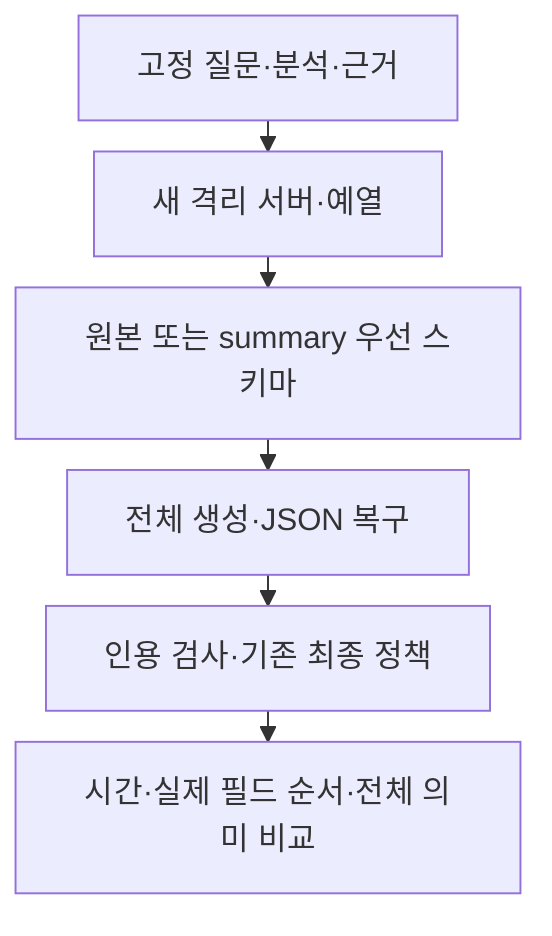

# 요약 필드 우선 생성 시험 결과 — 2026-10-12

> 보관 위치 변경 (2026-10-13): 시험용 worktree와 브랜치를 정리했다. 후보 코드와 실행 상태는 압축 보관했으며, 아래 측정 원자료는 유지했다. [정리 내역과 복원 방법](unsuccessful-experiments-cleanup-2026-10-13.md)을 참고한다.

## 1. 결론

JSON 스키마의 summary를 analysis보다 앞으로 옮기는 후보를 채택하지 않는다. 운영 코드와 설정은 변경하지 않았다.

입력 보존: **통과**. 실제 순서 반영: **통과**. 속도 기준: **실패**. 상대 품질 기준: **실패**.

고정된 검색·분석 이후 답변 생성과 기존 최종 정책이 끝날 때까지 측정했다. 검색을 포함한 전체 요청이나 브라우저 첫 표시 시간은 측정하지 않았다.

## 2. 조건과 변경

- qwen3:4b Q4_K_M, Ollama0.16.2, f16 KV, Flash Attention ON, 전체 GPU37/37, parallel1, num_batch512.
- temperature0.2, 컨텍스트12288, 출력2048, think false. 질문·참고 답변·검색/분석 스냅샷·근거5개·프롬프트·JSON 복구·인용 검사·최종 정책을 유지했다.
- 원본 스키마 순서는 legal_issues→analysis→summary→나머지 필드다. 후보는 summary→legal_issues→analysis→나머지 필드다. 첫 요청과 모든 후속 요청에 같은 변경을 적용했다.
- 8개 필드 정의·기본값·required를 유지했다. 기존 required는 analysis·summary·confidence3개다. 사용자 반환 답변은 기존 모델로 파싱·직렬화한다.
- 문항0·20·40·60·43·2, 제외 예열26. 원본→후보→후보→원본의 ABBA24회와 예열4회. 2차 문항은 역순이며, 쌍별 seed는 같다.

Ollama v0.16.2 [Completion 구현](https://github.com/ollama/ollama/blob/v0.16.2/llm/server.go)은 JSON 스키마를 grammar로 변환한다. 순서 변경이 실제 생성에 반영됐는지는 raw JSON에서 별도로 판정했다.

## 3. 시간·출력·호출

| 회차 | 조건 | 최종 처리 중앙값 | p90 | 첫 입력 평가 중앙값 | 디코딩 중앙값 | 출력 토큰 중앙값 | 실제 호출 |
|---|---|---:|---:|---:|---:|---:|---:|
| 1 | 원본 | 12.840초 | 21.592초 | 1.958초 | 55.57 tokens/s | 579.5 | 6 |
| 1 | 요약 우선 | 21.092초 | 53.318초 | 1.978초 | 54.16 tokens/s | 1002.5 | 7 |
| 2 | 원본 | 14.846초 | 54.067초 | 1.989초 | 54.64 tokens/s | 667.0 | 7 |
| 2 | 요약 우선 | 20.207초 | 57.250초 | 1.979초 | 54.15 tokens/s | 963.0 | 7 |

- 1차 중앙값 변화: **+64.27%**. 사전 속도 기준 **실패**.
- 2차 중앙값 변화: **+36.11%**. 사전 속도 기준 **실패**.

이번 시험에서는 입력 평가 시간이 양쪽 약 2초이고, 디코딩 속도도 약 54–56 tokens/s로 비슷했다. 후보의 문항별 총 출력 토큰 중앙값은 1차 579.5→1002.5, 2차 667→963으로 늘었다. 두 회차 모두 대북전단 문항에 인용 재생성이 추가됐다. 따라서 관찰된 지연 증가에는 더 많은 출력과 추가 호출이 함께 작용했다. 전체 생성·검사를 기다리는 현재 표시 정책에서 요약 순서를 앞당기는 것만으로 첫 답변 지연을 줄이지 못했다.

두 회차 모두 중앙값10% 이상 감소하고 p90·호출·전송 오류·거절·인용 재생성·제거가 늘지 않아야 한다. 6문항의 nearest-rank p90은 최댓값이다. 디코딩은 실제 호출별 eval_count/eval_duration 중앙값이며, 출력량은 복구·재생성까지 합친 문항별 토큰 수다.

| 회차 | 조건 | answer/rejected/error | 출력 상한 종료 호출 | 인용 재생성 문항 | 인용 제거 문항 |
|---|---|---|---:|---:|---:|
| 1 | 원본 | 6/0/0 | 0 | 0 | 0 |
| 1 | 요약 우선 | 6/0/0 | 0 | 1 | 0 |
| 2 | 원본 | 6/0/0 | 1 | 0 | 0 |
| 2 | 요약 우선 | 6/0/0 | 0 | 1 | 1 |

측정의 실제 호출은27회, 제외 예열의 실제 호출은6회다. 측정 시간에는 문항의 JSON 복구와 인용 재생성을 포함했다. 예열은 사전 규칙대로 모두 제외했다.

### 문항별 비교

| 회차 | 문항 | 원본 시간/호출 | 후보 시간/호출 |
|---|---:|---|---|
| 1 | 0 | 14.926초 / 1 | 24.433초 / 1 |
| 1 | 20 | 21.592초 / 1 | 17.750초 / 1 |
| 1 | 40 | 13.564초 / 1 | 17.198초 / 1 |
| 1 | 60 | 12.116초 / 1 | 28.326초 / 1 |
| 1 | 43 | 10.365초 / 1 | 9.300초 / 1 |
| 1 | 2 | 11.184초 / 1 | 53.318초 / 2 |
| 2 | 0 | 16.587초 / 1 | 21.664초 / 1 |
| 2 | 20 | 13.617초 / 1 | 15.870초 / 1 |
| 2 | 40 | 16.075초 / 1 | 18.750초 / 1 |
| 2 | 60 | 10.775초 / 1 | 26.939초 / 1 |
| 2 | 43 | 7.881초 / 1 | 9.901초 / 1 |
| 2 | 2 | 54.067초 / 2 | 57.250초 / 2 |

## 4. 실제 필드 순서와 입력

예열 포함 완료 후보 호출17개 중17개에서 summary가 analysis보다 먼저 나타났다. 불완전 후보 호출은1개다. 원본 완료 호출14개 중 summary가 analysis보다 먼저 나온 호출은0개다. 잘린 호출은 완료 순서의 통과 증거에 포함하지 않았다.

캐시의 prompt/used/remaining 로그를 예열 포함 실제 호출과 대조했다. prompt_eval_count에는 재사용 접두부가 포함되므로 count/duration을 새 입력 처리량으로 표시하지 않았다.

| 회차 | 조건 | 첫 호출 재사용 토큰 범위 | 첫 호출 새 평가 토큰 범위 | Ollama 보고 VRAM |
|---|---|---:|---:|---:|
| 1 | 원본 | 810–814 | 5025–5837 | 4525.2 MiB |
| 1 | 요약 우선 | 810–814 | 5025–5837 | 4525.2 MiB |
| 2 | 요약 우선 | 810–814 | 5023–5837 | 4525.2 MiB |
| 2 | 원본 | 810–814 | 5023–5837 | 4525.2 MiB |

모든 블록의 실제 commit 로그와 /api/ps에서 배치512·f16·Flash Attention·전체 GPU·컨텍스트12288을 확인했다. 입력 잘림과 context shifting은 관찰되지 않았다. 쌍별 첫 prompt count는 동일하고, 예열 포함 모든 보고된 prompt count+2048은 컨텍스트 이내였다. 내부 토큰 전체가 동일하다는 독립 증명은 아니다.

## 5. 전체 상대 품질 검토

전체 질문·참고 답변·근거가 직전 시험과 동일함을 사전 검사했다. 이번6문항의 제공 근거도 다시 읽었으며,12쌍의 최종8필드·완료 초안·검사를 새로 검토했다. 사유는 AI reviewed (Codex)로 기록하고 입력과 두 최종 답변의 해시로 연결했다.

결과: **pass 4, fail 7, uncertain 1**. 새 중요한 오류나 uncertain은 품질 통과를 막는다. pass는 제공 근거에 대한 상대 비교이며, 법률 전문가의 정확도 인증은 아니다. 자동 인용 검사 통과도 문장 의미의 정확성을 보장하지 않는다.

| 회차 | 문항 | 판정 | AI reviewed + 이유 |
|---|---:|---|---|
| 1 | 0 | fail | AI reviewed (Codex): 중심 인과관계 법리와 개별 업무·의학 증거 확인은 유지했습니다. 하지만 후보는 S1에 참조 번호로만 등장하는 87누625·87누81·90누1274까지 심근경색 발병 인정 사례로 구체화했습니다. 제공 조각은 이 사건90누3881의 심근경색 사실만 확인하므로 새로운 사례 사실 확장은 뒷받침되지 않습니다. S2의 원심84구1178을 대법원 사건으로 묶은 기준 답변의 기존 오류도 후보의 명시적인 인용에 남았습니다. 기존 판결 식별 오류와 새 사실 확장을 분리해 실패로 판정했습니다. |
| 1 | 20 | fail | AI reviewed (Codex): 핵심 summary의 허위 자료와 공정성 위험 조건은 유지했습니다. 그러나 후보 analysis는 S1의 취소 통보만 근거로 삼고 이후 단순 오기·공정성 위험 부정 판단을 누락해 취소의 정당성 사례처럼 제시했습니다. S2의 동종공사 자격 문제도 허위 실적 제출 사례로 묶었고 S5의 입찰참가 제한을 낙찰예정자 취소의 명문 근거로 바꿨습니다. 기준의 질문 반복 analysis와 당사자 주장 인용·담합 조사 제안은 기존 오류지만 후보의 새 사례 해석은 통과시킬 수 없습니다. |
| 1 | 40 | pass | AI reviewed (Codex): 제85조의 조사·징벌, 교육생 선정, 질병·신체조건의 세 가지 금지와 선정해서는 안 된다는 효과를 유지했습니다. 후보는 기준에 있던 일반 교도소 헌법소원 판례를 군수형자 재량으로 연결한 혼동을 줄였고 실제 상태 확인과 조문 인용을 추가했습니다. 새 질병 기준이나 예외를 만들지 않았습니다. 제84조의 일반 자격을 모두 풀어 설명하지 않은 것은 질문 범위상 새로운 중요한 손실로 보지 않은 상대 비교 통과입니다. |
| 1 | 60 | fail | AI reviewed (Codex): 귀책과 당사자 역할을 확인한다는 일반 조건은 유지했습니다. 그러나 후보는 S2의 원고 주장인 표시광고법 책임을 인정 결과로, S3의 배상 청구를 실제 배상 발생으로 바꿨습니다. S3의 법원 판단은 피고에게 협조의무만 있고 분양 수행 책임은 없다는 내용입니다. S4에는 없는 위약금 감액 필요성도 추가했고 공동불법행위 책임이 발생하는 경우가 많다는 빈도를 새로 단정했습니다. 기준의 추상적인 분석과 즉시 해제 행동 제안은 기존 한계지만 새 당사자 주장·판단 혼동 때문에 실패입니다. |
| 1 | 43 | pass | AI reviewed (Codex): 농장경영자·닭과 오리·매월·장관에게 신고라는 핵심 의무를 유지했고 제8조의2제2항을 정확하게 인용했습니다. 기준의 시행령 접수 근거 설명은 줄었지만 이 질문에 대한 주체·대상·주기·신고처·강행 효과는 모두 남았습니다. 세부 기한과 방법은 부령 확인 대상으로 두고 새로운 날짜나 신고 면제 예외를 만들지 않아 상대 보존 통과입니다. |
| 1 | 2 | uncertain | AI reviewed (Codex): 후보 최종 답변은 공적·사회적 역할과 해산으로 구성원의 활동을 막지 못한다는 S2 인용을 추가해 기준의 추상적인 설명을 보완했습니다. 다만 국민 위해 증명 부족을 남북관계발전법 제24조제1항제3호에 해당하지 않았다는 별도의 확정 판단으로 연결했습니다. 제공 근거는 위해가 증명됐다고 보기 어렵다는 판단이며 S1은 해당 조항의 위헌 효력 상실도 명시합니다. 기준에도 공익 침해 부정의 과도한 단정과 효력 상실 누락이 있어 상대 회귀 범위를 확정하지 못했습니다. 최초 완료 초안의 표현 방법 규제 단정은 최종에서 제거됐지만 최종의 새 법조 적용 설명 때문에 전체 보존 통과를 확정하지 않았습니다. |
| 2 | 2 | fail | AI reviewed (Codex): 후보는 직접·구체적 침해와 해산 제재의 긴요성 및 원심 파기를 설명했지만 기준 답변이 명시한 헌법제21조의 표현·결사의 자유와 헌법적 가치를 최종8필드에서 잃었습니다. 공적 역할 설명만으로 이 심사 기준을 대체할 수 없습니다. 인용 제거 후 남은 대법원2.2023두30833 식별도 제공 사건 번호와 다릅니다. 기준의 위해 조건 불충족 단정과 위헌 효력 상실 누락은 기존 오류로 분리했고, 후보 최초 초안의 방법 규제 혼동이 최종에서 줄어든 개선은 인정했습니다. 최종의 중요한 법리 손실 때문에 상대 보존 실패입니다. |
| 2 | 43 | pass | AI reviewed (Codex): 두 답변 모두 농장경영자·닭과 오리·매월·농림축산식품부장관에게 신고해야 한다는 핵심 의무를 유지했습니다. 후보는 질문 반복 analysis를 조문 설명으로 바꾸고 제8조의2제2항과 정확한 원문 인용을 추가했습니다. 기한·방법·필수 항목은 추가 확인 대상으로 남겼고 근거 없는 날짜나 신고 생략 조건을 만들지 않아 전체 필드의 상대 보존 통과입니다. |
| 2 | 60 | fail | AI reviewed (Codex): 후보는 S2의 원고 주장인 표시광고법 책임을 법원이 적용한 결과로 바꾸고 S3·S4에 없는 위약금 과도성 판단을 연결했습니다. S5의 특정 사건에서10%가 과도하지 않다는 결론을 일반적인 계약 위약금 결론으로 summary에 제시했고 기준의 귀책·구체 사정에 따른 판단도 약해졌습니다. 기준에도 근거 없는 책임 발생 빈도와 추상적인 분석이 있지만 새 주장·판단 혼동과 사례 범위 확대 때문에 실패입니다. |
| 2 | 40 | pass | AI reviewed (Codex): 제85조의 세 가지 선정 금지와 강행 효과를 모두 유지하고 기준이 확인 대상으로 둔 현재 상태·구체적 질병 기준도 남겼습니다. 후보는 일반 수형자 헌법소원 사례를 군수형자에게 연결한 기준의 혼동을 줄였고 정확한 제85조 인용을 추가했습니다. 세부 기준이 제공되지 않았다는 점을 명시했으며 새로운 예외나 별도 기준을 만들어내지 않아 상대 보존 통과입니다. |
| 2 | 20 | fail | AI reviewed (Codex): 원본의 허위 자료·공정성 위험이라는 핵심 조건은 남겼고 즉시 입찰참가 제한과 담합 신고의 과도한 행동 제안을 줄였습니다. 그러나 후보 analysis는 S1의 취소 통보를 공정성 침해 사례의 확인 근거로 반복하면서 뒤의 단순 오기·침해 우려 부정 판단을 빠뜨렸습니다. S2의 동종공사 실적 자격 문제도 잘못 신고한 허위 실적 사례로 설명했습니다. 원본의 질문 반복과 공정성 중복 표현은 기존 한계지만 후보가 새로 추가한 사례 해석이 제공 근거와 달라 실패입니다. |
| 2 | 0 | fail | AI reviewed (Codex): 과로가 기존 질병을 유발·악화한 경우의 인과관계 법리와 의학·업무 증거 확인은 유지했습니다. 하지만 후보는 S1과 S2를 함께 경찰관의 심근경색 사망 인정 사례로 설명했습니다. S2는 인쇄7급공무원의 급성심부전 사망에 업무 인과관계 증거가 없어 청구를 배척한 사례입니다. 기준의 원심84구1178을 대법원 판례로 묶은 식별 오류는 기존 문제로 분리했지만 이 새로운 사실·결론 뒤바꿈은 중요한 회귀입니다. S3의 개인적 요인과 S5의 뇌출혈 구분을 추가한 개선은 인정해도 전체 품질 통과는 불가합니다. |

첫 raw 출력이 같은 쌍은0/12, 최종 답변 전체가 같은 쌍은0/12다. 같은 가중치와 seed여도 스키마 순서가 바뀌면 출력과 호출 수가 달라질 수 있다.

## 6. 검증과 보존

- 모든 실제 요청의 직렬화 순서·seed·파서·스키마·완료 초안·검사·기존 최종 정책을 새로 재생했다. dict 내용 비교에 더해 직렬화 비교를 사용해 속성 순서도 검사했다.
- 회귀 시험은 새로 실행하지 않았다. 기존630 passed/3 skipped 증거를 현재 root/worktree의 byte 동일 소스·설정·시험248파일에 연결해 재사용했다. 런타임 측정과 정책 재생은 이번 새 증거다.
- 최종 감사에서 root 기준437파일, 이전 실행 상태13개, 외부 모델·키·실행 파일9개의 보존을 확인했다. root에는 결과·설계·계획3문서만 추가했다. stage·commit은 하지 않았다.
- 소유 서버4개와 전용 모델은 포트11435에서 실행·종료했다. 원본 블롭은 읽기 전용으로 참조했다. 다운로드·prune을 수행하지 않았다. 운영11434 모델 목록은 측정 전후 비어 있었다.
- 첫 sandbox 실행은 localhost 조회에서 차단되어 서버 실행·측정 전에 끝났다. 같은 고정 명령을 승인된 실행으로 재시도했다. 이 실패는 측정값에 포함하지 않았다.

## 7. 제한과 판단

개발 문항6개와 두 반복으로 제품의 지연 분포를 추정할 수 없다. 독립 holdout과 인간 전문가 검토도 없다. 출력량과 복구 호출이 달라져 디코딩 시간 변화만으로 엔진 처리량 향상을 주장하지 않는다.

입력·실제 순서·속도·상대 품질 기준을 함께 적용한다. 운영 코드와 검증 정책은 유지한다.

## 증거

- [설계](../superpowers/specs/2026-10-12-summary-first-design.md), [계획](../superpowers/plans/2026-10-12-summary-first.md)
- [지표](../../data/eval/reports/chat_pipeline/summary-first-2026-10-12/metrics.json)
- [측정 원본](../../data/eval/reports/chat_pipeline/summary-first-2026-10-12/results.jsonl)
- [제외 예열](../../data/eval/reports/chat_pipeline/summary-first-2026-10-12/warmup.jsonl)
- [필드 순서 확인](../../data/eval/reports/chat_pipeline/summary-first-2026-10-12/ordering.json)
- [전체 검토](../../data/eval/reports/chat_pipeline/summary-first-2026-10-12/review.jsonl)
- [판정](../../data/eval/reports/chat_pipeline/summary-first-2026-10-12/quality.json)
- [정책 재생](../../data/eval/reports/chat_pipeline/summary-first-2026-10-12/measurement-verification.json)
- [캐시 대조](../../data/eval/reports/chat_pipeline/summary-first-2026-10-12/cache-usage.json)
- [회귀 바인딩](../../data/eval/reports/chat_pipeline/summary-first-2026-10-12/regression.json)
- [실제 엔진](../../data/eval/reports/chat_pipeline/summary-first-2026-10-12/engine-confirmations.jsonl)
- [서버 종료](../../data/eval/reports/chat_pipeline/summary-first-2026-10-12/lifecycle.jsonl)
- [최종 감사](../../data/eval/reports/chat_pipeline/summary-first-2026-10-12/final-audit.json)
