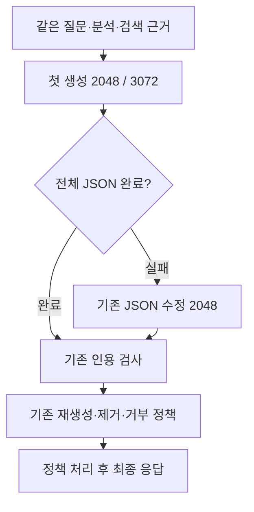

# 긴 응답의 재호출 원인과 첫 생성 한도 비교

> 보관 위치 변경 (2026-10-13): 시험용 worktree와 브랜치를 정리했다. 후보 코드와 실행 상태는 압축 보관했으며, 아래 측정 원자료는 유지했다. [정리 내역과 복원 방법](unsuccessful-experiments-cleanup-2026-10-13.md)을 참고한다.

기록일: 2026-10-11. 결정: **첫 생성 3,072토큰 후보를 서비스에 적용하지 않는다.**

재호출 원인을 다시 분류하고, 첫 생성의 출력 예산만 늘리는 후보를 시험했다. 실제 호출은 두 회차 모두 5회에서 4회로 줄었지만 속도 개선은 반복되지 않았다. 전체 내용 검토도 통과하지 못했다. 이번 작업은 원인 분석과 후보 시험을 완료한 것이며, 사용자의 대기 시간을 해결한 결과는 아니다.

## 1. 원인 확인

기존 full 80턴과 answer-recovery의 4설정 × 80턴을 다시 읽어 호출·종료·검사 기록을 분류했다. 같은 frozen 질문을 여러 설정에서 실행한 기록이다. 서로 독립된 400문항 평가로 합산하지 않는다.

| 기존 실행군 | 여러 호출 턴 | length 종료 호출 | 인용 재생성 턴 |
| --- | ---: | ---: | ---: |
| verified-latency full | 6 / 80 | 5 | 2 |
| answer-recovery baseline | 5 / 80 | 2 | 3 |
| answer-recovery guard | 1 / 80 | 1 | 0 |
| answer-recovery recovery | 3 / 80 | 3 | 1 |
| answer-recovery combined | 6 / 80 | 3 | 3 |

잘림과 인용 재생성은 같은 턴에서 생길 수 있다. 표의 열을 더해 전체 턴 수로 해석하지 않는다.

answer-recovery에 전체 raw가 있는 구조화 실패 **9개 호출**을 현재 LegalAnswer schema로 다시 검사했다. 모두 `json_invalid`, `length`, 출력 2,048토큰이었다. [이전 전체 원문 검토](answer-recovery-latency-2026-10-10.md)에서는 analysis·uncertainty 반복과 긴 직접 인용이 예산을 사용했다. 이번에 그 이전 의미 검토를 새로 수행한 것으로 표현하지 않는다. 단순히 닫는 괄호를 추가하면 미완성 내용의 완료를 임의로 선언하므로 후보로 삼지 않았다.

인용 재생성의 첫 완성 초안은 현재 backfill·Verifier로도 다시 확인했다. 예를 들어 기준 문항43의 `제12조의2`, 문항44의 `제15조의1`, 문항67의 `제31조의2`가 여전히 제공 근거 부재로 검사됐다. 다른 실행군에는 올바른 번호를 다른 source에 연결한 사례도 있었다. 현재 검사를 유지한다.

문항43의 일부 본문에는 `제12조의 2항`이라는 비표준 표기가 있다. 현 검사에서는 파생 조문 `제12조의2`로 읽힌다. 이를 곧바로 안전한 형식 오탐으로 분류하지 않았다. 부분 S2에는 그 문장이 주장하는 항 번호를 확인할 전체 문맥이 없으며, 표기를 바꿔 통과시키는 기능은 이번 시험에 넣지 않았다.

## 2. 선택한 후보

첫 실제 답변 생성만 **2,048 → 3,072토큰**으로 바꾼다. 후속 JSON 수정과 인용 재생성은 양쪽 모두 기존 2,048토큰이다. 프롬프트·모델·근거·전체 schema·검사·재시도·표시 경계는 같다. 설정 한도를 늘리는 것은 실제 출력을 그 길이로 강제하는 것과 다르다.

복구 문구 변경과 답변 길이 지시는 이전 시험에서 실패했다. 이번에는 다시 섞지 않았다. 잘린 JSON을 이어 생성하거나 응답 필드를 줄이는 기능도 추가하지 않았다.

## 3. 실행 조건

| 항목 | 조건 |
| --- | --- |
| 표본 | 기존 frozen 문항 `[2,26,75,43]` |
| 선정 이유 | 이전 JSON 잘림 3문항과 인용 재생성 1문항 |
| 측정 | 4문항 × 2방식 × 2회차 = 16턴 |
| 준비 실행 | 사전 지정 4턴, 모두 집계 제외 |
| 실제 모델 호출 | 측정 18회, 준비 7회 |
| 코드 | 현재 root의 미커밋 변경까지 복제한 격리 worktree |
| 기준 설정 | 이전 frozen 기준, full 스타일·JSON 수정 1회·인용 재생성 1회 |
| 모델 | qwen3:4b, 4.0B, Q4_K_M, Ollama 0.16.2 |
| 생성 | temperature 0.2, context 12,288, think=false |
| 순서 | 쌍별 선후를 번갈아 배치하고 2회차에서 역순 |
| seed | 쌍 안에서 동일, 회차별 변경. 후속 호출은 호출 순번에 따라 변경 |

모델 digest는 `359d7dd4bcdab3d86b87d73ac27966f4dbb9f5efdfcc75d34a8764a09474fae7`이다. 입력·전체 생성 소스·첫 요청·실행기·판정 기준을 추론 전에 해시로 고정했다. 첫 요청은 `num_predict` 하나만 다르다. 후속 요청 한도도 전부 확인했다.

기존 GPU lock 아래 순차 실행했다. 서비스 재시작이나 강제 unload는 하지 않았다. GPU layer 배치와 Flash Attention 활성 여부는 이번에 새로 확인하지 않았다. 작은 진단 표본이므로 일반 질문의 성능으로 확대하지 않는다.

분석과 검색은 고정 기록을 사용한다. 시간은 그 뒤 생성·JSON 수정·인용 검사·재생성·최종 정책 처리를 포함한다. **웹 전체 첫 답변 지연이나 TTFT가 아니다.** Ollama가 반환하는 종료 사유와 출력 토큰·생성 시간은 [공식 chat API 응답 항목](https://docs.ollama.com/api/chat)을 사용했다.

## 4. 속도와 호출

단위는 초다. 각 군은 4턴이며 p90은 nearest-rank 방식의 최댓값이다. 실패·거부를 제외하지 않았다.

| 회차 | 방식 | 중앙값 | p90 | 실제 호출 | length | 인용 재생성 | 인용 제거 |
| --- | --- | ---: | ---: | ---: | ---: | ---: | ---: |
| 1 | 기준 2048 | 18.16 | 31.94 | 5 | 0 | 1 | 1 |
| 1 | 첫 생성 3072 | 19.83 | 54.34 | 4 | 0 | 0 | 0 |
| 2 | 기준 2048 | 19.73 | 54.39 | 5 | 1 | 0 | 0 |
| 2 | 첫 생성 3072 | 11.35 | 32.29 | 4 | 0 | 0 | 0 |

측정 16턴은 모두 최종 답변을 반환했다. 오류·거부는 0건이다. 두 회차 모두 중앙값 10% 이상 감소, p90·호출·거부·오류 비증가라는 기준을 정했다. **1회차는 중앙값 9.18% 증가와 p90 증가로 실패, 2회차는 42.47% 감소로 속도 신호 통과**다. 두 회차 모두 통과해야 하므로 최종 속도 기준은 실패다.

### 달라진 두 사례

| 회차·문항 | 기준 시간·호출 | 후보 시간·호출 | 첫 출력 토큰: 기준 → 후보 |
| --- | --- | --- | ---: |
| 1·문항2 | 12.21초·1회 | 54.34초·1회 | 645 → 2,820 |
| 2·문항2 | 54.39초·2회 | 10.21초·1회 | 2,048 → 537 |
| 1·문항43 | 24.11초·2회 | 8.59초·1회 | 512 → 330 |
| 2·문항43 | 11.60초·1회 | 12.49초·1회 | 498 → 642 |

문항2는 1회차에서 재호출 없이도 후보가 54초를 사용했다. 긴 근거 재인용과 설명이 출력 예산을 사용했다. 2회차에서는 기준의 첫 JSON이 잘리고 수정 호출이 이어졌으나, 후보는 짧게 끝났다. 문항43의 1회차 기준은 인용 재생성 후에도 문제가 남아 기존 제거 정책을 거쳤다.

### 효과를 분리할 수 없는 부분

**8쌍 모두 첫 출력 본문이 2,048토큰 전에 달랐다.** 후보가 기준의 동일 raw 접두부를 그대로 이어 완성한 쌍은 0개였다. 특히 2회차 문항2의 후보는 537토큰으로 끝났고 기준과 첫 108문자 뒤부터 달랐다. 따라서 같은 잘린 출력에 예산을 더 주어 JSON을 완성했다는 효과로 해석할 수 없다.

paired seed가 있어도 동일 본문을 보장하지 않았다. 출력 길이·인용 선택이 함께 달라졌다. 속도·내용 차이를 모두 출력 한도만의 효과로 귀속하지 않는다. 결과를 보고 추가 seed를 골라 재실행하지 않았다.

준비 실행에서도 1회차는 기준 2,048·후보 3,072에서 각각 첫 출력이 잘렸고, 둘 다 JSON 수정이 필요했다. 2회차 기준은 두 호출 모두 잘려 거부했고 후보는 2,289토큰으로 완료했다. 준비 실행은 사전 규칙대로 전부 제외했다. 유리한 준비 결과를 측정 집계에 넣지 않았다.

## 5. 전체 내용 검토

검토자: **AI reviewed (Codex)**. 8쌍 모두 질문·참고 답변·제공된 다섯 근거의 전체 Text·양쪽 최종 8필드·완성 초안의 차이를 대조했다. Text는 모델에 제공된 1,500자 한도 근거다. 원본 문서 전체를 모델이나 검토에 추가했다고 표현하지 않는다. 같은 필드는 다시 복제하지 않고 차이가 있는 초안 필드를 읽었다. raw 잘림은 완성 답변으로 취급하지 않았다.

| 판정 | 쌍 수 | 의미 |
| --- | ---: | --- |
| pass | 3 | 새 중요한 회귀를 확인하지 못한 상대 보존 |
| fail | 4 | 후보 출력의 새 오류 또는 조건과 요약의 충돌 확인 |
| uncertain | 1 | 제공 자료로 새 절차 일반화의 타당성·영향을 확정하지 못함 |

pass는 기준부터 있던 오류가 해결됐다는 뜻이 아니다. 예를 들어 손해액 입증 문항은 양쪽 모두 일반적인 입증 요건보다 예외적 손해액 산정에 치우쳤다. 이 공유 불완전성을 후보의 새 오류로 세지 않았다.

| 사례 | 구체적 검토 사유 |
| --- | --- |
| 문항2·1회차 | 후보가 처분 정당화에 관한 S5 문맥을 북한이 군사 도발을 방지하기 위한 조치로 설명하고 S4에도 잘못 연결했다. 표현의 자유 보호와 행위 자체의 자유 침해 여부도 혼동했다. |
| 문항2·2회차 | 후보가 취소 처분이 비례·과잉금지 원칙을 위반하지 않았다는 하급심 취지의 설명을 전단 행위가 공익 침해가 아닌 이유로 사용했다. S2의 원심 파기와 판단 역할을 구분해야 한다. |
| 문항75·1회차 | 이사회 책임을 추가하며 바로 뒤의 반대 의사 표시 예외를 빠뜨렸다. S4에 나열된 손해배상 제한 요소가 명시돼 있지 않다고 설명했다. |
| 문항75·2회차 | 분석에는 고의·중과실 조건이 있지만 요약은 그 조건 없이 연대 책임을 단정했다. 조건이 전체 답변에서 사라졌다고 기록하지 않았다. S4의 2004년 판결을 사건번호 연도인 2002년 판결로 설명한 오류도 있었다. |
| 문항43·2회차 | 매월 특정일까지가 일반적이라는 설명을 추가했다. 구체적 기한을 정하는 부령이 없어 이 일반화의 영향을 확정하지 못해 uncertain이다. |

새마을금고 문항은 기준부터 신용협동조합법을 해당 기관에 직접 적용하는 문제와 일부 임원 구분 누락이 있었다. 이를 후보에서 새로 생긴 오류로 세지 않았다. 참고 답변의 새마을금고법 조문은 제공 근거에 없어 억지로 답변에 넣지 않았다.

모든 답변은 기존 인용 검사와 최종 정책을 거쳤다. 자동 검사 통과는 조건·예외·판단 역할까지 정확하다는 뜻이 아니다. 이번 AI 검토도 전문가의 법률 정확성 인증은 아니다. 첫 본문이 예산 전에 달라진 점 때문에 새 의미 오류를 출력 한도 변경의 단독 인과 효과로 단정하지 않는다. **관찰된 설정 비교의 품질 기준은 실패다.**

## 6. 판정과 검증

| 항목 | 결과 |
| --- | --- |
| 두 회차 속도 기준 | 실패 |
| 전체 의미 보존 기준 | 실패 |
| 첫 payload 차이 | num_predict 하나만 변경 |
| 후속 호출 출력 한도 | 모두 2,048 유지 |
| 측정·준비 실행의 전체 payload·seed·순서 | 통과 |
| 원본 근거로 기존 최종 정책을 offline 재실행 | 20턴 모두 기록과 일치 |
| 기준 backend 테스트 | 630 passed, 3 skipped, 4 warnings |
| 서비스 적용 | 하지 않음 |

backend 테스트는 샌드박스에서 같은 위치에 진행이 멈춰 중단한 뒤, 로컬 통신이 가능한 환경에서 완료했다. 중단 실행을 통과로 세지 않았다. 모델 실행도 샌드박스의 Python 로컬 연결 차단 뒤 승인된 환경에서 수행했다. baseline 코드 이후 서비스 구현을 바꾸지 않았으므로 같은 전체 테스트를 다시 실행하지 않았다. 새 웹 측정·웹 테스트는 이번 범위에 없다.

원인별로 후속 접근을 분리해야 한다. 반복으로 잘린 JSON에는 출력 예산 확장만으로 해결된다는 근거가 부족하다. 근거에 없는 번호와 source 연결 오류에는 현재 검사 유지가 필요하다. 이 결과가 하드웨어·모델의 추론 성능 한계에 도달했다는 뜻은 아니다.

## 7. 재현 자료와 보존

- [사전 설계](superpowers/specs/2026-10-11-first-pass-budget-design.md), [실행 계획](superpowers/plans/2026-10-11-first-pass-budget.md)
- [기준 상태](../data/eval/reports/chat_pipeline/first-pass-budget-2026-10-11/baseline.json), [원인 분류](../data/eval/reports/chat_pipeline/first-pass-budget-2026-10-11/diagnosis.json)
- [사전 판정 규칙](../data/eval/reports/chat_pipeline/first-pass-budget-2026-10-11/pilot-PREREG.json), [고정 manifest](../data/eval/reports/chat_pipeline/first-pass-budget-2026-10-11/pilot-manifest.json), [실행 환경](../data/eval/reports/chat_pipeline/first-pass-budget-2026-10-11/pilot-runtime.json)
- [16턴 기록](../data/eval/reports/chat_pipeline/first-pass-budget-2026-10-11/pilot-results.jsonl), [준비 4턴](../data/eval/reports/chat_pipeline/first-pass-budget-2026-10-11/pilot-warmup.jsonl), [지표](../data/eval/reports/chat_pipeline/first-pass-budget-2026-10-11/pilot-metrics.json)
- [8쌍의 AI 검토 사유](../data/eval/reports/chat_pipeline/first-pass-budget-2026-10-11/review.jsonl), [첫 본문 비교](../data/eval/reports/chat_pipeline/first-pass-budget-2026-10-11/first-output-comparison.json), [최종 판정](../data/eval/reports/chat_pipeline/first-pass-budget-2026-10-11/quality.json)
- [요청·정책 재실행 확인](../data/eval/reports/chat_pipeline/first-pass-budget-2026-10-11/measurement-verification.json), [보존 감사](../data/eval/reports/chat_pipeline/first-pass-budget-2026-10-11/final-audit.json)

원문·payload는 private 실험 폴더에 보관한다. root의 기준 파일 422개, 이전 실행 상태 8개와 HEAD·stage를 보존한다. 격리 worktree는 `.worktrees/first-pass-budget`이다. root에는 결과·설계·계획 문서만 추가한다. 서비스 코드·설정·응답 계약은 변경하지 않으며 commit하지 않는다.
