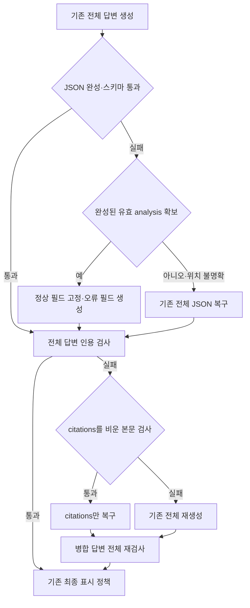

# 실패 필드만 복구하는 후보 시험

> 보관 위치 변경 (2026-10-13): 시험용 worktree와 브랜치를 정리했다. 후보 코드와 실행 상태는 압축 보관했으며, 아래 측정 원자료는 유지했다. [정리 내역과 복원 방법](unsuccessful-experiments-cleanup-2026-10-13.md)을 참고한다.

## 1. 결과

**구현과 비교 시험을 완료했다. 현재 후보는 운영에 적용하지 않는다.**

부분 복구는 완성된 필드를 정확히 보존했다. 그러나 스키마상 유효한 분석에도 의미 오류가 있었다. 이를 고정하면 전체 재작성에서 사라졌을 오류가 최종 답변에 남을 수 있다. 전체 속도와 내용 품질 기준도 통과하지 못했다.

코드는 `.worktrees/partial-repair`, 브랜치는 `perf/partial-repair`에 보관한다. 기본값 `field_repair=False`를 유지한다. 이전 핵심·상세 우선 표시 후보와 결합하지 않았다. 운영 활성화, 스테이징, 커밋은 하지 않았다.

## 2. 구현한 복구 경로

- JSON 문자열·배열·객체를 임의로 닫지 않는다. 맨 앞부터 완전히 끝난 최상위 값만 읽는다.
- 중복 키, 알 수 없는 키, 잘못된 구분자, 객체 외 출력은 기존 전체 복구로 보낸다.
- 필드별 타입 검증을 통과한 값은 고정한다. 누락·오류 필드만 필수인 동적 `FieldPatch` 스키마를 만든다. 다른 키는 금지한다.
- patch를 정확히 병합한 뒤 전체 `LegalAnswer`를 검증한다. 인용은 기존 backfill·검사·재생성·strip·reject 정책을 거친다.
- 인용 목록을 비워도 본문 검사에 실패하면 인용 배열만 고치지 않는다. 기존 전체 재생성을 사용한다.
- 기존 JSON 2호출·검증 재생성 1회 상한을 늘리지 않는다. 부분 복구가 실패했다고 추가 전체 복구를 더 호출하지 않는다.
- 정상 첫 요청은 기존 방식과 같다. 부분 필드나 미완성 초안은 표시하지 않는다. 고정 필드는 요청 지역 변수에만 둔다.

여기서 **정상 필드**는 스키마상 유효한 값이다. 사실·법률 의미까지 확인된 값이라는 뜻은 아니다.

## 3. 비교 조건과 범위

같은 최초 실패를 주입해 후속 복구를 비교했다. 이전 fixed-failure의 JSON 실패 8건 전부와 baseline 최초 인용 실패 3건을 사용했다. 합계는 **11개 실패 기록, 고유 질문 9개**다. 동일 질문의 다른 실패 기록도 포함한다.

두 방식·두 회차로 **44턴**을 측정했다. 예열 4턴은 제외했다. 실제 추론은 **측정 48호출 + 예열 6호출 = 54호출**이다. 기록된 최초 응답을 주입한 48회는 실제 추론 호출로 세지 않는다.

| 항목 | 고정 조건 |
|---|---|
| 순서 | 기존 → 부분 복구 → 부분 복구 → 기존, 2회차 질문 역순 |
| 입력 | 질문·분석·검색 근거·기록된 최초 응답·이력·최초 메시지 동일 |
| 모델 | qwen3:4b, Q4_K_M, Ollama 0.16.2 |
| 생성 | context 12,288, 출력 상한 2,048, temperature 0.2, think OFF |
| 엔진 | batch 512, f16 KV, Flash Attention, GPU 37/37, parallel 1 |
| 실행 | GPU lock 아래 11435 포트의 소유 서버 4개, 블록별 운영 모델 비어 있음 확인 |

두 방식의 최초 메시지는 해당 과거 실패의 프롬프트를 그대로 사용한다. 과거 다른 후보의 지시도 기록대로 포함한다. 새 정상 경로 자체는 별도 무추론 검사에서 이전 original의 **7개 최초 payload와 정확히 같음**을 확인했다. JSON 8건의 기존 복구 지시도 이전 legacy와 같다.

**측정 시간은 최초 실패 이후 생성·검사·정책 처리 시간이다.** 최초 생성, 실제 검색, Flask/SSE, 브라우저 대기를 포함하지 않는다. 전체 사용자 첫 답변 시간을 줄였다는 결과로 해석하면 안 된다.

## 4. 시간과 완료율

단위는 초다. 중앙값과 nearest-rank p90은 거절 턴도 포함한다. 11턴의 p90은 정렬한 10번째 값이다.

| 회차·방식 | 후속 전체 중앙값 | p90 | 완료 / 거절 / 오류 | 실제 호출 | 출력 토큰 중앙값 |
|---|---:|---:|---|---:|---:|
| 1회 기존 | 17.63 | 20.58 | 11 / 0 / 0 | 12 | 797 |
| 1회 부분 복구 | 17.46 | 37.69 | 10 / 1 / 0 | 12 | 797 |
| 2회 기존 | 17.92 | 41.31 | 9 / 2 / 0 | 12 | 807 |
| 2회 부분 복구 | 19.61 | 39.36 | 10 / 1 / 0 | 12 | 807 |

중앙값 변화는 **1회 -0.96%, 2회 +9.41%**다. 사전 기준인 두 회차 모두 10% 이상 감소와 p90 비증가를 충족하지 못했다. 1회는 완료율도 낮아졌다. 2회의 완료율 개선만으로 채택하지 않는다.

JSON 실패 8건만 따로 보면 중앙값은 **1회 17.64→18.88초, 2회 22.70→22.42초**다. 해당 그룹의 총 출력 토큰 중앙값은 **795.5→787, 1,062→861.5**였다. 출력 감소 사례가 있었지만 전체 복구 시간 감소로 안정적으로 이어지지 않았다. 실제 후속 호출 수도 전체 비교에서 줄지 않았다.

| 사례 | 확인한 결과 |
|---|---|
| `combined-1` | 일부 필드만 생성해 15.18→10.61초, 15.89→9.46초로 단축했다. 그러나 1회는 신고 후 서류 준비라는 새 절차 오류가 있었고, 2회도 법명·제출 기관 연결의 정확성을 확정하지 못했다. |
| `combined-75`, 2회 | uncertainty만 생성해 12.45초에 완료했다. 기존은 42.61초에 JSON 거절됐다. 후보 답변에는 초기 분석의 주체·판례 오류가 남았다. |
| `baseline-26` | 두 회차 모두 부분 JSON 복구 뒤 citations 재복구를 호출했다. S4 인용 불일치가 남아 strip됐다. 37.69초·39.36초가 걸렸다. |
| `recovery-15` | 두 필드만 요청했지만 긴 인용과 분석 반복으로 출력 상한에서 잘렸다. 45.79초·45.21초 뒤 거절했고 미완성 초안은 표시하지 않았다. |
| 최초 인용 실패 3건 | 본문도 검사에 실패해 모두 전체 재생성으로 돌아갔다. 같은 회차의 기존·후보 완료 초안과 최종 8필드가 정확히 같았다. |

## 5. 내용 검토

검토자는 **AI reviewed (Codex)**다. 22쌍의 제공 근거 전체, 최초 실패 본문, 기존·후보 최종 답변, 완료 초안, 고정·대상·병합 필드, 전체 검사, 미완성 출력을 읽었다. 대상 해시와 판정 사유를 저장했다.

| 판정 | 쌍 수 |
|---|---:|
| pass | 6 |
| fail | 15 |
| uncertain | 1 |

pass 6쌍은 **같은 답변을 만든 전체 재생성 fallback**이다. 실제 부분 복구를 사용한 16쌍은 fail 15쌍과 uncertain 1쌍이다. fail에는 후보 미제공, 기존 미제공으로 비교가 제한된 상태에서 후보에 확인된 출처 오류도 포함한다. 15쌍 모두 새로 생성한 필드에 오류가 있었다는 뜻은 아니다.

주요 문제는 다음과 같다.

- 초기 분석에 있던 ‘담합이 없으면 손해배상 불가능’ 단정을 보존했다. 제공 자료의 별도 계약 체결 신뢰 법리를 배제했다.
- 법원의 판단과 원고의 청구 주장을 혼동한 문장을 고정했다. 새 인용도 이를 반복했다.
- 이사회 출석 임원의 책임을 설명하면서 반대 의사 표시 예외를 생략했다.
- 자료가 인용한 대법원 사건을 해당 자료의 하급심 법원 사건으로 표시했다.
- 실제 제15조의 부당이득 환수 문장을 제11조 reference와 연결했다. 현재 인용 검사는 이런 quote·조문 연결 오류를 모두 검출하지 못한다.

기존 답변에도 법률·역할 혼용, 조건 누락, 면제 근거 반전이 있었다. 기존 방식과 동일하다는 판정은 법률 정확성을 인증하지 않는다. 원문 대조는 제공된 코퍼스 범위이며, 현재 법률 유효성 확인이나 독립적인 사람의 검증을 대신하지 않는다.

## 6. 계약·회귀·실행 기록

- 기능 부재 RED 17건을 기록한 뒤 부분 복구·fallback·엄격 병합·호출 상한·자료 전달·요청 격리 계약 **19개가 통과**했다.
- 동일 소스의 새 backend 회귀는 **649 passed, 3 skipped**다.
- 기존 표시 경계 웹 테스트 4개 파일은 독립 `/tmp/core-first-web` 환경에서 **54 passed, 7 subtests passed**였다. 웹 전체 suite 통과로 표현하지 않는다. 운영 모델 호출은 차단했다.
- 샌드박스의 최초 전체 회귀는 API health에서 진행이 멈췄다. 단일 health 시험도 12초 제한을 넘었고, traceback은 Starlette TestClient가 AnyIO blocking portal의 응답을 기다리는 위치를 가리켰다. 소유 검사만 중단하고 미완료 로그를 보존했다. 동일 소스의 샌드박스 밖 전체 회귀는 통과했다. 환경 차이는 확인했지만 더 낮은 수준의 원인은 확정하지 않았다.
- 54개 실제 요청·동적 스키마·파싱·병합·고정 필드·전체 검사·정책·최종 답변을 기록에서 새로 재생했다. 캐시 로그도 54호출과 대응했다.
- 예열을 포함한 모든 호출의 입력 토큰+출력 상한 최댓값은 **10,879**였다. 문맥 12,288을 넘지 않았고 입력 절단·문맥 이동도 없었다.
- 소유 서버 4개를 종료했다. 운영 모델은 수동 해제·재시작하지 않았다. root443파일·이전15상태·외부9파일은 기준 해시로 보존한다.

## 7. 결정과 남은 작업

입력 보존과 구현 계약은 통과했다. 속도·내용 품질 기준은 실패했다. 후보 기본값을 켜지 않는다.

필드별 오류 위치, patch 스키마, 정확한 병합과 전체 재검사 기반은 확보했다. **부분 JSON의 분석을 보존할지 결정하는 의미 검증**은 이번 구현에 없다. 다음 후보를 설계할 때 이 경계를 먼저 다뤄야 한다. 인용 reference와 quote의 법리 연결 검증도 별도 작업으로 남긴다.

## 8. 근거 파일

[설계](superpowers/specs/2026-10-12-partial-repair-design.md) · [계획](superpowers/plans/2026-10-12-partial-repair.md)

[고정 조건](../data/eval/reports/chat_pipeline/partial-repair-2026-10-12/PREREG.json) · [manifest](../data/eval/reports/chat_pipeline/partial-repair-2026-10-12/manifest.json) · [전체 시간·호출](../data/eval/reports/chat_pipeline/partial-repair-2026-10-12/metrics.json)

[22쌍 검토](../data/eval/reports/chat_pipeline/partial-repair-2026-10-12/review.jsonl) · [품질 결정](../data/eval/reports/chat_pipeline/partial-repair-2026-10-12/quality.json) · [요청·정책 재생](../data/eval/reports/chat_pipeline/partial-repair-2026-10-12/replay.json) · [캐시 대응](../data/eval/reports/chat_pipeline/partial-repair-2026-10-12/cache-usage.json)

[새 회귀](../data/eval/reports/chat_pipeline/partial-repair-2026-10-12/regression.json) · [샌드박스 미완료 기록](../data/eval/reports/chat_pipeline/partial-repair-2026-10-12/sandbox-check.json) · [최종 보존 감사](../data/eval/reports/chat_pipeline/partial-repair-2026-10-12/final-audit.json)
