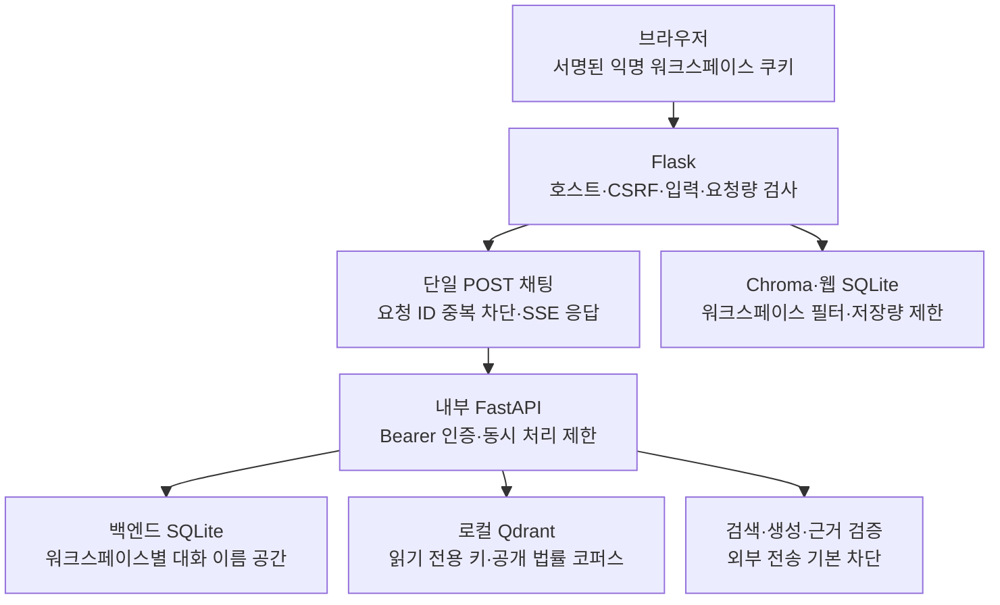
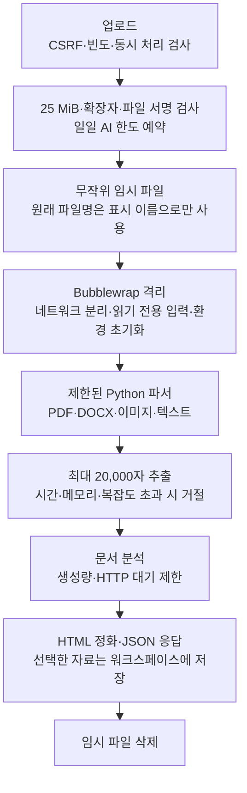

# 보안 설계와 적용 기록

작성일: 2026-10-07. 기준 커밋: `d13bb85`.

## 1. 적용 범위

[보안 점검 보고서](security-review-2026-10-07.md)의 S01–S15에 대한 코드와 설정을 수정했다.
기존 데이터와 실제 `.env`는 수정하지 않았다. 서버와 Qdrant는 재시작하지 않았다.

**현재 상태는 구현 반영이다. 운영 적용과 동작 검증은 남아 있다.**
구문 검사와 변경 범위 검사만 수행했다. 회귀 테스트, 브라우저 실행, 악성 파일 실행, 실제 Qdrant 인증 확인은 수행하지 않았다.

## 2. 요청 경계

### 식별과 인증

1. Flask는 서명된 쿠키에서 워크스페이스 ID를 얻는다.
2. Flask는 서버에만 저장한 Bearer 토큰으로 내부 API를 호출한다.
3. 내부 API는 토큰을 확인한 뒤 `X-Workspace-ID`를 받는다.
4. 내부 API는 워크스페이스 ID의 SHA-256 값과 대화 ID의 SHA-256 값을 결합한다.
5. 대화 조회와 삭제에는 이 이름 공간을 사용한다.

서비스 토큰을 브라우저에 전달하지 않는다. 토큰 소유자는 모든 워크스페이스를 지정할 수 있다.
외부 사용자에게 내부 API를 제공하려면 사용자별 인증과 권한 검사를 추가한다.
익명 쿠키를 잃으면 기존 워크스페이스를 복구할 수 없다.

기존의 소유자 없는 백엔드 대화는 새 API에서 조회하지 않는다. 기존 행을 자동 이전하거나 삭제하지 않는다.
서비스 토큰 교체는 새 이름 공간을 만들지 않는다. Flask의 `SECRET_KEY` 교체는 기존 쿠키를 무효화한다.

### 요청 제한

| 항목 | 제한 |
|---|---:|
| 웹·내부 API JSON 본문 | 32 KiB |
| 채팅 메시지 | 4,000자 |
| 자료 검색어 | 2,000자 |
| 업로드 지시문·질문 | 각 2,000자 |
| 파일명·자료명 | 200자 |
| 웹 요청 빈도 | 직접 접속 IP당 분당 30회 |
| 내부 API 요청 빈도 | 워크스페이스당 분당 20회 기본값 |
| 웹 채팅·대화 삭제 | 한 프로세스에서 합계 1개 |
| 웹 업로드 | 한 프로세스에서 1개 |
| 웹 자료 조회·수정 | 한 프로세스에서 합계 2개 |
| 내부 API 검색·채팅·대화 삭제 | 한 프로세스에서 합계 1개 기본값 |
| 웹 저장 대화 | 워크스페이스당 새 기록 최대 500행 |
| 백엔드 저장 대화 | 워크스페이스당 새 기록 최대 5,000행 |
| 대화 조회 | 최근 100행 |
| Chroma 자료 | 워크스페이스당 새 청크 최대 5,000개 |

대화 제한은 새 요청을 거절한다. 기존 기록을 자동으로 지우지 않는다.
일일 AI 한도는 기존 `DAILY_AI_REQUEST_LIMIT`을 사용한다. 업로드는 파싱 전에 한도를 예약한다.
예약된 요청은 처리 실패 시에도 한도를 사용한다.

내부 API와 웹 서비스는 각각 **단일 워커**로 운영한다. 내부 API의 동시 처리 설정은 `1`로 유지한다.
현재 동시 처리 제한과 Chroma 저장량 검사는 프로세스 안에서 작동한다.
여러 워커를 사용하려면 공유 제한기와 워크스페이스 잠금을 먼저 구현한다.
독립된 익명 워크스페이스의 생성량과 전체 디스크 사용량은 게이트웨이·파일시스템에서 제한한다.

## 3. 파일 처리 경계

| 항목 | 제한·처리 |
|---|---|
| HTTP 업로드 본문 | 최대 26 MiB. Multipart 부가 정보를 포함한다. |
| 개별 파일 | 최대 25 MiB |
| PDF | 암호화 문서 거절. 최대 100페이지 |
| DOCX | 최대 2,000개 ZIP 항목. 전체 해제 크기 50 MiB. 과도한 압축률·암호화 거절 |
| 이미지 | 최대 1,600만 픽셀 |
| 추출량 | 최대 20,000자. 초과 문서는 자르지 않고 거절 |
| 파서 전체 대기 | 최대 45초. 시간 초과 시 프로세스 그룹 종료 |
| 파서 프로세스 | CPU 시간 25초, 주소 공간 1 GiB, 파일 크기 4 MiB, 열린 파일 64개 |
| 격리 임시 파일시스템 | 최대 32 MiB |
| OCR | Tesseract 대기 최대 20초 |
| 문서 생성 | 최대 2,048 출력 토큰. HTTP 대기 120초 |
| 웹 자료 임베딩 | HTTP 대기 60초 |

Linux와 Bubblewrap이 필요하다. Bubblewrap의 사용자 네임스페이스 생성이 허용되어야 한다.
격리 실행이나 파서 의존성이 준비되지 않으면 요청을 거절한다. 일반 프로세스로 우회하지 않는다.
표준 시스템 경로의 Tesseract 모델을 사용한다. 사용자 지정 `TESSDATA_PREFIX`는 전달하지 않는다.

격리에는 Python 설치·가상 환경, 시스템 실행 파일·라이브러리, OCR 모델을 읽기 전용으로 제공한다.
프로젝트의 `.env`, SQLite, Chroma, 업로드 디렉터리 전체와 호스트 네트워크는 제공하지 않는다.
가상 환경과 시스템 라이브러리 경로에 비밀키나 사용자 데이터를 두지 않는다.
운영 서비스에 별도 UID와 cgroup 메모리·프로세스 수 제한을 적용한다.
Bubblewrap 실행 정책과 커널 보안 경계는 실제 운영 호스트에서 검증한다.

HTTP 대기 제한은 전체 RAG 작업의 강제 종료 시간이 아니다.
모델 호출이 여러 단계로 실행되면 전체 시간은 더 길어질 수 있다.
작업 전체의 강제 종료와 여러 사용자에 대한 공정한 스케줄링은 별도 작업 격리가 필요하다.

## 4. 개인정보와 응답

- `GET /chat?message=...`를 제거했다. `POST /chat`이 SSE 응답을 직접 반환한다.
- 브라우저는 `request_id`를 전송한다. 같은 워크스페이스에서 처리한 ID를 다시 받으면 `409`를 반환한다.
- 자동 재연결로 생성을 다시 실행하지 않는다. 중단된 응답을 복구하거나 재생하는 기능은 제공하지 않는다.
- ‘새 상담’은 백엔드 삭제에 성공한 뒤 웹 기록을 삭제한다. 실패하면 화면의 기록을 유지한다.
- 대화 삭제는 업로드 자료를 삭제하지 않는다. 자료 비우기는 Chroma의 별도 기능을 사용한다.
- 백엔드의 `trace.include_text=false`는 사용자 원문·분석·검색어·검증 설명을 추적 결과에서 제거한다.
- `include_trace`는 기본 거절한다. 텍스트 추적이 켜진 백엔드도 별도 허용 설정 없이 채팅을 처리하지 않는다.
- 외부 LangSmith 추적이 켜진 웹 서비스는 채팅·업로드·자료 검색을 거절한다.
- 외부 Ollama와 Gemini는 별도 설정 없이는 API 요청을 처리하지 않는다. 원격 Ollama는 HTTPS를 요구한다.
- 사건 자료를 외부 생성 모델로 보내려면 자료 전송 설정도 별도로 허용한다.
- 오류 응답은 일반 오류 코드로 제한한다. 문서·채팅 오류 로그에는 예외 종류만 기록한다.
- `/health`는 생존 상태만 반환한다. 모델 준비, 인증 키 준비, 검색 성공을 보증하지 않는다.
- 동적 응답에는 `Cache-Control: no-store`를 적용한다. CSP, 프레임 차단, MIME 검사, Referrer 제한을 적용한다.
- HTTPS 요청에는 HSTS를 적용한다. Bleach가 없으면 HTML을 실행 가능한 형태로 반환하지 않는다.

외부 전송 허용은 운영자 설정이다. 사용자별 동의 기록을 대신하지 않는다.
실제 외부 모델을 제공하기 전에는 사용자의 안내·동의·보관 정책을 설계한다.
프롬프트 인젝션은 불신 자료 구분과 권한·전송 경계로 완화한다. 답변 조작 가능성이 제거되었다고 판단하지 않는다.

## 5. 적용 순서

### 5.1 환경 설정

1. [환경 변수 예시](../.env.example)를 확인한다. 실제 `.env`를 예시 파일로 덮어쓰지 않는다.
2. `SECRET_KEY`와 서비스 토큰에 각각 독립된 무작위 값을 설정한다. 최소 32자를 사용한다.
3. 같은 `LEGAL_RAG__API__SERVICE_TOKEN`을 Flask와 내부 API에 공급한다.
4. Qdrant 관리자 키와 읽기 전용 키를 서로 다른 무작위 값으로 설정한다.
5. API 서버의 `LEGAL_RAG__QDRANT__API_KEY`에는 읽기 전용 키를 공급한다.
6. 인덱싱 작업에는 별도의 환경에서 관리자 키를 공급한다. 웹·API 실행 환경에 관리자 키를 공급하지 않는다.

Compose를 실행하는 운영 환경에만 `QDRANT_ADMIN_API_KEY`와 `QDRANT_READ_API_KEY`를 공급한다.
`docker compose`가 자동으로 읽는 공용 `.env`에 관리자 키를 넣고 웹에서도 같은 파일을 읽으면 키 분리가 성립하지 않는다.
Compose 전용 환경 파일을 사용하고 웹·API의 환경 파일과 분리한다.
기존 키가 약하거나 노출되었는지는 별도 확인한다. 이번 수정은 실제 키를 교체하지 않았다.

### 5.2 서버 적용

1. 기존 Qdrant 데이터를 백업한다. 컬렉션을 재생성하지 않는다.
2. 변경된 Compose로 기존 저장 볼륨을 유지하며 Qdrant를 재시작한다.
3. 내부 API와 Flask를 각각 단일 워커로 다시 시작한다.
4. 로컬 HTTP 실행에는 `APP_ENV=local`을 사용한다.
5. 외부 서비스에는 `APP_ENV=production`, HTTPS, 안정적인 `SECRET_KEY`를 사용한다.
6. `TRUSTED_HOSTS`에 실제 서비스 호스트를 지정한다.
7. TLS 종료 프록시를 사용하면 `TRUSTED_PROXY_COUNT=1`을 설정한다. 프록시만 웹 서버에 접속하도록 제한한다.
8. 프록시에서 `X-Forwarded-Proto`를 직접 설정한다. 외부에서 받은 값을 그대로 전달하지 않는다.
9. 게이트웨이에 클라이언트별 빈도, 본문 크기, 연결 수, 본문 읽기 시간을 제한한다.

`TRUSTED_PROXY_COUNT`는 HTTPS 스킴 판단에만 사용한다. 전달된 IP는 신뢰하지 않는다.
앱의 IP 한도는 직접 접속한 프록시 주소에 합산될 수 있다. 클라이언트별 한도는 게이트웨이에 적용한다.
직접 실행하는 Flask 개발 서버는 외부 운영용 서버로 사용하지 않는다.
현재 코드의 직접 실행 바인딩은 `127.0.0.1:5005`이며 디버그는 꺼져 있다.
Qdrant의 REST·gRPC 바인딩도 `127.0.0.1`이다. 원격 접근이 필요하면 별도 TLS 경계를 구성한다.

### 5.3 동작 확인 항목

다음 항목은 **실행 전 계획**이다. 이번 작업에서 성공 여부를 확인하지 않았다.

1. 정상 키로 검색·채팅을 처리한다. 누락·잘못된 키로 요청을 거절한다.
2. 서로 다른 워크스페이스에서 같은 대화 ID를 사용한다. 다른 기록이 보이지 않는지 확인한다.
3. CSRF 누락, 다른 Origin, 허용되지 않은 Host, 과도한 본문을 거절한다.
4. 단일 POST 스트리밍, 중복 요청 ID, 동시 요청, 일일 한도를 확인한다.
5. 대화 삭제 후 웹과 백엔드 기록을 확인한다. 삭제 실패 시 화면이 유지되는지 확인한다.
6. 정상 TXT·PDF·DOCX·이미지와 복잡도 초과 문서를 확인한다.
7. 파서 격리에서 프로젝트 비밀 파일과 호스트 네트워크에 접근할 수 없는지 확인한다.
8. 원문 없는 추적, 외부 전송 차단, 일반 오류 응답, CSP를 확인한다.
9. Qdrant에 무인증 접근과 읽기 키의 쓰기 요청을 거절하는지 확인한다.

## 6. 점검 항목별 상태

| ID | 코드·설정 반영 | 남은 확인·운영 작업 |
|---|---|---|
| S01 | 디버그 해제·루프백 바인딩 | 운영 WSGI 서버와 외부 접근 경계 |
| S02 | Qdrant 루프백·필수 키·읽기 키 분리 설정 | 실제 키 공급·재시작·쓰기 거절 확인 |
| S03 | Bearer 인증·본문·빈도·동시 처리 제한 | 운영 게이트웨이·단일 워커·동작 확인 |
| S04 | 서버에서 만든 워크스페이스 대화 이름 공간 | 교차 워크스페이스 검증·기존 미할당 행 처리 정책 |
| S05 | 서명·크기·복잡도·격리·파서 시간 제한 | Bubblewrap 정책·정상 OCR·격리 실패·cgroup 확인 |
| S06 | 타입·길이·조회량·새 저장량 제한 | 전체 디스크 한도·익명 워크스페이스 보관 기간 |
| S07 | 단일 POST 스트리밍·요청 ID 중복 차단 | 브라우저 스트림·중단·재전송 확인 |
| S08 | 백엔드와 웹 대화 삭제 연결 | 실제 삭제·실패·동시 처리 확인. 백업·추적 삭제는 별도 정책 |
| S09 | 원문 없는 추적의 파생 텍스트 제거·상세 추적 차단 | 기존 추적 파일·백업 보관 기간 |
| S10 | 로컬 무작위 세션 키·약한 설정 거절 | 현재 운영 키 평가·필요 시 교체와 쿠키 영향 안내 |
| S11 | CSRF 토큰·Origin·Fetch Metadata 검사 | 브라우저·프록시 설정 확인 |
| S12 | 불신 자료 지침·외부 전송 기본 차단 | 답변 조작 평가·외부 모델 안내·사용자 동의 설계 |
| S13 | 공개 health 축소·일반 오류 응답 | 운영 로그 접근·기존 상세 로그 보관 정책 |
| S14 | CSP·no-store·보안 헤더 | HTTPS 종료 경계·브라우저 표시 확인 |
| S15 | Bleach 부재 시 HTML 전체 이스케이프 | 정화 회귀 테스트·향후 HTML 렌더링 경로 확인 |

## 7. 후속 작업

- 기존 대화·Chroma·추적·백업에 대해 보관 기간과 삭제 정책을 정한다. 먼저 삭제 후보를 조회한다.
- 파일시스템 권한, 암호화 볼륨, 서비스 UID, cgroup 제한을 적용한다.
- Python 의존성·Qdrant 이미지·OS 패키지의 알려진 취약점과 패치 버전을 별도로 점검한다. 이번 작업은 CVE 전수 점검이 아니다.
- 여러 워커·여러 서버가 필요하면 공유 제한기, 사용자별 작업 잠금, 작업 시간 상한을 구현한다.
- 외부 API 공개가 필요하면 서비스 토큰과 사용자 인증을 분리한다.

## 8. 참고

- [Flask 보안 지침](https://flask.palletsprojects.com/en/stable/web-security/)
- [Qdrant 인증·보안](https://qdrant.tech/documentation/tutorials-operations/secure-qdrant/)
- [Bubblewrap 정책과 제한](https://github.com/containers/bubblewrap)
- [ChatOllama 출력·HTTP 클라이언트 설정](https://reference.langchain.com/python/langchain-ollama/langchain_ollama/chat_models/ChatOllama)
- [OllamaEmbeddings HTTP 클라이언트 설정](https://reference.langchain.com/python/langchain-ollama/embeddings/OllamaEmbeddings)
