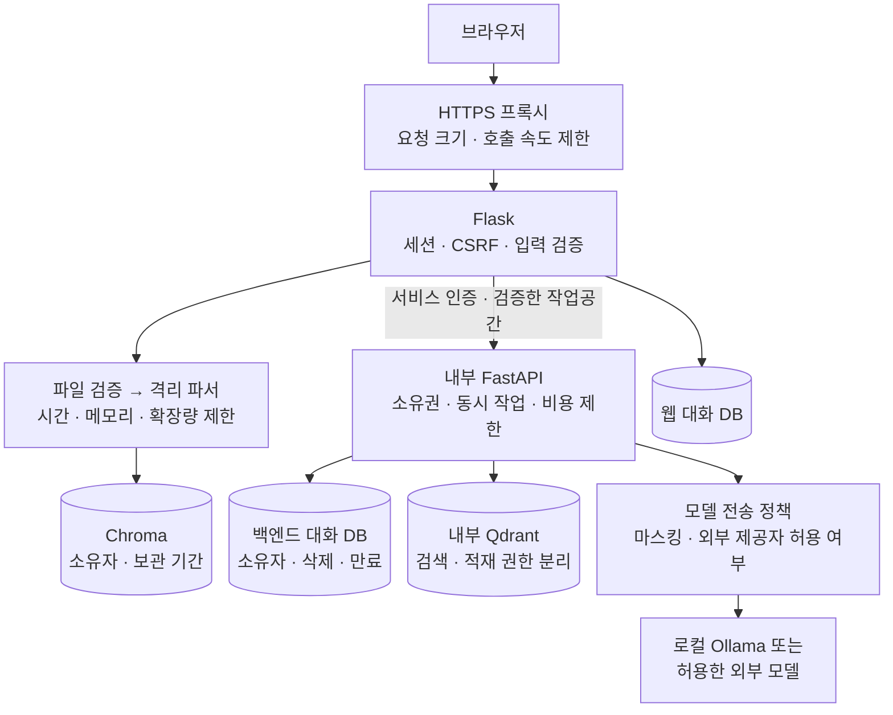

# 보안 설계 및 취약점 검토

검토일: 2026-10-07. 기준 커밋: `0f44061`. 현재 작업 트리의 코드를 읽었다.

## 1. 범위와 판단 기준

Flask 웹 앱, FastAPI 법률 RAG, 업로드·OCR, SQLite·Chroma·Qdrant, 브라우저 렌더링, 외부 모델 연결을 정적으로 검토했다. 기존 테스트의 검증 범위도 읽었다. 이번 작업에서는 코드를 수정하거나 테스트를 실행하지 않았다.

아래의 **확인**은 코드 또는 저장소 설정에서 문제를 확인했다는 뜻이다. 실제 공격 성공을 재현했다는 뜻은 아니다. **조건부**는 노출 범위·환경 설정·호출자 접근에 따라 영향이 달라진다. **설계 과제**는 방어가 필요하지만 공격 성공을 확인하지 않은 항목이다.

- **P0:** 외부 공개 전에 먼저 처리한다.
- **P1:** 사용자 자료를 다루는 서비스의 첫 보안 개선에 포함한다.
- **P2:** 기본 통제를 적용한 뒤 방어와 운영 절차를 보완한다.

우선순위는 공개 서비스 기준이다. FastAPI 기본 바인딩은 `127.0.0.1`이므로 인터넷에 공개되어 있다고 단정하지 않는다. 방화벽, HTTPS 프록시, 실행 중인 포트, 파일 권한, 설치 패키지의 CVE는 이번 검토에서 확인하지 않았다. `.env`의 실제 비밀 값도 읽지 않았다.

## 2. 우선순위 목록

| ID | 우선순위 | 항목 | 상태 | 주요 영향 |
|---|---|---|---|---|
| S01 | P0 | Flask 외부 바인딩과 고정 debug 모드 | 확인·노출 조건부 | 디버거·오류 상세 노출 |
| S02 | P0 | Qdrant 포트 공개와 인증 설정 누락 | 확인·노출 조건부 | 색인 열람·변조·삭제 |
| S03 | P1 | FastAPI 인증·호출량 통제 누락 | 확인·접근 조건부 | 웹 할당량 우회·GPU/외부 API 비용 소진 |
| S04 | P1 | 백엔드 대화 소유자 검증 누락 | 확인·ID 획득 조건부 | 다른 대화 맥락 이용·대화 오염 |
| S05 | P1 | 업로드 크기·형식·복잡도·시간 통제 부족 | 확인 | 디스크·메모리·CPU 소진 |
| S06 | P1 | Flask 입력·저장·검색 요청 제한 부족 | 확인 | DB 증가·임베딩 호출 폭주 |
| S07 | P1 | GET으로 답변 생성, 질문을 URL에 포함 | 확인 | 원치 않는 작업·URL 로그에 상담 내용 기록 |
| S08 | P1 | 대화 삭제가 백엔드 저장소까지 전달되지 않음 | 확인 | 삭제 후에도 상담 내용 잔존 |
| S09 | P1 | trace의 텍스트 비활성화가 일부 필드에만 적용 | 확인·기록 설정 조건부 | 로그에 질문·사건 사실 잔존 |
| S10 | P1 | 개발 모드의 알려진 세션 서명 키 | 확인·환경 조건부 | 세션 위조·브라우저 작업공간 접근 |
| S11 | P2 | 상태 변경 요청의 CSRF 통제 누락 | 확인·브라우저 조건부 | 사용자 의도와 다른 변경 |
| S12 | P2 | 문서·검색 근거의 프롬프트 인젝션 방어 | 설계 과제 | 답변 조작·정보 재출력 |
| S13 | P2 | 예외 상세와 운영 정보 응답 | 확인 | 내부 경로·구성 정보 노출 |
| S14 | P2 | 보안 헤더·캐시 정책의 앱 설정 누락 | 확인·프록시 조건부 | 클릭재킹·민감 응답 캐시 |
| S15 | P2 | HTML sanitizer의 위험한 대체 경로 | 확인·HTML 소비 조건부 | HTML 재해석 시 XSS 가능성 |

## 3. 근거와 해결 방법

### S01. Flask 외부 바인딩과 고정 debug 모드

**근거:** [app.py:541](../app.py#L541)의 직접 실행은 `host="0.0.0.0"`, `debug=True`다. `APP_ENV=production`이어도 이 실행문의 debug 값은 바뀌지 않는다. 일부 입력 오류가 라우트의 예외 처리 밖에서 발생할 수 있다.

**영향:** `python app.py`로 실행한 서버가 다른 사용자에게 도달 가능하면 개발 디버거와 오류 상세가 노출될 수 있다. 디버거의 PIN을 보안 경계로 취급하면 안 된다. 원격 코드 실행 성공은 이번에 재현하지 않았다.

**해결:** 운영 실행은 WSGI 서버와 HTTPS 프록시로 전환한다. debug는 기본 끄고, 개발 실행은 loopback으로 제한한다. 운영 환경에서 debug가 켜지면 시작을 거부한다. [Flask 공식 지침](https://flask.palletsprojects.com/en/stable/debugging/)

**수정 후 확인:** 운영 시작에서 debug가 꺼지는지, 잘못된 입력이 디버거 대신 일반 오류 응답을 받는지 확인한다.

### S02. Qdrant 공개 포트와 인증 설정

**근거:** [docker-compose.yml:13](../docker-compose.yml#L13)은 `6333:6333`, `6334:6334`를 공개한다. loopback 바인딩, API 키, TLS 설정은 이 파일에 없다. 비특권 컨테이너 사용은 파일 소유권 보호이며 API 인증을 제공하지 않는다.

**영향:** 저장소의 Compose 설정으로 실행하고 네트워크 접근이 허용되면 Qdrant 관리 API에 접근할 위험이 있다. 여기에는 색인의 변조·삭제도 포함된다. 실제 호스트 방화벽과 실행 설정은 별도 확인 대상이다.

**해결:** 같은 호스트 개발에서는 loopback에만 포트를 바인딩한다. 운영에서는 내부 네트워크로 격리하고 인증을 켠다. 검색용 자격증명과 적재·삭제용 자격증명을 분리한다. 호스트 간 통신은 TLS를 적용한다. 자격증명은 Compose 본문에 적지 않는다. [Qdrant 공식 보안 안내](https://qdrant.tech/documentation/tutorials-operations/secure-qdrant/)

**수정 후 확인:** 외부에서 두 포트에 접근하지 못하는지 확인한다. 키 없는 요청과 검색용 키의 삭제 요청은 거부되어야 한다.

### S03. FastAPI 인증과 자원 통제

**근거:** [api/routes.py:35](../src/legal_rag/api/routes.py#L35)와 [api/app.py:38](../src/legal_rag/api/app.py#L38)에 인증 의존성·미들웨어·호출량 제한이 없다. [legal_backend.py:42](../legal_backend.py#L42)도 서비스 자격증명 없이 요청한다. Flask의 일일 할당량은 FastAPI 요청 경로에서 검사하지 않는다.

**영향:** FastAPI에 도달하는 호출자는 웹 할당량을 거치지 않고 검색·생성을 실행할 수 있다. 기본 바인딩은 loopback이므로 외부 접근을 이미 확인한 취약점으로 표시하지 않는다. 다만 같은 호스트의 호출자도 신뢰 경계에 포함해야 한다.

**해결:** 내부 서비스로 유지하면서 Flask를 인증한다. 직접 API 사용을 제공할 경우 별도 호출자 인증과 권한을 적용한다. 백엔드에도 요청 속도, 동시 생성 수, 대기열 길이, 요청 전체 시간, 토큰·비용 예산을 둔다. API 키만으로 사용자 소유권까지 해결되지는 않는다. [OWASP REST 보안 지침](https://cheatsheetseries.owasp.org/cheatsheets/REST_Security_Cheat_Sheet.html)

**수정 후 확인:** 인증 없는 호출은 거부되고, 한도를 넘는 호출은 비싼 작업을 시작하기 전에 거부되어야 한다.

### S04. 대화 ID의 소유자 검증

**근거:** [api/routes.py:47](../src/legal_rag/api/routes.py#L47)은 호출자가 보낸 `conversation_id`를 그대로 사용한다. [rag/conversation.py:38](../src/legal_rag/rag/conversation.py#L38)의 DB 키와 조회 조건에는 소유자가 없다. [orchestrator.py:89](../src/legal_rag/rag/orchestrator.py#L89)는 이 ID의 과거 대화를 읽고 새 메시지를 저장한다.

**영향:** 백엔드에 접근하고 다른 대화 ID를 알게 된 호출자는 그 대화에 메시지를 추가할 수 있다. 과거 맥락이 분석기·생성기에 전달되므로 정보가 답변으로 재출력될 위험도 있다. ID 추측 가능성이나 실제 다른 사용자 정보 유출은 재현하지 않았다. Flask가 직접 사용자 ID를 받지 않는 보호는 백엔드까지 이어지지 않는다.

**해결:** 검증한 호출자·작업공간 식별자와 대화를 서버에서 연결한다. 모든 조회·추가·삭제에서 소유권을 검사한다. 익명 브라우저를 유지해도 구현할 수 있다. 공유 서비스 키와 검증되지 않은 `owner_id` 헤더만 추가하는 방식은 피한다.

**수정 후 확인:** 두 작업공간을 만든 뒤 다른 작업공간의 대화 ID로 조회·이어쓰기·삭제가 모두 거부되는지 확인한다.

### S05. 업로드와 파서의 자원 제한

**근거:** [app.py:473](../app.py#L473)은 확장자만 검사하고 [app.py:503](../app.py#L503)에서 파일을 저장한다. 앱의 전체 요청 크기 제한은 설정하지 않았다. [llm_ocr.py:75](../llm_ocr.py#L75)는 TXT 전체 읽기, PDF 전체 페이지 처리, DOCX 파싱을 수행한다. 이미지 OCR에 timeout을 지정하지 않는다. 할당량 예약은 추출·프롬프트 구성 뒤의 [llm_ocr.py:232](../llm_ocr.py#L232)에서 이뤄진다.

**영향:** 큰 파일, 압축 확장량이 큰 DOCX, 복잡한 PDF, 장시간 OCR로 AI 일일 한도와 별개로 자원을 소진할 수 있다. 파서의 임의 코드 실행 취약점이 확인되었다는 뜻은 아니다. 프레임워크 기본 multipart 제한만으로 전체 파일·추출 비용을 통제할 수는 없다.

**해결:** 요청·파일 크기를 제한하고 실제 형식을 확인한다. PDF 페이지 수, 이미지 픽셀 수, DOCX ZIP 항목 수·압축 해제량, 추출 문자 수를 제한한다. 비싼 파싱 전에 호출량 슬롯을 예약한다. 파서는 별도 작업자로 실행하고 시간·메모리·CPU·네트워크 접근을 제한한다. 임시 파일 실패 정리도 유지한다. [OWASP 파일 업로드 지침](https://cheatsheetseries.owasp.org/cheatsheets/File_Upload_Cheat_Sheet.html)

**기존 설계와의 차이:** [8월 업로드 보안 설계](superpowers/specs/2026-08-21-upload-expensive-route-hardening-design.md)에 25 MiB, 형식 검사, 복잡도 제한, 분당 10회가 제안되어 있다. 현재 `security.py` 및 해당 라우트 연결은 찾지 못했다. 이 숫자는 당시 제안이며 현재 구현된 제한으로 표시하지 않는다.

**수정 후 확인:** 크기·형식·복잡도·시간 한도를 넘는 파일은 저장·모델 호출 전에 차단되는지 확인한다. 압축 입력 검증은 실제 확장량도 제한해야 한다.

### S06. Flask 입력과 무제한 저장·검색

**근거:** [app.py:378](../app.py#L378)은 message의 문자열 타입·길이를 검사하지 않고 SQLite에 저장한다. 이 POST만 반복하면 AI 할당량을 예약하지 않는다. [app.py:439](../app.py#L439)의 문서 검색도 query 길이·호출량을 제한하지 않는다. 웹 대화 조회와 [rag/conversation.py:50](../src/legal_rag/rag/conversation.py#L50)는 저장된 전체 대화를 읽는다.

**영향:** 모델에 도달하지 않아도 DB를 늘릴 수 있다. 문서 검색을 반복하면 임베딩 자원을 소모한다. FastAPI의 message 4,000자 제한은 Flask의 선행 저장을 보호하지 않는다. 입력 타입이 다르면 일부 경로에서 500 오류가 발생할 수 있다.

**해결:** 웹과 API의 입력 스키마를 맞춘다. 요청 크기·필드 타입·길이를 저장 전에 검사한다. 저장·검색에도 속도 제한을 적용한다. 작업공간별 문서·청크·저장량 한도와 대화 보관 한도를 둔다. 대화 조회는 페이지나 최근 구간으로 제한한다.

**수정 후 확인:** 잘못된 타입과 초과 길이가 4xx로 거부되고 DB에 남지 않는지, 모델 호출 없는 POST와 검색 반복도 제한되는지 확인한다.

### S07. GET에서 생성하고 상담 내용을 URL에 전달

**근거:** [static/lc-chat.js:146](../static/lc-chat.js#L146)은 메시지를 POST한 뒤 같은 메시지를 `/chat?message=...`에 넣어 EventSource를 연다. [app.py:390](../app.py#L390)은 선행 POST와 연결을 확인하지 않고 GET만으로 생성·할당량 소비·답변 저장을 수행한다.

**영향:** 상담 내용이 프록시·접근 로그·APM의 URL 기록에 들어갈 수 있다. GET 재요청은 다시 작업을 실행한다. SameSite=Lax 쿠키가 전송되는 외부 사이트의 최상위 GET 이동에서도 작업이 시작될 수 있다. 브라우저 히스토리에 EventSource URL이 반드시 저장된다고 주장하지 않는다.

**해결:** 메시지를 POST 본문으로 한 번 전달하고 그 응답을 스트리밍한다. 두 단계가 필요하면 POST로 소유자에 묶인 작업 ID를 만들고 GET은 이미 만든 작업 결과만 구독하게 한다. 생성 작업에 중복 실행 방지를 적용한다.

**수정 후 확인:** GET만으로 새 작업을 만들지 못하고 URL에 상담 내용이 남지 않는지 확인한다. 재연결이 생성 비용을 중복 발생시키면 안 된다.

### S08. 삭제와 보관 수명

**근거:** [app.py:419](../app.py#L419)의 삭제는 Flask 대화 행을 지운 뒤 `conversation_epoch`만 올린다. [app.py:209](../app.py#L209)는 백엔드에 잊기 API가 없음을 설명한다. [factory.py:229](../src/legal_rag/factory.py#L229)는 별도 `conversations.db`에 대화를 저장한다. 기존 대화·문서·할당량의 보관 만료 작업은 검토한 경로에서 찾지 못했다.

**영향:** 새 대화에서 과거 맥락을 사용하지 않는 것과 원본을 삭제하는 것은 다르다. 삭제 후에도 백엔드 상담 내용이 남는다. 브라우저 쿠키를 잃으면 자료에 접근할 수 없지만 자료 자체는 남을 수 있다. 옛 users 테이블도 스키마 초기화에서 보존한다.

**해결:** 소유권을 검사하는 삭제 경로로 두 대화 저장소를 함께 정리한다. 사건 자료와 대화의 삭제 범위를 UI에 명시한다. 익명 작업공간, 고아 자료, trace, 할당량, 백업의 보관 기간을 정하고 만료 처리를 구현한다. 저장소 암호화·권한·백업 복구는 운영 검증에 포함한다.

**수정 후 확인:** 삭제한 작업공간의 데이터가 두 DB와 관련 자료 저장소에서 제거되는지 확인한다. 백업의 잔존 기간은 별도 정책으로 남긴다.

### S09. trace의 불완전한 텍스트 제외

**근거:** [rag/trace.py:15](../src/legal_rag/rag/trace.py#L15)의 `include_text=False`는 `user_text`만 비운다. [orchestrator.py:94](../src/legal_rag/rag/orchestrator.py#L94)와 113행은 `analysis`와 `search_queries`를 항상 trace에 넣는다. `analysis`에는 key_facts와 dates가 포함된다. path를 설정하면 전체 trace를 JSONL로 저장한다.

**영향:** `include_text=false`여도 질문이나 사건 사실이 로그에 남을 수 있다. trace 파일 기록은 기본 꺼짐이므로 기본 설치에서 이미 로그 유출이 발생했다고 단정하지 않는다. `include_trace`의 응답 공개 권한도 함께 설계해야 한다.

**해결:** 기본 trace는 단계·시간·건수·오류 코드만 기록한다. 원문·질의·사건 사실은 동일한 명시적 정책 아래에서 제외하거나 마스킹한다. 공개 API에서 상세 trace는 운영자 권한으로 제한한다. 보관 만료와 로그 접근 제어를 둔다.

**수정 후 확인:** 원문 비활성화 상태에서 이름·날짜·금액을 넣고 저장 trace와 응답에 민감 내용이 남는지 확인한다.

### S10. 개발 모드의 알려진 SECRET_KEY

**근거:** [app.py:49](../app.py#L49)는 local/development/testing 환경에서 키가 없으면 고정 문자열을 사용한다. [.env.example](../.env.example)은 이 경우 임의 키가 생성된다고 설명하지만 실제 코드와 다르다. 운영 모드에서 키 누락을 거부하는 보호는 구현되어 있다.

**영향:** 개발 설정으로 접근 가능한 서비스를 실행하면 세션 서명 위조가 가능해진다. 다른 작업공간 ID까지 알게 되면 그 ID를 세션에 넣을 위험이 있다. 고정 키만으로 무작위 작업공간 ID를 알아낼 수 있는 것은 아니다.

**해결:** 개발도 비어 있으면 프로세스별 임의 키를 생성한다. 공유 환경은 환경 모드와 관계없이 강한 명시적 키를 요구한다. 운영 시작에서 알려진 기본 값·예제 값·빈 값을 거부한다. 실제 비밀을 문서에 적지 않는다.

**수정 후 확인:** 기본 키로 만든 쿠키가 공유 환경에서 거부되는지, 키 설정 누락이 운영 시작을 중단시키는지 확인한다.

### S11. CSRF 방어

**근거:** 대화·문서 삭제와 업로드 라우트에 CSRF 토큰, Origin 검증, Fetch Metadata 검사가 없다. 세션 쿠키의 HttpOnly, SameSite=Lax 및 운영 Secure 설정은 존재한다.

**영향:** SameSite=Lax는 일반적인 교차 사이트 POST에 보호를 제공하므로 모든 POST가 바로 공격 가능하다고 단정하지 않는다. 같은 사이트의 다른 출처와 S07의 최상위 GET 작업은 따로 고려해야 한다. CORS가 없다는 사실은 CSRF 방어를 대신하지 않는다.

**해결:** 상태 변경 요청에 CSRF 토큰을 적용하고 Origin·Fetch Metadata 정책을 보완한다. GET의 상태 변경을 먼저 제거한다. 웹 쿠키와 내부 API 인증은 각 신뢰 경계에서 검증한다. [OWASP CSRF 지침](https://cheatsheetseries.owasp.org/cheatsheets/Cross-Site_Request_Forgery_Prevention_Cheat_Sheet.html)

**수정 후 확인:** 외부 출처와 토큰 누락 요청은 거부되고 정상 업로드·삭제·상담은 동작하는지 확인한다.

### S12. 프롬프트 인젝션과 근거 신뢰 경계

**근거:** [generator.py:94](../src/legal_rag/rag/generator.py#L94)는 검색 근거·사용자 파일·대화를 모델에 전달한다. 사용자 파일 지시를 무시하라는 프롬프트는 있다. [llm_ocr.py:169](../llm_ocr.py#L169)의 별도 문서 분석도 원문을 프롬프트에 넣는다. [verification/verifier.py:12](../src/legal_rag/verification/verifier.py#L12)는 인용 ID·법령·사건번호를 검사하며 정보 유출이나 악성 지시 수행을 판정하지 않는다.

**영향:** 악성 문서와 질문이 답변의 방향을 바꾸거나 대화 내용을 재출력하도록 유도할 수 있다. 인용 검증 통과는 인젝션 방어 성공을 뜻하지 않는다. 검토한 답변 경로에는 모델이 임의 셸 명령이나 URL 요청을 수행하는 도구가 없어, 현재 코드만으로 그러한 실행까지 주장하지 않는다.

**해결:** 원본의 출처·소유자·신뢰 수준을 보존한다. 자료는 비신뢰 데이터로 취급하고 애플리케이션의 권한 결정에 모델 출력을 사용하지 않는다. 문서 분석에도 같은 경계를 적용한다. 원문 전체 재출력 제한과 외부 전송 정책을 코드에서 집행한다. 악성 질문·업로드·검색 근거·후속 턴의 방어 평가를 별도 수행한다. [OWASP LLM 인젝션 지침](https://cheatsheetseries.owasp.org/cheatsheets/LLM_Prompt_Injection_Prevention_Cheat_Sheet.html)

**수정 후 확인:** 공격 문서가 있어도 다른 작업공간 데이터와 비밀 값은 모델 입력 자체에 들어가지 않아야 한다. 출력의 지시 무시와 민감 내용 재출력 여부를 반복 측정한다.

### S13. 예외 상세와 운영 정보 노출

**근거:** [app.py:530](../app.py#L530), [llm_ocr.py:252](../llm_ocr.py#L252), [langchain_config.py](../langchain_config.py)의 일부 실패 응답은 예외 문자열을 반환한다. `/health`는 모델·컬렉션·tracing 정보를 공개한다. 비밀 키 자체를 반환하는 코드는 확인하지 못했다.

**해결:** 사용자에게 안정적인 오류 코드와 요청 ID를 반환한다. 예외 상세는 접근 제한된 서버 로그에 기록하고 민감 값을 제거한다. 공개 health는 최소 생존 확인으로 제한하고 상세 진단은 내부 운영 경로로 분리한다.

**수정 후 확인:** 손상 파일·백엔드 장애·설정 오류 응답에 경로·자격증명·원문이 나오지 않는지 확인한다.

### S14. 보안 헤더와 캐시 정책

**근거:** Flask 응답에 CSP, frame-ancestors/X-Frame-Options, nosniff, 민감 응답의 Cache-Control 정책을 적용하는 코드가 없다. HTTPS 프록시가 대신 적용하는지는 확인하지 않았다. 템플릿은 외부 Google Fonts와 많은 인라인 스타일을 사용한다.

**해결:** 인증·상담·문서 응답에 `Cache-Control: no-store`를 적용한다. 클릭재킹 방어, nosniff, Referrer-Policy를 적용한다. HTTPS가 확정된 운영 환경에서 HSTS를 적용한다. CSP는 현재 스타일·폰트 사용을 고려해 보고 모드부터 적용한다. 외부 폰트 자체를 코드 실행 취약점으로 표시하지 않는다. [Flask 공식 보안 지침](https://flask.palletsprojects.com/en/stable/web-security/)

**수정 후 확인:** 프록시를 통과한 실제 응답에서 헤더가 존재하고 정상 UI가 동작하는지 확인한다.

### S15. HTML sanitizer 대체 경로

**근거:** [html_sanitizer.py:30](../html_sanitizer.py#L30)는 Bleach가 없을 때 태그 제거 후 `html.unescape`를 실행한다. 인코딩된 태그가 제거 단계 이후 다시 태그 문자열로 바뀔 수 있다. 현재 프런트엔드는 업로드 응답의 `report_html`을 직접 HTML로 렌더링하지 않는다. 따라서 현재 화면에서 XSS가 발생한다고 단정하지 않는다.

**해결:** sanitizer 의존성 누락 시 HTML 출력을 거부하거나 안전하게 escape한 텍스트로 반환한다. 정규식 대체 경로를 제거한다. HTML 보고서를 다시 도입하면 브라우저의 삽입 위치까지 포함해 검토한다.

**수정 후 확인:** 의존성 누락 상태와 인코딩·중첩 입력에서도 위험한 HTML이 재구성되지 않는지 확인한다. 기존 sanitizer 테스트는 정상 의존성 경로를 다루며 이번에 실행하지 않았다.

## 4. 권장 보안 구조

다음 그림은 **개선 제안**이다. 현재 구현 완료 상태를 나타내지 않는다. 익명 브라우저 작업공간을 유지하면서도 적용할 수 있다.

### 추가 설계 결정

1. **사용자 식별:** 익명 작업공간을 계속 제공할지 결정한다. 자료를 장기간 보관하거나 기기 간 복구를 제공하려면 별도 인증·복구 정책을 설계한다. 단순히 로그인 버튼을 추가하는 것으로 소유권 문제를 해결하지 않는다.
2. **외부 모델과 관측 서비스:** Gemini 선택 시 질문·근거·전달한 사건 자료가 [Gemini 어댑터](../src/legal_rag/llm/gemini.py#L29)를 통해 외부로 나간다. LangChain tracing도 설정에 따라 문서 분석 입력을 전송할 수 있다. 외부 전송 허용 여부, 사용자 안내, 민감정보 최소화, 로그 보관을 정한다. 이번에 실제 실행 환경의 선택은 확인하지 않았다.
3. **프록시 신뢰:** [quota.py](../quota.py)는 전달 헤더를 무시하고 직접 peer IP를 사용한다. 헤더 위조 방지에는 유리하지만 프록시 뒤에서는 모든 사용자가 같은 할당량을 공유할 수 있다. 신뢰할 프록시 주소·홉을 한정하고 외부가 보낸 전달 헤더를 프록시에서 덮어쓴다. 예제의 `TRUSTED_PROXY_COUNT`는 현재 코드에 연결되어 있지 않다.
4. **파일과 백업:** SQLite·Chroma·Qdrant 볼륨의 최소 파일 권한, 전용 서비스 계정, 암호화된 디스크·백업, 복구 권한을 정한다. 코드는 저장소 암호화를 직접 구현하지 않는다. 실제 OS 암호화 여부는 별도 확인한다.
5. **관측:** 원문 없이 거부·인증 실패·할당량 초과·파서 timeout·삭제 완료를 기록한다. 고정 IP 해시는 익명화 보장이 아니라 연결 가능한 식별자다. 필요한 기간만 보관한다.

## 5. 이미 구현된 보호

- Flask 작업공간 ID를 서버가 만들고 서명 쿠키에 저장한다. JSON·헤더·쿼리로 소유자를 선택하지 않는다.
- 웹 SQL과 Chroma의 조회·삭제에는 사용자 범위가 있다. SQL 값은 파라미터로 전달한다.
- 운영 환경의 SECRET_KEY 누락은 시작을 중단한다. 쿠키에는 HttpOnly·SameSite=Lax와 운영 Secure가 설정되어 있다.
- 업로드 임시 파일 이름은 무작위이며 원본 이름으로 디스크 경로를 만들지 않는다. 종료 시 삭제를 시도한다.
- 일일 AI 할당량 예약은 SQLite의 원자적 갱신을 사용한다. 직접 전달 헤더를 신뢰하지 않는다.
- FastAPI 요청은 길이·근거 개수·검색 k를 제한한다. 이 제한은 Flask의 선행 저장·파싱을 대신하지 않는다.
- 채팅 본문·파일명·근거 텍스트는 현재 UI에서 escape한다. 정상 Bleach 경로도 허용 태그·프로토콜로 제한한다.
- FastAPI 기본 바인딩과 Ollama 기본 URL은 loopback이다. trace 파일은 기본 미설정이고 LangSmith tracing도 명시적으로 켜야 한다.

위 보호는 코드에서 확인했다. 기존 테스트가 모두 통과한다고 이번 검토에서 주장하지 않는다.

## 6. 구현 순서와 완료 기준

| 순서 | 작업 | 완료 기준 |
|---|---|---|
| 1 | S01·S02 공개 범위와 실행 모드 | debug 꺼짐, 비공개 DB 포트, Qdrant 인증·권한 분리 |
| 2 | S03·S04·S10 서비스 인증과 소유권 | 무인증 호출·다른 소유자의 대화 접근·기본 키 쿠키 거부 |
| 3 | S05·S06 자원 예산 | 저장·파싱 전 제한, 동시 작업·저장량 한도, 안정적인 4xx |
| 4 | S07·S11 브라우저 요청 흐름 | 질문 없는 URL, GET의 새 작업 금지, CSRF·재연결 중복 방어 |
| 5 | S08·S09 개인정보 수명 | 두 대화 DB의 삭제, 만료 정책, 원문 없는 기본 trace |
| 6 | S12–S15 출력·오류·응답 방어 | 인젝션 평가, 일반 오류 코드, 실제 응답 헤더, 안전한 HTML 실패 경로 |

### 별도 확인이 필요한 항목

- 실제 호스트의 공개 포트·방화벽·TLS·프록시 구성과 debug 상태.
- Python 3.13 웹 환경과 Python 3.11 백엔드 환경 각각의 직접·전이 의존성 보안 감사. `uv.lock`만으로 두 환경을 모두 대표하지 않는다.
- Qdrant `v1.12.1-unprivileged` 이미지와 OS 패키지 취약점·이미지 digest·업데이트 경로. 버전이 오래되었다는 이유만으로 특정 CVE를 확정하지 않는다.
- 저장소 전체 이력의 비밀 값 검사, 실제 secret 관리·권한·회전 정책. 이번 텍스트 패턴 검색만으로 비밀 유출이 없다고 결론내리지 않는다.
- 공격 재현과 수정 후 회귀 검증: 대화 소유권, 비정상 파일, 동시 요청, CSRF, 삭제 잔존, 로그 원문, 프롬프트 인젝션.

이번 결과는 구현을 위한 보안 목록이다. 수정 완료나 침투 테스트 통과 기록은 아니다.
