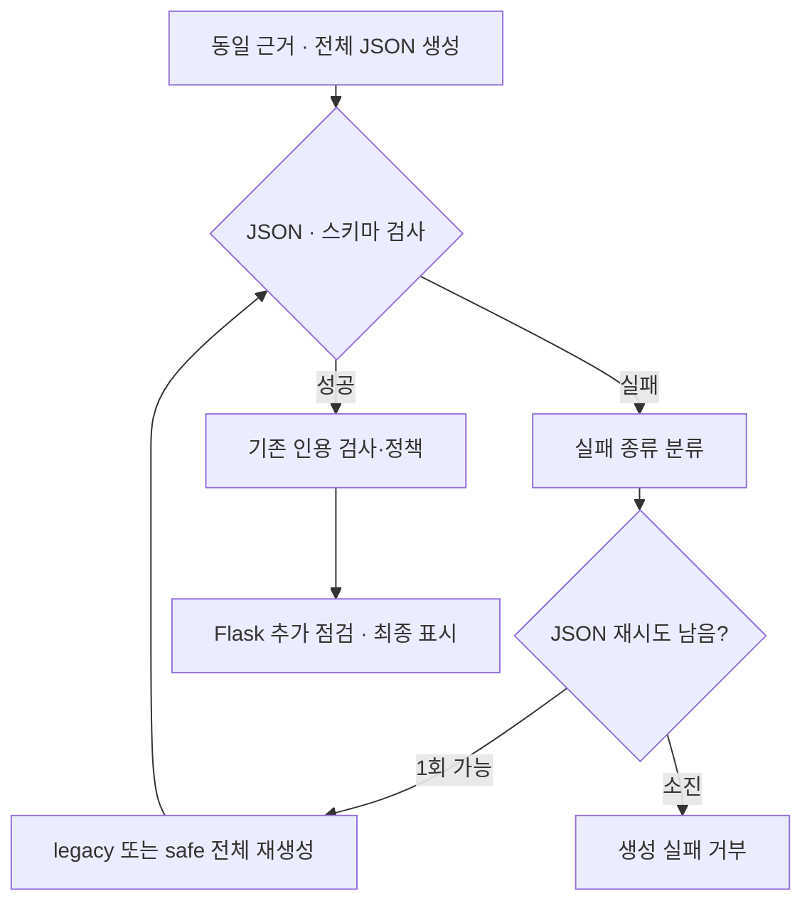

# 긴 답변과 JSON 복구 개선 설계

작성일: 2026-10-10. 상태: 2026-10-11 격리 구현·주 비교·전체 직접 의미 검토 및 최종 감사 완료. 세 후보를 모두 채택하지 않는다. OFF / legacy 기본값 유지. [실제 결과](../../experiments/answer-recovery-latency-2026-10-10.md).

사용자 요청: 답변 시간 개선 제안 중 우선순위 1과 2의 계획을 만든다. 문서는 ASD-STE 100의 간결한 문장 원칙을 한국어에 맞게 적용한다. 규격 준수를 인증하는 문서는 아니다.

## 1. 목적과 근거

전체 답변을 다시 생성하는 횟수를 줄여 긴 대기를 줄인다. 답변의 조건, 예외와 인용 검사를 유지한다.

[기존 측정](../../experiments/verified-chat-latency-2026-10-10.md#4-같은-근거의-답변-비교)에서 `full` 80문항의 생성·검사 중앙값은 16.19초, p90은 32.38초였다. 45초 초과는 5건이었다. 여러 모델 호출이 필요한 6문항의 중앙값은 58.38초였다. `full`의 JSON 수정 5건은 모두 최초 출력이 2048 토큰 한도에 도달했다.

긴 출력의 문항 순번은 **0부터 시작하는 1, 2, 54, 55, 71**이다. 55번은 JSON 수정 후 인용 재생성도 필요했다. 이 순번을 법률 문항 번호나 사용자 질문 번호로 사용하지 않는다.

현재 기록에는 최종 답변과 호출별 시간이 있다. 실패한 최초 JSON 본문은 없다. 따라서 반복 문장이나 긴 인용문이 원인이라고 아직 확정할 수 없다. 새 격리 재생에서 실패 본문을 수집한다. 같은 실패가 다시 발생하지 않으면 재현되지 않았다고 기록한다.

## 2. 비교한 방식

| 방식 | 장점 | 제한 | 선택 |
|---|---|---|---|
| 반복 억제와 실패 종류별 복구 | 현재 관측한 추가 호출을 직접 다룬다 | 프롬프트가 조건을 누락할 수 있다. 별도 품질 평가가 필요하다 | 이번 계획 |
| 출력 한도 증가 | 잘린 JSON을 끝까지 만들 가능성이 있다 | 긴 출력과 대기가 늘 수 있다 | 이번 비교에서 제외 |
| 필드별 생성 또는 작은 모델로 수정 | 일부 내용만 다시 만들 가능성이 있다 | 호출·결합·의미 검사가 추가된다 | 이후 별도 설계 |

`concise` 지침을 다시 적용하지 않는다. 기존 간결화 실험과 마찬가지로 단순 반복 억제도 성공이 보장되지 않는다. 실패 본문에서 확인한 패턴과 별도 비교 결과로 채택한다.

## 3. 우선순위 1: 잘림 예방

기존 `answer_system` 뒤에 선택 가능한 반복 억제 지침을 추가한다. 모든 필드, 필드 순서와 2048 토큰 한도를 유지한다. 문장 수와 목록 수를 제한하지 않는다.

지침은 다음 내용을 명시한다.

- 같은 명제의 반복만 줄인다.
- 결론이 달라지는 조건, 예외, 기간, 주체와 기관은 각각 남긴다.
- 인용문은 필요한 구절을 사용한다. 제한 문구를 잘라 의미를 바꾸지 않는다.
- 근거끼리 다르면 각각의 적용 범위를 적는다.
- 사용자에게 필요한 사실 질문과 불확실성을 남긴다.

이 지침은 `full` 전용 실험 플래그다. 기본값은 OFF다. 실패 출력에서 반복이 확인되지 않으면 이 지침을 잘림의 해결책으로 주장하지 않는다. 내용 중복과 인용문 길이는 사람 대신 AI가 먼저 읽되, 사례별 이유와 한계를 기록한다.

## 4. 우선순위 2: 실패 종류별 복구

현재 생성기는 JSON 실패 후 최초 근거와 질문에 수정 지시를 추가한다. 실패 본문은 추가하지 않는다. 실제로는 새 답변을 생성한다. 이 방식의 입력 경로와 재시도 한도는 유지한다. 잘린 본문을 이어 쓰거나 새 근거로 사용하지 않는다.

Ollama의 구조화 출력 오류에 `failure_kind`와 `stop_reason`을 붙인다. 기존 두 인자 생성자는 계속 지원한다. 다른 어댑터는 기본값 `unknown`을 사용한다. HTTP 실패는 기존 HTTP 오류로 처리한다.

| 분류 | 판정 | 처리 |
|---|---|---|
| `truncated` | 종료 사유 `length`, 또는 파서의 EOF 오류 | 전체 답변 1회 재생성. 반복만 줄이고 조건·예외를 보존하도록 지시 |
| `syntax` | 완전한 출력의 JSON 문법 오류 | 이번 실행에서는 기존 한도 안에서 재생성. 로컬 수정은 실제 사례 조건 미충족으로 제외 |
| `schema` | 파싱되지만 필드·타입·열거 값이 잘못됨 | 필드나 값을 임의로 만들지 않고 재생성 |
| `unknown` | 기존 어댑터 또는 확인할 수 없는 오류 | 기존 방식으로 재생성. EOF 메시지는 잘림으로 취급 |

### 로컬 형식 수정의 경계 (조건부 설계, 이번 실행 제외) (조건부 설계, 이번 실행 제외)

추가 모델 없이 시도할 변경은 **문자열 밖에서 닫는 괄호 앞에 붙은 마지막 쉼표 제거** 하나다. 기존 코드의 정상 JSON 및 Markdown fence 처리는 그대로 유지한다.

수정 후보는 다음 검사를 모두 통과해야 한다.

1. 종료 사유가 `length`가 아니다.
2. 하나의 완전한 JSON 객체다. 따옴표나 괄호를 추가하지 않는다.
3. 중복 키, NaN, Infinity가 없다.
4. 최상위 답변 필드 8개가 모두 명시돼 있다.
5. Pydantic 검사를 통과한다.
6. 파싱한 값과 직렬화한 답변 값이 정확히 같다. 기본값 채움과 타입 보정으로 통과시키지 않는다.
7. 기존 인용 검사와 정책 처리를 계속 수행한다.

쉼표 앞에 값이 없는 `[, ]`, `{"analysis":,}`는 수정하지 않는다. 문장, 숫자, Source ID, reference, quote를 변경하지 않는다. 인용 실패는 기존 재생성·제거·거부 정책으로 처리한다. 기존 인용 backfill을 중복 구현하지 않는다.

격리 재생에서 이 수정으로 구할 수 있는 오류가 없으면, 로컬 수정 기능은 구현 대상에서 제외한다. 실패 분류와 조건 보존 재시도는 독립적으로 비교한다. 로컬 형식 수정이 잘림 5건을 해결한다고 주장하지 않는다.

## 5. 실제 구현한 처리 구조

진단에서 완전한 JSON 쉼표 오류가 없었다. 위 실제 경로에는 로컬 쉼표 수정 기능이 없다. 실패한 원문을 임의로 닫거나 필드를 만들어 채우지 않는다.

JSON 재시도는 각 생성에서 최대 1회다. 인용 재생성은 턴 전체에서 최대 1회다. 정상 답변 생성 경로에 별도 모델 호출을 추가하지 않는다. 기존 SSE에서는 최종 정책 처리가 끝나기 전 상태 문구만 보낸다.

## 6. 비교와 채택

실험 플래그 두 개를 독립적으로 선택한다.

- `rag.answer_repetition_guard`: OFF / ON.
- `rag.structured_recovery`: `legacy` / `safe`.

현재 서비스 기본값은 OFF와 `legacy`다. 네 조합을 동일 근거 80문항으로 비교한다. 개발 중 프롬프트를 수정할 때는 새 버전으로 기록하고, 최종 비교 전에 고정한다. 주 비교 중 수정하지 않는다.

주 비교의 후보 순서는 문항마다 회전한다. 선택 후보와 기준을 전체 80문항으로 다시 비교할 때는 첫 비교와 반대 순서로 실행한다. 각 반복을 별도로 보고한다. 기준에서 긴 대기가 거의 발생하지 않으면 개선을 입증하지 못했다고 기록한다.

성능 목표는 후보의 45초 초과 건수가 **80문항당 2건 이하**이며, 같은 실행의 기준보다 **50% 이상 적은 것**이다. 두 조건을 두 비교에서 확인한다. 기준의 45초 초과가 0건인 실행으로 감소를 주장하지 않는다. 중앙값과 p90의 5% 초과 악화가 두 비교에서 반복되면 채택하지 않는다. 이 수치는 사전 판정 기준이며 통계적 유의성이나 실제 사용자 SLA를 뜻하지 않는다.

품질은 최우선이다. AI가 모든 80쌍의 전체 본문과 제공 근거를 읽고 조건·예외·기간·주체·단정의 차이를 기록한다. 기존 27개 검토 사례와 긴 출력 5개는 심층 검토한다. 새 필수 조건 누락, 잘못된 단정 또는 인용 지원 악화가 확인되면 해당 후보를 채택하지 않는다. core와 strict 결론 점수는 보조 지표이며 각각 기준보다 3/80 초과 감소하면 후보를 제외한다. 점수 유지는 의미 검토 실패를 덮지 않는다. 인용 검사 통과를 의미상의 법률 정답으로 해석하지 않는다.

오류·거부·인용 재생성·제거 건수가 기준보다 늘면 사례별 원인을 확인하고 그 후보의 채택을 보류한다. 잘못된 답변을 거부한 개선과 단순 회귀를 구분해 결과에 남긴다. 전체 답변 시간을 실패 사례를 제외하고 계산하지 않는다.

웹에서는 기준과 선택 후보의 일반 질문·후속 대화·문서 질문을 두 순서로 비교한다. 측정값은 POST부터 SSE 최종 응답까지다. 동시 요청 최적화, 모델 변경과 업로드 분석 개선은 이번 범위에 없다.

## 7. 실행 경계

이번 요청은 계획 작성이다. 구현, 테스트와 모델 실행은 후속 실행 요청에서 진행한다. 계획 작성 중 사용자 서비스, `.env`, 코퍼스와 인덱스를 변경하지 않는다. 커밋하지 않는다. 하위 에이전트를 사용하지 않는다.

실행 시 현재 미커밋 코드도 기준에 포함한다. HEAD만 체크아웃하면 이전에 측정한 검색 재사용 등이 빠진다. 대상 파일의 현재 내용과 해시를 먼저 저장한다. 기존 `llm_ocr.py`, `tests/test_document_citation_notice.py`, `docs/superpowers/plans/2026-10-09-four-levers.md`를 보존한다. 모델 원문은 실험 폴더의 비공개 파일에만 저장하며 서비스 로그에 넣지 않는다.

결과는 [실행 계획](../plans/2026-10-10-answer-recovery.md)에 따라 별도 문서로 남긴다. 개선이 입증되지 않으면 기준 동작과 기본 설정을 유지하고 실패 결과를 보고한다.
