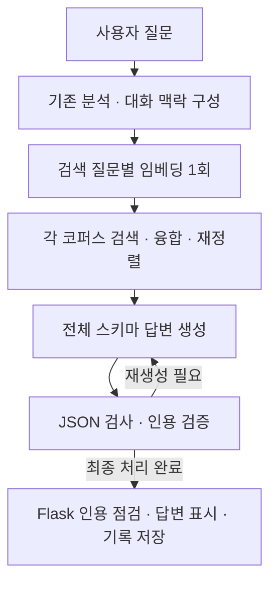

# 첫 답변 표시 시간 개선안

작성일: 2026-10-10  
상태: 코드 구현 후 성능·품질 측정 완료. 검색 재사용은 유지한다. 간결한 표현은 속도와 조건 보존 기준을 충족하지 못해 로컬 기본값을 `full`로 복원했다. [이번 측정 기록](../../verified-chat-latency-2026-10-10.md)을 함께 읽는다.

## 1. 목표

사용자가 질문을 보낸 뒤 검증된 답변을 읽기까지의 시간을 줄인다. 사용자는 정확성을 우선하여 검증 전 초안을 표시하지 않도록 결정했다. 첫 상태 이벤트와 검증된 답변의 시간을 구분하고, 상태 문구만 표시한 시간은 답변 시간에 포함하지 않는다.

사용자가 보고한 대기 시간은 약 1분이다. 별도 로컬 웹 재현 환경에서도 57.79초, 64.31초, 80.70초 응답을 확인했다. 기존 사용자 서비스나 실제 브라우저를 직접 측정한 값은 아니다. 이 설계는 웹 채팅을 대상으로 한다.

## 2. 확인한 근거

설계 시점에는 현재 코드와 저장된 실험 자료를 읽었다. 아래 표는 이번 변경 전에 저장된 자료다. 이후 사용자의 측정 요청으로 별도 비교 실험을 시작했다.

| 저장된 웹 경로 측정 | 질문 수 | 중앙값 | 90백분위 | 최대 |
|---|---:|---:|---:|---:|
| 준비된 상태의 첫 질문 | 90 | 17.5초 | 30.7초 | 54.8초 |
| 후속 질문 | 16 | 23.5초 | 37.6초 | 60.2초 |
| 업로드 문서 관련 질문 | 12 | 19.9초 | 43.6초 | 59.5초 |
| 모델을 내린 뒤 첫 질문 | 5 | 20.1초 | 27.1초 | 27.1초 |
| 두 사용자의 동시 질문 | 16 | 33.4초 | 46.1초 | 54.6초 |

출처: [웹 경로 결과](../../../data/eval/reports/chat_pipeline/latency-e2e-2026-10-10/results.txt), [측정 조건](../../../data/eval/reports/chat_pipeline/latency-e2e-2026-10-10/PREREG.txt), [저장된 측정값](../../../data/eval/reports/chat_pipeline/latency-e2e-2026-10-10/turns.jsonl).

이 측정은 로컬 Flask 및 법률 API를 통해 수신한 이벤트의 시간이다. 실제 브라우저 렌더링이나 현재 사용자의 배포 환경을 측정한 값은 아니다. 모델만 내린 조건도 서비스 전체를 처음 실행한 조건과 다르다.

현재 경로에서 확인한 사항:

- Flask는 법률 API의 전체 응답을 기다린다. SSE로 전송하는 중간 이벤트는 상태 문구다.
- Ollama 어댑터는 `stream: false`를 사용한다.
- 첫 질문에도 분석 모델 호출과 답변 모델 호출이 순서대로 필요하다. 후속 질문에는 대화 맥락을 반영하는 호출도 추가된다.
- 인용 검사에서 문제가 발견되면 답변을 다시 생성한다. JSON 형식 오류에도 별도의 수정 호출이 가능하다.
- 기존 측정에서 Flask 및 문서 조회 등의 추가 시간은 일반 질문의 중앙값 약 0.01초다. 주요 대기는 법률 API에 있다.

기존 실험도 확인했다. 분석 출력 축소는 사용자에게 부적절한 추가 질문을 늘렸다. 답변 스키마에서 인용문 등을 제거한 실험은 재생성과 제거를 늘리고 시간을 늘렸다. 분석과 검색의 병렬화는 같은 GPU의 경합으로 근거 준비 시간을 약 0.4초만 줄였다. 세 변경은 채택되지 않았다.

출처: [기존 실험 및 판정](../../../data/eval/reports/chat_pipeline/latency-2026-10-10/PREREG.txt).

Flash Attention은 기존 기록에서 이미 켜진 것으로 확인된다. 해당 실험의 답변 생성·검증 중앙값은 OFF 세 실행의 17.9~20.0초에서 ON 두 실행의 16.6초로 줄었다. 이 값은 위 웹 경로 측정과 조건이 다르다. 설계 초기에는 RTX 4060 Laptop GPU 8 GB가 유휴 상태였고 Ollama에 로드된 모델이 없어 GPU 적재 비율을 확인하지 못했다. 이후 이번 측정에서는 Flash Attention ON과 qwen3:4b의 GPU 37/37 레이어 적재를 확인했다.

출처: [Flash Attention 속도](../../../data/eval/reports/chat_pipeline/latency-2026-10-10/flash-speed/RESULT.txt), [품질 비교](../../../data/eval/reports/chat_pipeline/latency-2026-10-10/flash-quality/RESULT.txt).

## 3. 선택한 방식

2026-10-10 사용자 결정: 검증을 마친 답변만 표시한다. 초안 스트리밍과 미검증 요약은 사용하지 않는다.

두 변경을 독립적으로 비교한다.

1. **요청 안에서 질문 임베딩을 재사용한다.** 다섯 코퍼스의 dense leg는 같은 embedder 객체를 사용하지만 각 leg가 같은 질문을 다시 임베딩한다. 검색 호출 안에서 `(embedder 객체, 질문 문자열)`별 벡터를 한 번만 만들고 각 코퍼스 검색에 전달한다. 캐시는 다른 요청과 공유하지 않는다. 검색 후보 수, sparse 검색, 융합, 재정렬은 유지한다.
2. **같은 스키마로 간결한 답변을 생성한다.** 기존 시스템 규칙에 간결한 표현 지침을 추가한다. 조건, 예외, 기간, 불확실성, 인용문은 유지하고 반복을 줄인다. 문장·목록 길이는 권고이며, 필요한 조건을 담기 위해 더 길게 답할 수 있다. 답변 토큰 한도와 재생성 횟수는 줄이지 않는다.

`rag.answer_style`은 `full`과 `concise`를 지원한다. 설정 기본값과 로컬 서비스 프로필은 모두 `full`이다. `concise`는 측정에서 속도 개선과 조건 보존 기준을 충족하지 못했다. 실험용으로만 `LEGAL_RAG__RAG__ANSWER_STYLE=concise`를 선택할 수 있다. 프로필의 변경은 API를 다시 시작한 뒤 적용된다. 측정을 위해 기존 사용자 서비스를 재시작하지 않았다.

기존 축소 실험과 달리 분석 스키마, 답변 스키마, 필드 순서, citation quote, confidence를 유지한다. 새 모델 호출이나 두 단계 답변을 추가하지 않는다.

## 4. 처리 구조

### 정확성 경계

- 답변은 기존 생성·인용 검사·재생성·제거·거부 처리를 마친 뒤 표시한다.
- Flask의 추가 인용 점검과 사용자별 문서 선택을 유지한다.
- 인용 검증은 의미상의 법률 정답 여부 전체를 판정하지 않는다. 검증 경로를 유지했다는 사실과 간결한 답변의 품질 유지 여부를 구분한다.
- 동일 근거 80문항에서 간결한 모드의 중앙값은 17.25초, 기존 모드는 16.19초였다. AI의 짝지은 읽기 검토에서도 적용 범위와 자격 조건 손실을 확인했다. 간결한 모드를 기본값으로 채택하지 않는다.
- 검색 재사용 비교 48쌍은 검색 순서가 모두 같았고 점수 차이는 허용 오차 `1e-5` 이내였다. 검색 시간 중앙값은 2.18초에서 1.81초로 줄었다. 이 결과는 전체 웹 답변의 1분 대기가 해결됐다는 뜻은 아니다.
- 임베딩 재사용은 같은 객체와 같은 문자열에만 적용한다. 서로 다른 embedder나 질의의 벡터를 섞지 않는다.
- 사용자 질문이나 임베딩을 전역 캐시에 저장하지 않는다.

### 측정 자료

Ollama 호출의 벽시계 시간, 모델 로드 시간, 입력 처리 시간, 출력 생성 시간, 토큰 수, 종료 사유를 기록한다. 질문·근거·답변 내용은 이 로그에 포함하지 않는다. 기존 단계별 trace도 유지한다.

Ollama의 생성 통계 항목은 공식 [Chat API](https://docs.ollama.com/api/chat)를 확인했다.

## 5. 수용 기준

아래 기준은 측정 전에 정했다. 판정과 측정 범위는 별도 결과 문서에 기록한다.

- 로컬 다섯 코퍼스에서 동일 질의를 처리할 때 질의 임베딩 호출을 다섯 번에서 한 번으로 줄인다. 각 코퍼스 검색과 검색 결과 처리 순서는 유지한다.
- 별도 요청과 서로 다른 embedder 객체 사이에서 벡터를 공유하지 않는다.
- 간결한 모드에서도 모든 답변 필드와 인용문, 생성 순서, 기존 토큰 한도 및 재생성 정책을 유지한다.
- 근거 또는 모델 출력의 완성 전에 답변 본문을 표시하지 않는다.
- 속도 비교에서는 상태 문구의 표시 시간을 별도 기록하고, 최종 검증 답변의 중앙값·90백분위·45초 초과 질문 수를 비교한다.
- 답변 품질은 같은 근거를 사용한 반복 실행에서 비교한다. 조건·예외 누락을 직접 읽고, 기존 결론 일치 평가 및 인용 재생성·제거 횟수도 보고한다.
- 전체 생성 시간은 동일 조건의 기준 실행보다 중앙값 15% 이상 감소하는 것을 목표로 한다. 기존 실행의 변동성과 함께 판정한다.
- 조건 누락이 발견되거나 품질 저하가 실행 간 변동성을 넘어가면 간결한 모드의 채택을 재검토한다. 임베딩 재사용은 별도 판단한다.

## 6. 변경 위치

| 위치 | 역할 |
|---|---|
| `src/legal_rag/retrieval/dense.py` | 이미 만든 질의 벡터로 검색하는 메서드 |
| `src/legal_rag/retrieval/hybrid.py` | 검색 호출 안에서 질의 벡터 재사용 |
| `src/legal_rag/config/settings.py` | 답변 표현 방식 설정 |
| `src/legal_rag/llm/prompts/answer_concise.md` | 조건·예외를 보존하는 간결한 표현 지침 |
| `src/legal_rag/rag/generator.py` | 기존 시스템 규칙에 선택된 지침 추가 |
| `src/legal_rag/rag/orchestrator.py` | 설정을 생성기에 전달 |
| `src/legal_rag/llm/ollama.py` | 내용 없이 호출 시간·토큰 통계 기록 |
| `configs/local.yaml` | 기존 표현을 기본값으로 유지, 간결한 표현은 실험용 |
| `scripts/serve.py` | 표준 API 실행에서 생성 통계 로그 활성화 |

기존 작업인 `llm_ocr.py`, `tests/test_document_citation_notice.py`, `docs/superpowers/plans/2026-10-09-four-levers.md`는 보존한다. 코퍼스, 인덱스, 기존 평가 결과, 모델 종류와 생성 한도는 바꾸지 않는다.
