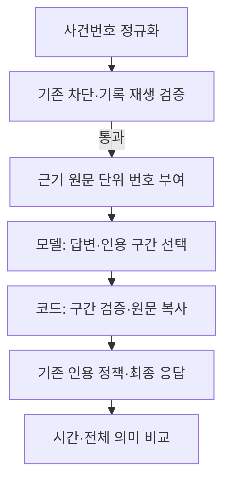

# 인용 처리 지연 개선 설계

승인: 사용자가 1번을 먼저 검증하고 통과하면 2번도 시도하도록 요청했다. 필요한 수정·테스트·실험을 진행한다. 커밋, 서비스 재시작, 데이터·인덱스 변경은 포함하지 않는다.

## 단계 1: 사건번호 표기 오탐

공유 reference extractor가 사건번호 사이의 가로 공백을 인식하고 공백 없는 정규형을 반환한다. 헤더, 본문, 사용자·이전 대화 참조, 인용 backfill에도 같은 정규형을 사용한다. 사건번호의 연도·사건 종류·일련번호는 그대로 비교한다. 줄바꿈을 가로 공백처럼 합치지 않는다.

검사 우회를 하는 방법과 특정 사례를 예외 처리하는 방법은 사용하지 않는다. 공통 extractor를 고쳐 같은 입력이 같은 번호로 비교되게 한다. 잘못된 번호, 다른 source, 미지 source, 날짜 오인은 계속 차단해야 한다.

통과 기준: 실패 재현 후 새 회귀 테스트와 기존 CPU backend·웹 검사 통과, 기록된 답변의 전후 검사 대조, 알려진 `99다 40418` 오탐 제거, 설명되지 않은 기존 검사 실패의 해제 없음. 실제 생성 본문을 변경하지 않는다. 기록 재생에서 제거한 재호출 비용은 반사실적 계산이며 실제 웹 속도라고 표현하지 않는다.

## 단계 2: 원문 인용 복사 pilot

1번 통과 뒤 실험 전용 모델 wrapper를 만든다. 기존 generator·복구·최종 스키마·검사·표시 흐름은 유지한다. wrapper의 내부 생성 스키마는 `quote` 대신 근거의 `quote_start`, `quote_end` 단위 번호를 받는다. 코드가 선택한 연속 원문 범위를 그대로 복사해 최종 `Citation.quote`를 구성한다. 인용하지 않으면 두 값은 null이다.

근거 원문을 안정적인 문장 단위로 나누고 각 단위에 번호를 붙인다. 원문 전체를 보존하며 단위별 시작·끝 offset을 저장한다. 모델이 계산한 문자 offset은 받지 않는다. 선택 번호는 같은 source 안에서 시작≤끝, 유효 범위, 정수인지 확인한다. 잘못된 선택은 구조화 생성 오류로 처리하고 기존 재시도 한도를 따른다. 제목·법률명·사건번호와 reference는 원래처럼 검증한다. 원문 복사 자체를 주장 지원이나 법률적 정확성으로 인증하지 않는다.

대안은 quote를 제거하는 방법 또는 모델이 문자 offset을 계산하는 방법이다. 앞 방법은 인용 기능을 잃고, 뒤 방법은 작은 모델의 문자 계산 오류 위험이 있어 단위 번호 선택을 사용한다. 이 pilot은 기본값에 적용하지 않는다.

입력은 기존 개발용 frozen 질문 중 순번 `[1,15,26,40,55,56,63,75]` 8개다. 기존 오류·조건 손실 사례를 포함하도록 먼저 고정한 선택이며 전체 질문 집단의 대표 표본은 아니다. 근거와 분석은 고정하며 두 방식에 동일하게 제공한다. 모델은 qwen3:4b, context 12288, 출력 2048, temperature 0.2, think OFF다.

회차당 8문항×2방식, 두 회차 32턴과 별도 워밍업 4턴을 실행한다. 쌍별 seed를 같게 하고 2회차 선후를 뒤집는다. 최초 호출 시간과 인용·JSON 재시도까지 포함한 전체 처리 시간을 구분한다. GPU lock을 사용하며 실패도 분모에 포함한다. 소스·입력·요청을 추론 전에 해시로 고정한다.

pilot의 개선 신호는 두 회차 모두 전체 처리 시간 중앙값 10% 이상 감소, p90 비증가, 거부·오류·추가 호출 증가 없음이다. AI reviewed (Codex)가 16쌍 전체 필드·질문·참고 답변·제공 근거·복사 인용을 읽는다. 새 조건·예외 누락, 지원되지 않는 단정, 잘못된 인용 구간 또는 uncertain이 있으면 후보를 채택하지 않는다. 통과해도 전체 개발·held-out·실제 웹 검증 전 서비스 적용은 하지 않는다.

