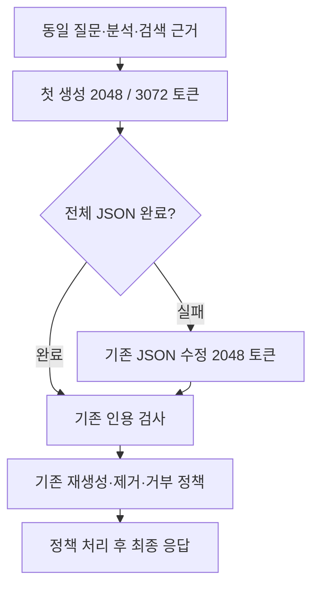

# 첫 생성 출력 한도와 재호출 비교 설계

## 목적과 근거

사용자가 선택한 2번, 긴 응답의 재호출 원인 분석을 수행한다. 기존 실패 원문 검토에서 구조화 실패 9건은 모두 2,048토큰에서 잘렸다. 반복 문장과 긴 직접 인용이 출력 예산을 사용했다. 완성된 JSON의 단순 문법 오류는 관측되지 않았다. 인용 재생성은 제공 근거에 없는 조문 번호 등 별도 원인이었다.

## 접근 선택

1. **첫 출력 예산 확장:** 프롬프트와 전체 답변 계약을 유지하며 잘림을 줄이는지 확인한다. 반복이 계속되면 오히려 느려질 수 있다. 이번 후보로 선택한다.
2. 출력 필드 축소·길이 지시: 이전 시험에서 품질 회귀 또는 효과 불일치가 있었다. 이번에 다시 섞지 않는다.
3. 잘린 원문 이어 생성: 전체 답변의 연결과 검증을 새로 설계해야 한다. 이번 범위에서 제외한다.

## 비교 계약

기준은 현재 코드의 첫 호출 2,048토큰이다. 후보는 **턴의 첫 실제 답변 생성 호출만 3,072토큰**이다. JSON 수정과 인용 재생성을 포함한 후속 호출은 양쪽 모두 2,048토큰이다. 모델, 전체 프롬프트, 근거, schema, temperature 0.2, context 12,288, think=false, 재시도 한도와 최종 표시 정책은 같다. 첫 요청의 차이는 `options.num_predict` 하나다. seed는 쌍 안에서 같다.

## 문항·실행

기존 frozen 80문항에서 `[2,26,75,43]`을 결과 생성 전에 고정한다. 2는 최근 중복 제거 시험 양쪽에서 첫 출력이 잘린 사례, 26·75는 이전 기준 방식의 잘림 사례, 43은 잘림 없이 인용 재생성이 있었던 사례다. 대표 표본이 아닌 재호출 진단용 표본이다.

4문항 × 2방식 × 2회차, 총 16턴을 측정한다. 워밍업 4턴은 모두 제외한다. 쌍별 순서를 번갈아 배치하고 2회차에서 뒤집는다. 기존 GPU lock 아래 순차 실행하며 서비스 재시작과 강제 unload는 하지 않는다. 실행기·전체 생성 소스·근거·첫 payload·기준은 추론 전에 해시로 고정한다. 실패와 거부를 집계에서 제외하지 않는다.

## 판정

회차별로 후보의 전체 시간 중앙값이 10% 이상 감소하고 p90, 실제 호출 수, 거부·오류 수가 늘지 않아야 속도 신호 통과다. 두 회차 모두 통과해야 한다. 4표본의 p90은 최댓값이다. 잘림, JSON 재시도, 인용 재생성, 제거와 출력 토큰을 별도로 센다.

8쌍 모두 질문·참고 답변·제공된 전체 근거·양쪽 전체 8필드·완성 초안을 읽는다. AI reviewed (Codex)와 구체적인 이유를 남긴다. 기존 공유 오류와 후보의 새 오류를 구분한다. 새 중요한 의미 오류 또는 uncertain이 있으면 품질 통과로 처리하지 않는다. 자동 인용 검사 통과는 법률 의미 정확성 인증이 아니다.

이 작은 시험만으로 서비스에 적용하지 않는다. 통과 후보의 대표 표본·웹 확인은 후속 판단 대상으로 남긴다. 분석·검색은 고정하므로 이번 시간을 실제 웹 첫 답변 지연이나 TTFT라고 쓰지 않는다. 원문과 payload는 private 실험 폴더에만 저장한다. root 코드·설정, 이전 변경과 실행 상태를 보존하고 commit하지 않는다.
