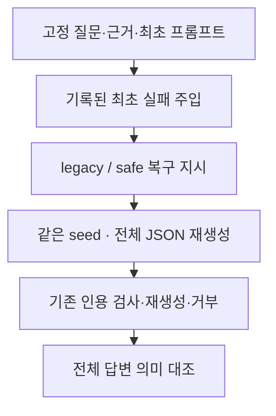

# 같은 최초 실패 입력의 복구 비교

사용자 승인: 이전 결과의 동일 실패 본문 비교 제안에 대한 `진행해줘`. 실행 범위는 복구 측정과 검토다. 기존 서비스에 후보를 적용하지 않는다.

## 목적과 선택

이전 80문항 비교는 첫 생성의 변동도 포함했다. 이번에는 기록된 최초 실패를 주입하고 복구부터 측정한다. 두 방식에 같은 질문, 분석, 근거, 최초 프롬프트와 실패 예외를 제공한다. 실패 본문은 진단 자료이며 모델에게 새로운 근거로 전달하지 않는다.

실패를 다시 발생시키는 방법은 첫 생성 변동을 다시 포함한다. 잘린 본문을 모델 입력에 넣는 방법은 기존 복구 계약을 바꾼다. 따라서 **기록된 예외를 실제 생성기에 주입하는 방식**을 선택한다.

## 입력과 실행

이전 주 비교에서 첫 호출이 실패한 8건을 모두 사용한다. 최초 프롬프트의 반복 억제 여부도 보존한다. 고유 질문은 6개이며 같은 프롬프트를 공유하는 사례가 있으므로 8개 독립 질문이라고 표현하지 않는다. 두 번째 호출까지 실패한 recovery 15번의 두 번째 실패는 새 최초 실패로 추가하지 않는다.

기존 Orchestrator와 Generator를 그대로 사용한다. 첫 호출은 기록된 StructuredOutputError를 돌려주고 실제 모델 호출을 생략한다. 그 뒤 JSON 재시도 1회와 필요한 인용 재생성·JSON 재시도는 기존 한도와 정책에 따라 실행한다. 초기 실패의 재현 시간은 측정에서 제외한다.

두 회차에 각각 8건 × 2방식을 실행한다. 회차별 방식마다 워밍업 1건은 제외한다. 측정 턴은 32개이며 새 모델 호출 수는 인용 정책 때문에 32보다 클 수 있다. 첫 회차의 쌍별 선후를 번갈아 배치하고 두 번째 회차에서 뒤집는다. 각 쌍은 같은 seed를 사용하며 회차 간에는 seed를 바꾼다. seed는 실험 요청에서만 지정한다.

모델은 qwen3:4b, context 12288, 출력 한도 2048, temperature 0.2, think OFF다. 기존 GPU lock 아래 순차 실행한다. 재시작·강제 unload는 하지 않는다. 기존 소스와 새 실행기·입력·요청 payload를 첫 추론 전에 해시로 고정한다.

## 측정과 판정

첫 실제 복구 호출의 시간·토큰·종료 사유와 실패 뒤 전체 정책 처리 시간을 따로 보고한다. 재생성·인용 제거·거부·오류도 포함한다. 원래 최초 호출 시간을 더한 값은 계산된 추정치일 뿐 실제 사용자 대기 시간이라고 표현하지 않는다.

속도 개선 신호는 두 회차 모두 복구 호출 중앙값이 10% 이상 감소하고 p90이 늘지 않을 때로 정한다. 거부·오류·추가 호출이 늘면 효과를 보류한다. 표본이 작고 실패 사례로 선택됐으므로 통계적 유의성이나 일반 80문항 효과를 주장하지 않는다.

AI reviewed (Codex)가 각 회차의 8쌍, 총 16쌍을 전체 8필드·질문·참고 답변·제공 근거와 대조한다. 최초 실패의 불완전 필드와 기존 답변의 오류를 새 회귀와 구분한다. 새 필수 조건·예외 누락, 잘못된 주체·단정·인용 지원 회귀가 있거나 판정이 불확실하면 개선 후보로 인정하지 않는다. 기존 인용 검사 통과는 의미 정확성 인증이 아니다.

이 소규모 비교가 통과해도 서비스에 적용하지 않는다. 이전 80문항에서 실패한 품질 기준을 통과하는 별도 검증이 필요하다.
