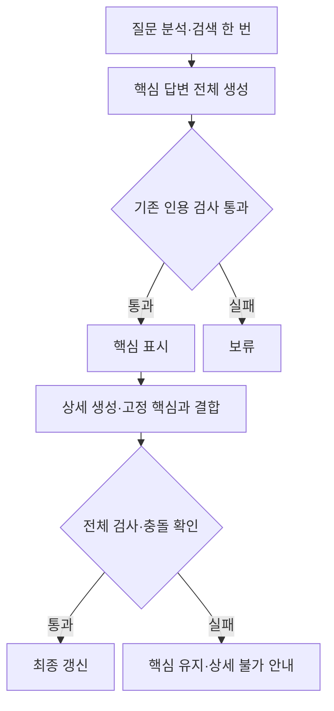

# 검증된 핵심 답변 우선 표시 시험 설계

## 승인과 범위

사용자가 제안된 방향으로 테스트하도록 승인했다. 첫 후보는 핵심 답변·상세 설명 분리다. 부분 복구는 별도 후보로 남겨 이번 효과와 섞지 않는다. 별도 worktree에서 구현하고 운영 코드·서버·DB·설정·코퍼스를 변경하지 않는다. 자동 commit은 없다.

## 구조

기존 분석·검색·근거 구성은 한 번 수행한다. core 모델은 reasoning, conclusion, conditions, exceptions, missing_facts, citations, uncertainty, confidence를 필수 필드로 생성한다. 필수 조건과 예외의 개수·문장 길이는 제한하지 않는다. reasoning을 먼저 작성한다. 이를 LegalAnswer로 변환할 때 조건·예외를 analysis에 모두 보관한다. 기존 backfill·Verifier·재생성 한도를 거친 뒤 verification.ok와 accept인 완성 답변만 core_response로 보낸다. 핵심의 인용 제거 결과는 표시하지 않고 답변을 보류한다.

상세 모델은 같은 전체 근거와 고정된 core를 받아 consistency, analysis, legal_issues, possible_actions, additional_information_needed, citations, uncertainty, confidence를 생성한다. consistency=conflict이면 상세를 표시하지 않는다. summary는 생성시키지 않고 이미 표시한 결론을 고정한다. 핵심 분석·조건·예외·미확인 사실·불확실성을 최종에 유지한 뒤 상세를 추가하고 전체를 재검사한다. 모델의 consistency 자기 보고는 의미 정합성의 보증이 아니며 전체 AI 읽기 검토로 추가 확인한다. 상세 실패 시 core를 유지하고 detail_status=unavailable을 보고한다. 핵심 이후 연결이 끊겨도 검사를 마친 core만 대화에 한 번 저장한다.

백엔드는 추가 POST /v1/chat/staged의 NDJSON 이벤트로 core_response와 final_response를 전달한다. Flask는 시험 전용 LEGAL_STAGED_CHAT=1에서 이 경로를 사용하고 각 단계의 표시 텍스트를 기존 추가 검사에 넣는다. 화면은 core_response에서 연결을 유지하고 final_response에서 같은 답변을 갱신·종료한다. 기존 /v1/chat 및 기본 화면 경로는 유지한다.

## 사전 판정

- 동일 qwen3:4b Q4_K_M, f16 KV, FA ON,37/37 GPU, parallel1, batch512,ctx12288,predict2048,temperature0.2,think false. 모든 단계·복구에 동일 한도. 근거5개 전문·질문·참고 답변·분석/검색 스냅샷 보존.
- 문항[0,20,40,60,43,2], 예열26. ABBA legacy→staged→staged→legacy,2차 문항 역순.24회 측정+제외 예열4회. seed=2026101280+round×100+원래 위치,후속 호출은1000×호출 위치 추가.
- 속도: 두 회차 모두 첫 검증 답변 중앙값20% 이상 감소,p90 증가 없음. 핵심 표시 성공은 각 군6/6,오류·거절 증가 없음. 전체 완료 중앙값·p90도 별도로 공개하고 중앙값50% 초과 증가는 채택을 막는다. 상세 unavailable이나 인용 재생성·제거 증가도 채택을 막는다.
- 입력: 각 arm의 정확한 요청과 전체 근거를 사전 고정한다. 스키마·단계 지침의 변경은 승인된 후보 차이다. 공유 근거·사용자 메시지는 동일하다. 모든 호출의 보고 prompt count+2048≤12288,잘림·context shifting 없음. 상세에 core가 추가돼 prompt count가 달라지는 점을 공개한다.
- 품질:12쌍 각각 기존 최종8필드,후보 core 전체 및 최종8필드,완료 초안·검사를 제공 근거 전체와 비교한다. core만으로 질문에 답해야 하며 필수 조건·예외·주체·강행 효과·판단 방향을 잃으면 실패다. 핵심/상세의 새 충돌·오류나 uncertain은 통과를 막는다. 기존 답변 오류와 분리한다. 단순 인용 검사 통과는 법률 의미 정확성 인증이 아니다.
- 먼저 단위·API·Flask·JS에서 표시 경계·실패·연결 종료·저장 계약을 검사한다. 전체 회귀를 새로 실행한다. 실제 모델 호출을 기존 파서/검사/정책으로 다시 재생한다.
- runtime 파일은 원본 모델과 운영11434를 읽기만 한다. 각 블록 새 소유11435 서버,전용 모델 메타데이터,원본 블롭 읽기 전용 참조,download/prune 금지,GPU 잠금. 실제 commit 로그·/api/ps 확인,소유 서버만 정리.
- pilot 시간은 고정 분석·검색 이후 생성·검사와 이벤트 생산 경계다. 전송 경계는 별도 지연 주입 HTTP 시험으로 확인한다. 브라우저·새 실제 검색을 포함한 사용자 TTFA나제품 p90으로 주장하지 않는다.6개 개발 문항,독립 holdout·전문가 인증 없음. 통과해도 운영 적용하지 않는다.
