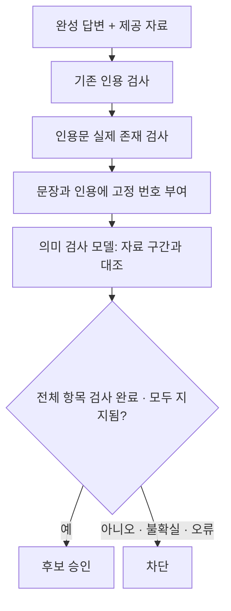

# 답변 의미 검증 시험 설계

## 목적

자료에 사건번호가 있다는 이유만으로 잘못된 결론이 통과하는 문제를 줄인다. 판결과 당사자 주장, 긍정과 부정, 의무와 재량, 적용 요건과 예외를 검사한다. 사용자가 승인한 정확도 개선 방향의 격리 시험이다.

## 범위

작업 공간은 `.worktrees/semantic-verification`이다. 기존 생성기, API, 프런트엔드, 운영 설정은 수정하지 않는다. 새 검증기의 결과가 불확실하거나 파싱에 실패하면 답변을 승인하지 않는다. 인용 삭제로 의미 오류를 승인하는 경로도 만들지 않는다.

## 설계 선택

- 규칙 검사만으로는 판결 취지와 예외를 판단하기 어렵다.
- 답변 전체의 단일 통과 점수는 어떤 문장을 확인했는지 알 수 없다.
- 따라서 모든 텍스트 필드와 인용을 번호로 고정한다. 모델은 항목별로 `supported`, `contradicted`, `insufficient`를 반환한다. 자료 구간 번호는 코드로 확인한다. 검사 누락·중복·가짜 구간·모델 오류는 차단한다.
- 인용문은 공백과 Unicode 표기만 정규화한다. 단어·부호·부정 표현은 바꾸지 않는다. 자료에 없는 직접 인용은 모델 호출 전에 차단한다.
- 인용 번호가 같은 자료에 존재하는 것과 그 인용문이 해당 번호를 설명하는 것은 다르다. 후자는 의미 검사 대상이다.
- 모델의 승인도 법적 정확성의 증명은 아니다. 같은 계열 모델의 공통 오류, 자료의 누락과 과거 법령, 문장 내부 복합 주장 누락은 남는 한계다.

## 사전 평가 기준

최근 두 시험에서 확인한 8개 주제를 사용한다. 각 주제에 자료로 지지되는 짧은 답변과 한 가지 의미 오류를 넣은 답변을 만든다. 추가로 같은 주제의 실제 생성 답변 8개를 보존한다. 총 24개 답변이다. 짧은 대조쌍은 전체 기존 답변을 수정한 결과가 아니다.

질문·전체 5개 자료·라벨·입력 해시를 모델 호출 전에 고정한다. 정답 라벨은 AI가 제공 자료와 대조해 작성하며 전문가 법률 검토를 대신하지 않는다. 참고 답변은 검사 모델에 제공하지 않는다.

기존 규칙 검사와 새 검증기를 비교한다. 기존 `qwen3:4b`와 설치된 `qwen3:8b`를 각각 2회 검사한다. 모델별 48개, 총 96개 측정이다. 모델·회차별 예열 1개는 제외한다. 입력 축소, 다운로드, 운영 서버 변경은 하지 않는다.

후보의 다음 단계 통과 조건:

1. 각 회차에 오류 대조군 8개와 실제 오류 답변 8개를 모두 차단한다.
2. 정상 대조군은 각 회차에 7개 이상 승인한다.
3. 구조 출력 실패와 입력 축소가 없다.
4. 예열 제외 검사 시간 중앙값은 모델별 20초 이하다.

조건을 만족해도 운영 배포는 하지 않는다. 독립된 질문과 전문가 라벨로 확인해야 한다. 시간은 완성 답변 이후 추가 검사 시간이며 검색·생성·브라우저 첫 응답 시간을 포함하지 않는다.

## 측정 전 용량 변경

첫 예열의 입력 10,100토큰과 출력 한도 3,072토큰이 초기 12,288 용량을 넘을 수 있어 측정 전에 18,432로 변경했다. 초기 예열과 계획은 `budget-probe/`에 보존한다. 입력·검사 프롬프트·라벨·통과 조건은 유지한다. 예열에서 잘못된 자료 구간 번호가 나온 결과도 보존한다.

## 중단 시험 보존과 재측정

첫 24개 검사와 2개 예열은 `interrupted-run/`에 보존한다. 요청 중 로그에 약 5시간 공백이 있고 이후 240초 시간 초과가 연속 발생했다. 절전·복귀 영향은 가설이며 원인은 확정하지 않았다. 8b는 실제 37개 레이어 중 출력 레이어 1개가 CPU에 적재되었다. 두 모델의 속도 차이를 모델 크기만의 효과로 해석하지 않는다. 새 시험은 같은 입력과 검사 코드로 수행하고, 요청을 전송 전에 저장한다. 시간 초과 시 해당 시험을 중단하여 연속 오염을 방지한다.
