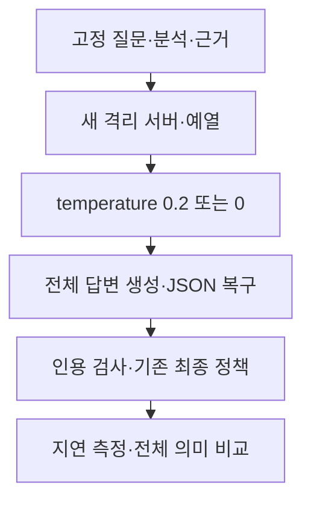

# Temperature 0 시험 결과 — 2026-10-11

> 보관 위치 변경 (2026-10-13): 시험용 worktree와 브랜치를 정리했다. 후보 코드와 실행 상태는 압축 보관했으며, 아래 측정 원자료는 유지했다. [정리 내역과 복원 방법](unsuccessful-experiments-cleanup-2026-10-13.md)을 참고한다.

## 1. 결론

답변 요청의 temperature를 0.2에서 0으로 바꾸는 후보를 채택하지 않는다. 운영 소스와 설정은 변경하지 않았다.

입력 보존: **통과**. 속도 기준: **실패**. 상대 품질 기준: **실패**.

이 시험은 고정된 검색·분석에서 답변 생성과 기존 최종 정책이 끝날 때까지 측정했다. 브라우저 첫 표시나 검색을 포함한 전체 요청 시간을 측정한 것은 아니다.

## 2. 조건과 범위

- 동일 `qwen3:4b` Q4_K_M, Ollama 0.16.2, f16 KV, Flash Attention ON, GPU 37/37 레이어, parallel 1, num_batch512.
- 컨텍스트12288, 출력2048, think false, 전체 출력 스키마. 질문·참고 답변·5개 근거·프롬프트·JSON 복구·인용 검사·기존 최종 정책을 유지했다.
- 문항0·20·40·60·43·2, 별도 예열26. 측정24회와 제외 예열4회. 1차0.2→0, 2차0→0.2, 2차문항 역순. seed는 쌍마다 같다.
- 첫 요청의 유일한 차이는 `options.temperature`다. JSON 복구와 인용 재생성에도 해당 설정을 적용했다. temperature0이나 같은 seed가 완전히 같은 출력·정확한 답변을 보장한다고 가정하지 않았다.

Ollama [v0.16.2 옵션 정의](https://github.com/ollama/ollama/blob/v0.16.2/api/types.go)에서 temperature가 요청별 predict 옵션임을 확인했다. 이 설정의 속도와 품질 효과는 실제 측정으로 판단했다.

## 3. 시간·출력·호출

| 회차 | temperature | 최종 처리 중앙값 | p90 | 첫 입력 평가 중앙값 | 디코딩 중앙값 | 출력 토큰 중앙값 | 실제 호출 |
|---|---:|---:|---:|---:|---:|---:|---:|
| 1 | 0.2 | 14.124초 | 54.877초 | 1.940초 | 55.61 tokens/s | 648.5 | 7 |
| 1 | 0 | 13.282초 | 59.219초 | 1.959초 | 54.34 tokens/s | 595.5 | 7 |
| 2 | 0.2 | 15.274초 | 54.928초 | 1.975초 | 54.46 tokens/s | 701.5 | 7 |
| 2 | 0 | 13.358초 | 54.884초 | 1.984초 | 54.68 tokens/s | 595.5 | 7 |

- 1차 중앙값 변화: **-5.96%**. 사전 속도 기준 **실패**.
- 2차 중앙값 변화: **-12.55%**. 사전 속도 기준 **통과**.

두 회차 모두 중앙값이 10% 이상 줄어야 한다. p90·호출·전송 오류·거절·인용 재생성·제거도 늘지 않아야 한다. 6문항의 nearest-rank p90은 최댓값이다. 디코딩 지표는 실제 호출별 `eval_count/eval_duration` 중앙값이다. 출력량은 복구·재생성 호출을 합친 문항별 토큰 수다.

| 회차 | temperature | 최종 answer/rejected/error | 출력 상한 종료 호출 | 인용 재생성 문항 | 인용 제거 문항 |
|---|---:|---|---:|---:|---:|
| 1 | 0.2 | 6/0/0 | 1 | 0 | 0 |
| 1 | 0 | 6/0/0 | 1 | 0 | 0 |
| 2 | 0.2 | 6/0/0 | 1 | 0 | 0 |
| 2 | 0 | 6/0/0 | 1 | 0 | 0 |

측정의 실제 호출은 28회, 제외 예열의 실제 호출은 4회다. 측정 시간에는 해당 문항의 JSON 복구와 인용 재생성이 포함된다. 모든 예열은 추가 호출 여부와 관계없이 사전 규칙대로 제외했다.

### 문항별 비교

| 회차 | 문항 | 0.2 시간/호출 | 0 시간/호출 |
|---|---:|---|---|
| 1 | 0 | 15.891초 / 1 | 20.918초 / 1 |
| 1 | 20 | 11.354초 / 1 | 11.700초 / 1 |
| 1 | 40 | 12.357초 / 1 | 14.002초 / 1 |
| 1 | 60 | 11.534초 / 1 | 12.562초 / 1 |
| 1 | 43 | 16.159초 / 1 | 8.112초 / 1 |
| 1 | 2 | 54.877초 / 2 | 59.219초 / 2 |
| 2 | 0 | 17.084초 / 1 | 18.814초 / 1 |
| 2 | 20 | 11.226초 / 1 | 12.442초 / 1 |
| 2 | 40 | 15.015초 / 1 | 14.200초 / 1 |
| 2 | 60 | 15.533초 / 1 | 12.516초 / 1 |
| 2 | 43 | 7.909초 / 1 | 7.925초 / 1 |
| 2 | 2 | 54.928초 / 2 | 54.884초 / 2 |

### 입력 캐시와 실행 조건

서버의 cache slot 로그 `prompt/used/remaining`을 예열 포함 모든 실제 호출과 연결했다. `prompt_eval_count`에는 재사용 접두부가 포함되므로 count/duration을 새 입력 토큰 처리량으로 표시하지 않았다.

| 회차 | temperature | 첫 호출 재사용 토큰 범위 | 첫 호출 새 평가 토큰 범위 | Ollama 보고 VRAM |
|---|---:|---:|---:|---:|
| 1 | 0.2 | 810–814 | 5025–5837 | 4525.2 MiB |
| 1 | 0 | 810–814 | 5025–5837 | 4525.2 MiB |
| 2 | 0.2 | 810–814 | 5023–5837 | 4525.2 MiB |
| 2 | 0 | 810–814 | 5023–5837 | 4525.2 MiB |

모든 블록에서 배치512·f16·Flash Attention·전체 GPU·컨텍스트12288을 확인했다. 입력 잘림과 context shifting은 관찰되지 않았다. paired 첫 prompt count는 같고, 예열 포함 모든 보고된 prompt count+2048은 컨텍스트 이내였다. 내부 토큰 전체가 동일하다는 독립 증명은 아니다.

## 4. 전체 상대 품질 검토

질문·참고 답변·근거 전체는 직전 배치 시험과 같음을 사전 비교했다. 변경되지 않은 입력의 전체 읽기는 재사용했고, 이번 최종8필드·완료 초안·검사 결과12쌍은 새로 읽었다. 각 사유는 `AI reviewed (Codex)`로 기록하고 입력 및 두 답변의 해시로 연결했다. 기존 답변 오류와 후보의 새 오류를 구분했다.

결과: **pass 4, fail 5, uncertain 3**. 새 중요한 오류나 uncertain이 있으면 품질 기준을 통과시키지 않는다. pass는 이번 근거에 대한 상대 비교 통과다. 전문가의 법률 정확도 인증은 아니다. 자동 인용 검사 통과도 문장의 법률 의미가 맞다는 보증은 아니다.

| 회차 | 문항 | 판정 | AI reviewed + 이유 |
|---|---:|---|---|
| 1 | 0 | fail | AI reviewed (Codex): 중심 인과관계 법리는 유지했지만 후보 uncertainty는 심근경색 직접 사례가 없다는 이유로 S3·S4를 모두 공무원연금법 범위 밖으로 분류했습니다. S4는 대사의 과로와 사망 사이 공무 인과관계 판단이며 질병 종류 차이와 적용 법률을 혼동한 새 오류입니다. 후보의 S1·S2·S5 quote도 원문을 바꾼 요약을 직접 인용처럼 제시했습니다. 기준 답변의 S2를 경찰관 인정 사례로 설명한 오류 및 84구1178 대법원 사건 혼동은 기존 오류로 분리했습니다. |
| 1 | 20 | pass | AI reviewed (Codex): 후보 summary는 사실과 다른 공사실적 자료와 공공성·공정성 침해 가능성이라는 핵심 조건을 유지하며, 과대신고만으로 무조건 취소된다고 단정하지 않습니다. 기준 답변의 담합 입찰참가 제한 조문을 낙찰예정자 취소와 연결한 설명은 후보에서 빠졌습니다. 양쪽의 질문 반복 analysis, S1 후속 판단 미설명 및 담합 신고 행동 제안은 기존 한계로 분리했습니다. 후보의 구체적 확인 항목에서 새 중요한 조건 손실은 확인되지 않은 상대 비교 통과입니다. |
| 1 | 40 | uncertain | AI reviewed (Codex): 제85조의 조사·징벌, 교육생 선정, 질병·신체조건의 세 가지 선정 금지를 모두 유지했고 제87조의 보류를 선정 제한과 구분했습니다. 기준 답변의 일반 수형자 판례를 군수형자 재량으로 연결한 혼동도 줄었습니다. 다만 후보 uncertainty가 구체적 질병 범위와 인정 기준이 국방부령으로 정해져 있다고 새로 단정했습니다. 제공 조문은 질병·신체조건으로 훈련을 감당할 수 없는 경우와 포괄 위임을 보여줄 뿐 그런 세부 기준의 존재·내용은 확인하지 못해 전체 필드 보존 통과를 확정하지 않았습니다. |
| 1 | 60 | pass | AI reviewed (Codex): 기준과 후보 모두 광고·계약 조건 차이, 명시적·묵시적 합의와 구체 사정 확인을 유지합니다. 후보는 공동불법행위와 당사자 역할·귀책사유를 추가하고 광고·계약 조항 및 실제 손해를 확인 대상으로 남겼습니다. 두 답변의 책임을 지는 경우가 많다는 근거 없는 빈도 표현, 추상적인 analysis, 기망·사용자 관계의 구체 조건 미설명은 기존 오류로 분리했습니다. 새 중요한 의미 손실을 확인하지 못한 상대 비교 통과이며 두 답변의 독립 정확성을 뜻하지 않습니다. |
| 1 | 43 | pass | AI reviewed (Codex): 후보는 농장경영자·닭과 오리·매월·장관에게 신고라는 핵심 의무를 analysis와 summary 및 행동에 유지했습니다. 법 제8조의2 제2항을 명시하고 세부 기한·방법은 추가 확인 대상으로 남겼습니다. 시행령 접수 근거와 직접 인용은 줄었지만 이 예/아니요 질문의 필수 의미가 빠지지 않았습니다. 새로운 날짜·생략 예외·양식을 만들어내지 않은 상대 보존 통과입니다. |
| 1 | 2 | fail | AI reviewed (Codex): 기준 답변에도 과잉금지 판단의 반대 설명과 효력 상실 조항 누락이 있습니다. 후보는 단체의 공적·사회적 역할과 해산으로 구성원의 활동을 막지 못한다는 기준 답변의 이유를 잃고, 법인격 소멸 처분을 표현 방법 규제로 요약했습니다. 처분 자체가 군사 긴장이나 생명·신체 위험을 초래하지 않았다는 다른 주체의 단정도 새로 추가했습니다. 직접·구체적 공익 침해와 제재 긴요성을 검토해야 한다는 제공 근거를 이런 설명으로 대체할 수 없어 새 중요한 의미 회귀로 판정했습니다. |
| 2 | 0 | fail | AI reviewed (Codex): 중심 인과관계 법리는 유지하고 기준 답변의 S2를 경찰관 인정 사례로 오독한 부분을 줄였습니다. 하지만 후보는 S1·S2·S5를 대법원 판결로 묶은 뒤 S2를 84구1178로 식별했습니다. 제공 S2에서 84구1178은 서울고등법원 원심 번호이므로 기준 답변에 없던 명시적인 잘못된 판결 식별이 추가됐습니다. S3의 법률 체계 차이를 구분한 개선은 인정하지만 기준 답변의 의학적·업무 증거에 따른 조건 판단을 더 높은 confidence로 바꾸면서 이 인용 오류가 남았습니다. 기존 S2 사실 오독과 후보의 새 식별 오류를 분리했습니다. |
| 2 | 20 | fail | AI reviewed (Codex): 기준 summary가 유지한 사실과 다른 자료 및 공정한 경쟁 침해 우려라는 조건을 후보는 실적을 과대신고한 경우에 한해 적용될 수 있다는 제한으로 바꿨습니다. 허위 작성 유형과 실질적 공정성 위험 판단을 과대신고 여부·금액으로 좁혔고 uncertainty에도 같은 제한을 반복했습니다. S1의 단순 오기와 위험 부정 판단 및 S5의 허위 실적 내용을 이런 범위 제한으로 대체할 근거가 없습니다. 양쪽 analysis의 질문 반복은 기존 문제이지만 후보의 조건 축소는 새 중요한 회귀입니다. |
| 2 | 40 | uncertain | AI reviewed (Codex): 세 가지 선정 금지 사유와 강행 효과는 모두 유지했고 제87조의 보류를 구분했습니다. 기준 답변의 일반 수형자 판례 혼용과 기타 제한 사유 가능성은 줄었습니다. 그러나 기준 답변은 구체적 질병 기준이 제공되지 않았다고 밝혔는데 후보는 범위와 인정 기준이 국방부령으로 정해져 있다고 단정합니다. 포괄 위임만으로 이런 세부 기준의 존재를 확인할 수 없어 새 추가 설명의 적합성을 확정하지 못했습니다. 핵심 의무 보존과 별개로 전체 필드 통과를 보류했습니다. |
| 2 | 60 | fail | AI reviewed (Codex): 후보는 기준 답변에 없던 분양대행사와 시행사가 배상 책임을 지는 경우가 많다는 빈도 표현을 추가했습니다. 제공한 서로 다른 사건 조각으로 일반적인 발생 빈도를 뒷받침할 수 없습니다. 기준 답변이 명시한 수분양자의 주의 여부와 분양대행사의 의도를 일반적인 귀책사유·조건 명시성으로 바꿔 S1의 책임 제한 사정도 추상화했습니다. 공동불법행위와 역할 확인을 추가한 개선은 있지만 새 빈도 단정 때문에 전체 보존 기준을 통과시키지 않았습니다. 기준의 추상적인 analysis와 법적 근거가 명확하지 않다는 과도한 불확실성은 기존 오류로 분리했습니다. |
| 2 | 43 | pass | AI reviewed (Codex): 두 답변 모두 농장경영자·닭과 오리·매월·농림축산식품부장관이라는 주체·대상·주기·신고처와 제8조의2 제2항 의무를 유지했습니다. 후보의 legal_issues에서 신고 의무 항목이 줄었지만 analysis와 summary가 명확히 답하며 추가 정보에 세부 기한·방법을 남겼습니다. 예외나 날짜를 새로 만들지 않았고 중요한 의미 손실을 확인하지 못했습니다. |
| 2 | 2 | uncertain | AI reviewed (Codex): 후보는 기준 답변의 근거 없는 정부 목적 무관 설명을 줄이고 단체의 공적·사회적 역할, 폭파 사실만으로 직접 위험을 증명할 수 없다는 점, 해산 제재의 긴요성 부족을 설명했습니다. 다만 표현 내용과 무관한 방법 규제가 비례 원칙을 위반할 수 있다는 설명을 사건 결론의 근거로 연결했습니다. 제공 근거는 내용 제한의 엄격한 심사와 단순 방법 규제를 구분하므로 이 연결의 적합성을 확인하지 못했습니다. 두 답변의 효력 상실 조항 누락은 기존 한계로 분리했습니다. 개선된 부분이 있어도 전체 법리 보존 통과를 확정하지 않았습니다. |

첫 raw 출력이 같은 쌍은 0/12, 최종 답변 전체가 같은 쌍은 0/12다. 회차 간 비교에서 temperature0의 raw·최종 답변은 3/6문항이 같고 0.2는 0/6문항이 같았다. 회차 간 seed와 문항 순서가 달라 이 결과로 완전한 결정성이나 품질 향상을 주장하지 않는다. 같은 후보 문장도 각 회차 기준 답변에 이미 있던 오류 여부에 따라 상대 판정이 달라질 수 있다.

## 5. 검증과 보존

- 원본 기록에서 실제 요청·순서·seed·파서·스키마·완료 초안·인용 검사·기존 최종 정책을 새로 재생했다.
- 회귀 시험은 새로 실행하지 않았다. 이전 `630 passed / 3 skipped` 증거를 소스·설정·시험 파일248개의 현재 root/worktree 해시와 연결해 재사용했다. 이번 런타임 측정과 정책 재생은 별도의 새 증거다.
- 최종 감사가 통과했다. root 기준 파일434개, 이전 실행 상태12개, 외부 모델·키·실행 파일9개의 보존을 확인했다. root 예상 추가 경로는 결과·설계·계획 문서3개다. stage·commit은 하지 않았다.
- 서버4개는 별도 포트11435와 모델 메타데이터를 사용했다. 원본 블롭은 읽기 전용으로 참조했다. 다운로드·prune 없이 소유 모델과 프로세스만 종료했다. 운영 포트11434 모델 목록은 측정 전후 비어 있었다.
- 첫 sandbox 실행은 localhost 조회에서 차단됐고 측정·서버 실행 전에 끝났다. 같은 고정 명령을 승인된 실행으로 재시도했다. 이 실패는 측정값에 포함되지 않는다.

## 6. 제한과 판단

개발 문항6개와 두 반복은 제품의 지연 분포를 추정하기에 부족하다. 별도 holdout과 인간 전문가 검토는 없다. 같은 가중치를 사용해도 출력량과 복구 호출이 달라지므로 디코딩 시간 변화만으로 엔진 처리량의 향상이라고 판단하지 않았다.

temperature0 후보의 입력·속도·상대 품질 기준을 함께 적용해 채택하지 않는다. 기존 운영 설정과 검증 정책을 유지한다.

## 증거

- [사전 설계](superpowers/specs/2026-10-11-temperature-zero-design.md), [실행 계획](superpowers/plans/2026-10-11-temperature-zero.md)
- [지표](../data/eval/reports/chat_pipeline/temperature-zero-2026-10-11/metrics.json), [측정 원본](../data/eval/reports/chat_pipeline/temperature-zero-2026-10-11/results.jsonl), [제외 예열](../data/eval/reports/chat_pipeline/temperature-zero-2026-10-11/warmup.jsonl)
- [전체 검토](../data/eval/reports/chat_pipeline/temperature-zero-2026-10-11/review.jsonl), [품질 판정](../data/eval/reports/chat_pipeline/temperature-zero-2026-10-11/quality.json), [내용 비교](../data/eval/reports/chat_pipeline/temperature-zero-2026-10-11/content-comparison.json), [회차 간 비교](../data/eval/reports/chat_pipeline/temperature-zero-2026-10-11/round-stability.json)
- [정책 재생](../data/eval/reports/chat_pipeline/temperature-zero-2026-10-11/measurement-verification.json), [캐시 대조](../data/eval/reports/chat_pipeline/temperature-zero-2026-10-11/cache-usage.json), [회귀 바인딩](../data/eval/reports/chat_pipeline/temperature-zero-2026-10-11/regression.json)
- [실제 엔진](../data/eval/reports/chat_pipeline/temperature-zero-2026-10-11/engine-confirmations.jsonl), [서버 종료](../data/eval/reports/chat_pipeline/temperature-zero-2026-10-11/lifecycle.jsonl), [최종 감사](../data/eval/reports/chat_pipeline/temperature-zero-2026-10-11/final-audit.json)
