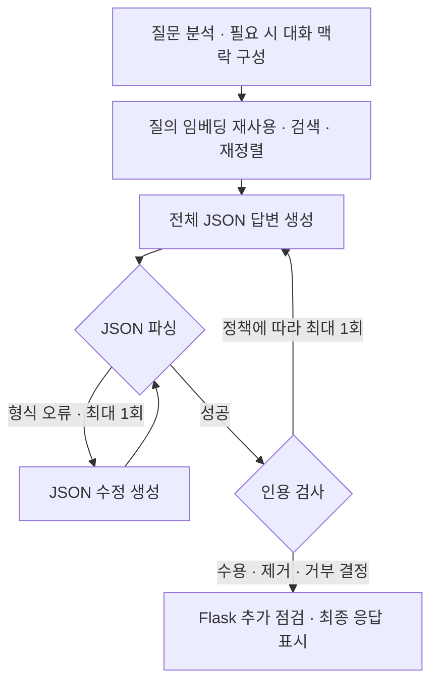

# 검증 후 답변 시간 측정

> 보관 위치 변경 (2026-10-13): 시험용 worktree와 브랜치를 정리했다. 후보 코드와 실행 상태는 압축 보관했으며, 아래 측정 원자료는 유지했다. [정리 내역과 복원 방법](unsuccessful-experiments-cleanup-2026-10-13.md)을 참고한다.

측정일: 2026-10-10. 상태: 검색, 80문항 답변 비교, 20문항 반복, 참고 결론 평가와 웹 요청 비교 완료.

## 1. 적용 결정

- **질의 임베딩 재사용을 유지한다.** 검색 비교 48쌍에서 결과 순서가 모두 같았고 검색 시간이 줄었다.
- **답변 표현의 기본값은 `full`로 유지한다.** `concise`는 답변 생성 중앙값을 줄이지 못했다. AI 읽기 검토에서도 적용 범위와 자격 조건 손실을 확인했다.
- **기존 검사를 마친 답변만 표시한다.** 상태 메시지는 먼저 표시하지만 답변 초안은 표시하지 않는다. 기존 검사는 인용 연결 등을 확인하며, 모든 문장의 법률적 정확성을 보증하지 않는다.

전체 웹 답변의 약 1분 대기가 해결됐다고 판단하지 않는다. 간결한 표현은 `LEGAL_RAG__RAG__ANSWER_STYLE=concise`로만 실험할 수 있다. 사용자 서비스는 재시작하지 않았다.

## 2. 측정 조건

| 항목 | 조건 |
|---|---|
| 기존 코드 기준 | `d03fd466906443b9060d7a3fd9dd6b91542f6885` |
| 하드웨어 | RTX 4060 Laptop, VRAM 8 GB |
| 답변 모델 | Ollama 0.16.2, `qwen3:4b`, Q4_K_M, GPU 37/37 레이어 |
| 실행 설정 | Flash Attention ON, `think: false`, temperature 0.2 |
| 입력·출력 한도 | context 12288, 답변 2048 토큰 |
| 검색 | 코퍼스 5개, 검색 깊이 100, 최종 근거 5개 |
| 검색 모델 | `bge-m3`, query context 1024; `BAAI/bge-reranker-v2-m3`, CUDA float16, max length 512 |
| 융합 | weighted RRF, dense 1.0 / sparse 0.75, RRF k 60 |
| 근거·검사 | 근거별 1500자, 전체 답변 스키마 유지, 인용 재생성 최대 1회 |
| 맥락 설정 | 대화 4턴, 추가 LLM 검색 재작성 없음, 근거 이웃 확장 없음, 사례 금액·날짜 마스킹 OFF |
| 평가 | 개발용 80문항, 동일한 고정 근거, 문항마다 두 방식의 순서를 교대 |
| 시간 집계 | 벽시계 시간, 중앙값, p90은 정렬 후 nearest rank |

GPU 작업은 기존 `gpu.sh` 잠금으로 순차 실행했다. 코퍼스와 인덱스를 변경하지 않았다. 웹 측정은 별도 Flask/API, 대화 저장소와 합성 업로드 문서를 사용한다. 사용자 DB는 사용하지 않는다.

새 검색·웹 측정은 로컬 프로필의 `criminal-v1`, `civil-v1`, `administrative-v1`, `ip-v1`, `statute-api-full-v1`을 사용했다. 고정 근거 비교는 기존 `prompt-tuning-2026-10-06/frozen.jsonl`을 재생한다. 참고 답변은 `prompt-format-2026-10-07/bullets-1/answer_pairs.jsonl`에서 가져왔다. 80문항의 구성은 행정·민사·형사·교차 분야 각각 20개다.

측정 기준은 모델 호출 전에 [PREREG.md](../data/eval/reports/chat_pipeline/verified-latency-2026-10-10/PREREG.md)에 기록했다. 이후 변경은 [AMENDMENTS.md](../data/eval/reports/chat_pipeline/verified-latency-2026-10-10/AMENDMENTS.md)에 남겼다. 원자료 폴더는 Git에서 제외된다. 이 문서는 주요 결과와 판단을 보관한다.

## 3. 검색 비교

자연 질의 40개와 변형 8개를 비교했다. 변형에는 서로 다른 두 질의, 중복 질의, 법령·판례 필터를 포함했다.

| 방식 | 비교 수 | 중앙값 | p90 | 최대 |
|---|---:|---:|---:|---:|
| 기존 검색 | 48 | 2.179초 | 2.828초 | 2.933초 |
| 임베딩 재사용 | 48 | 1.811초 | 1.996초 | 2.084초 |

중앙값 기준 16.9% 감소했다. 같은 문항끼리 계산한 절약 시간의 중앙값은 0.439초다. 두 집계는 서로 다른 계산이다.

각 dense leg, 융합 결과, 최종 재정렬 결과의 순서는 **48/48쌍에서 같았다**. 점수 차이는 `1e-5` 이내였다. 단일 질의는 임베딩 호출이 5회에서 1회로, 서로 다른 두 질의는 10회에서 2회로 줄었다. 캐시는 검색 호출 안에서만 사용한다.

## 4. 같은 근거의 답변 비교

아래 시간은 답변 생성과 기존 검사 시간이다. 질문 분석, 검색, Flask 처리, 브라우저 렌더링은 포함하지 않는다. 워밍업은 제외했다. 두 방식의 최종 제공 근거는 80/80쌍에서 같았고, 전체 답변 필드 8개도 모두 유지됐다.

| 방식 | 문항 수 | 중앙값 | p90 | 최대 | 45초 초과 |
|---|---:|---:|---:|---:|---:|
| `full` | 80 | 16.19초 | 32.38초 | 70.52초 | 5 |
| `concise` | 80 | 17.25초 | 32.53초 | 63.09초 | 3 |

`concise` 중앙값은 6.6% 늘었다. 사전에 정한 15% 이상 개선 기준을 충족하지 못했다. 최대 시간과 45초 초과 건수가 줄었지만 중앙값 개선이나 안정적인 전체 개선의 근거로 사용하지 않는다.

| 항목 | `full` | `concise` |
|---|---:|---:|
| 최종 본문 길이 중앙값 | 896.5자 | 920자 |
| 생성 토큰 중앙값, 추가 호출 포함 | 736 | 803 |
| JSON 수정 호출이 있었던 문항 | 5 | 2 |
| 인용 재생성 문항 | 2 | 2 |
| 최종 인용 제거 문항 | 2 | 1 |
| 별도 `citation_guard` 표기 경고 문항 | 4 | 0 |
| 오류 / 거부 | 0 / 0 | 0 / 0 |

JSON 수정 호출은 모델 호출 수가 파싱된 답변 검사 횟수보다 많은 문항으로 집계했다. 인용 재생성과 같은 문항에서 발생할 수 있으므로 합계를 단순히 더하지 않는다. 전체 스키마를 유지한 이번 지침은 최종 본문 길이도 줄이지 못했다.

별도 표기 경고는 근거·질문에 없는 법률 인용 표기를 찾는 추가 검사 결과다. 표기 정규화 차이도 있을 수 있어 확정된 오류 수로 해석하지 않는다. 최종 인용 제거 문항은 기존 정책에 따라 답변을 반환하지만 검사 결과의 `ok`가 참인 문항과 같지는 않다.

### 오래 걸린 호출

| 방식 | 모델 호출 1회 | 모델 호출 여러 회 |
|---|---:|---:|
| `full` | 74문항, 중앙값 15.57초 | 6문항, 중앙값 58.38초 |
| `concise` | 76문항, 중앙값 17.12초 | 4문항, 중앙값 53.90초 |

45초를 넘긴 8개 응답은 모두 모델을 여러 번 호출했다. `full`의 최대 70.52초 사례는 최초 출력이 2048 토큰 한도에 도달했고, JSON 수정과 인용 재생성이 이어졌다. 출력 생성 시간은 전체 생성·검사 시간의 문항별 비율 중앙값 기준 `full` 85.3%, `concise` 86.0%였다.

### 20문항 반복

| 방식 | 문항 수 | 중앙값 | p90 | 최대 | 45초 초과 |
|---|---:|---:|---:|---:|---:|
| `full` | 20 | 15.89초 | 25.94초 | 34.14초 | 0 |
| `concise` | 20 | 15.39초 | 22.84초 | 33.71초 | 0 |

반복에서는 concise 중앙값이 3.1% 작았다. 15% 개선 기준에는 못 미치며, 80문항 결과와 합산하지 않는다. 반복의 두 방식 모두 JSON 수정·인용 재생성·제거가 없었다.

계획은 모든 반복 쌍의 순서를 처음과 반대로 정했지만 실제 스크립트는 반복 안에서 순서를 교대했다. 10쌍은 처음과 반대 순서, 10쌍은 같은 순서였다. 반복을 시작하기 전에 이 차이를 기록했다. 주 비교 80문항과 채택 기준은 바꾸지 않았다.

도식은 주요 대기 경로를 보여준다. 각 답변 생성은 JSON 수정 최대 1회, 턴 전체의 인용 재생성은 최대 1회다. 따라서 답변용 모델 호출이 최대 4회까지 늘 수 있다. 반복 한도에 도달한 실패는 오류 또는 거부 처리될 수 있다. 검사를 줄이거나 출력 토큰 한도를 낮추는 변경은 이번 측정에 포함하지 않았다.

## 5. AI 읽기 검토

80문항 중 매 4번째 문항 20개와 두 참고 결론 평가 중 통과 여부가 바뀐 14문항을 선택했다. 중복을 제외하면 27문항이다. AI가 두 방식의 전체 본문과 참고 답변을 읽었다. 적용 범위 오류가 의심되는 사례에서는 제공 근거도 확인했다. 사례별 검토 범위와 이유를 [manual_review.jsonl](../data/eval/reports/chat_pipeline/verified-latency-2026-10-10/manual_review.jsonl)에 `AI reviewed (Codex)`로 기록했다. 전문가의 독립 법률 검토는 아니다.

| 순번 | 확인한 차이 | 판정 |
|---|---|---|
| 16 | 서로 다른 법률의 제출 기관을 concise 요약에서 하나로 합침 | 적용 범위 오류 |
| 24 | 근거에서 부정한 퇴임 예외를 concise 결론에서 다시 제시 | 결론과 근거 충돌 |
| 40 | 선정 금지를 “제외할 수 있다”로 표현 | 의무를 재량으로 변경 |
| 52 | 접견 관련 반사적 이익 판단을 빼고 별도 청구의 보충성 판단과 합침 | 핵심 근거 누락 |
| 56 | 과거 조교수 재직자의 자격을 빼고 명시된 전문의 정원도 불명확하다고 표현 | 자격 조건 누락 |
| 76 | 참고 결론의 금지 방향에는 맞지만 별도로 허용되는 보충 사용까지 부정 | 조건 손실; full에도 다른 범위 오류 있음 |

기존 `full`에도 오해와 조건 누락이 있었다. `full`을 유지하는 결정은 법률적 정확성을 인증하는 결정이 아니다. 인용 검사 통과와 의미상의 정확성을 구분해야 한다.

### 참고 결론 평가

동일하게 캐시한 참고 결론으로 모든 본문 필드를 평가했다. `summary`, `legal_issues`, `analysis`, `possible_actions`, `additional_information_needed`, `uncertainty` 전문을 사용하며 1500자로 잘라내지 않았다. 정책이 붙인 인용 제거 안내문은 평가 본문에서 제외했다. `citations`와 `confidence`를 포함한 전체 JSON 응답은 원자료에 보관했지만 두 점수로 인용문이나 confidence의 정확성을 평가하지 않는다. 평가 모델은 `qwen3:8b`, context 8192, temperature 0, `think: false`다. 각 방식과 평가 기준별로 80문항 모두 평가됐고 오류는 없었다.

| 기준 | `full` | `concise` |
|---|---:|---:|
| 기존 core 결론 일치 | 50/80 | 49/80 |
| core-v1 strict 결론 일치 | 38/80 | 41/80 |
| core 평가의 조건 언급, 조건이 있는 55문항 | 35/55 | 36/55 |

두 평가의 통과 조건은 참고 결론의 방향을 말하고 모순하지 않는 것이다. strict는 표현을 더 엄격히 판정하지만 **모든 조건 언급을 통과 필수 요건으로 요구하지 않는다**. 조건 언급은 별도 값이며, 근거 지원과 현행 법률의 정확성 전체를 판정하지 않는다.

예를 들어 22번 concise 답변은 결론 평가에서 통과했지만 개별 사건의 수리비 비율을 일반적인 50% 기준처럼 추가했다. 76번은 질문의 금지 방향에 맞아 점수가 올랐지만 허용되는 보충 사용까지 부정했다. 점수 증가를 전반적인 정확성 개선으로 해석하지 않는다.

### 사전 기준 판정

| 기준 | 결과 |
|---|---|
| 검색 순서 동일, 점수 차이 `1e-5` 이내 | 충족: 48/48쌍 |
| 고정 근거 답변 중앙값 15% 이상 개선 | 미충족: 주 비교 6.6% 증가, 반복 3.1% 감소 |
| core와 strict 통과 수 각각 3/80 초과 감소 없음 | 충족: -1, +3 |
| 재생성·제거 각각 2건 초과 증가 없음, 거부 증가 없음 | 충족 |
| 새 필수 조건 손실 또는 잘못된 단정 없음 | 미충족: AI 읽기 검토에서 사례 확인 |

검색 재사용과 답변 표현의 채택은 독립적으로 판단한다. 검색 재사용은 유지하며 concise 기본값은 채택하지 않는다.

## 6. 웹 최종 응답 시간

Flask에 질문을 POST한 시점부터 SSE `final_response`를 수신할 때까지 측정했다. 상태 문구는 답변 시간으로 세지 않는다. 브라우저 렌더링은 포함하지 않는다.

- `baseline`: 기존 검색 + full 표현.
- `reuse`: 임베딩 재사용 + full 표현. 일반 질문 12개만 추가 비교했다.
- `concise`: 임베딩 재사용 + concise 표현.

워밍업 5턴을 제외한 80턴을 아래에 모두 포함했다. 후속 질문에 앞선 첫 질문도 별도 행으로 보고한다. 표의 답변은 백엔드 `kind: answer`이며, 기존 검사와 최종 정책 처리를 마친 응답이다. `verification.ok: true`만 집계한 값이나 법률 정답 수는 아니다.

| 조건 | 방식 | 턴 수 | 중앙값 | p90 | 45초 초과 |
|---|---|---:|---:|---:|---:|
| 일반 질문 | baseline | 12 | 21.44초 | 31.71초 | 0 |
| 일반 질문 | reuse | 12 | 18.66초 | 28.41초 | 0 |
| 일반 질문 | concise | 12 | 23.69초 | 32.76초 | 0 |
| 후속 대화의 첫 질문 | baseline | 4 | 17.34초 | 26.62초 | 0 |
| 후속 대화의 첫 질문 | concise | 4 | 38.73초 | 57.79초 | 2 |
| 후속 질문 | baseline | 4 | 23.12초 | 24.51초 | 0 |
| 후속 질문 | concise | 4 | 19.80초 | 47.04초 | 1 |
| 문서 질문 | baseline | 4 | 20.88초 | 23.34초 | 0 |
| 문서 질문 | concise | 4 | 17.29초 | 24.40초 | 0 |
| 모델 언로드 후 질문 | baseline | 2 | 22.21초 | 25.51초 | 0 |
| 모델 언로드 후 질문 | concise | 2 | 33.87초 | 44.20초 | 0 |
| 두 사용자 동시 질문 | baseline | 8 | 25.70초 | 38.32초 | 0 |
| 두 사용자 동시 질문 | concise | 8 | 33.38초 | 80.70초 | 2 |

일반 질문은 정형 표현 6개와 일상 표현 6개를 교대로 사용했다. 2·4·8턴 조건에서는 nearest-rank p90이 최대값과 같다. 표본이 작으므로 넓은 사용자 집단의 p90으로 해석하지 않는다.

### 일반 질문의 단계별 시간

| 방식 | 분석 | 검색 | 답변 생성 | 웹 등 추가 시간 |
|---|---:|---:|---:|---:|
| baseline | 2.215초 | 2.295초 | 16.304초 | 0.159초 |
| reuse | 2.184초 | 1.789초 | 14.230초 | 0.146초 |
| concise | 2.194초 | 1.801초 | 19.964초 | 0.147초 |

각 열은 단계별 중앙값이다. 이 값들을 더한 수치는 전체 시간의 중앙값과 같지 않다. 추가 시간은 클라이언트 전체 시간에서 법률 API 처리 시간을 뺀 값이다.

reuse의 전체 중앙값은 baseline보다 약 13.0% 작았다. 검색 절약은 약 0.51초지만 같은 full 표현의 생성 시간도 달랐다. 따라서 전체 차이 2.78초를 임베딩 재사용의 효과만으로 설명하지 않는다. 검색 비교 48쌍의 결과가 재사용 효과를 분리한 근거다.

### 긴 응답의 원인

| 사례 | 시간 | 확인한 처리 |
|---|---:|---|
| baseline 일반 질문 7 | 44.37초 | 재시도 없이 2019 출력 토큰. 답변 생성 38.94초 |
| concise 후속 대화 첫 질문 0 | 57.79초 | 최초 2048 토큰 한도 도달 후 JSON 수정. 두 답변 호출 합계 53.43초 |
| concise 후속 질문 0 | 47.04초 | 답변 호출 1회, 1991 출력 토큰. 답변 생성 40.46초 |
| concise 동시 요청 0-b | 64.31초 | 답변 호출 벽시계 54.64초. 보고된 로드·입력·생성 시간 합계 27.22초 |
| concise 동시 요청 3-a | 80.70초 | 인용 재생성 1회 후 strip. 답변 생성 단계 44.27초 + 26.60초 |

동시 요청 0-b의 약 27.42초 차이는 대기와 호출 부가 처리 등을 포함한다. 이를 순수 출력 생성 시간이나 정확히 분리한 큐 대기 시간으로 보고하지 않는다. 모델 언로드는 Ollama 모델만 대상으로 했다. API, Flask, 재정렬 모델까지 처음 시작한 조건은 아니다. baseline의 해당 두 요청에서 채팅 모델 로드 시간 최대값은 1.50초였다.

### 표시 경로와 문서

워밍업을 포함한 85턴 모두 백엔드 응답과 연결됐다. 오류·추가 질문·거부는 없었다. `thought` 178개, `final_response` 85개, `stream_end` 85개를 기록했다. 각 턴의 최종 응답은 1개였다. 코드 경로와 이벤트 기록에서 최종 응답 전에 상태 문구만 전송하는 것을 확인했다. 세 방식의 일반 질문 12개는 모두 최종 근거 순서가 같았다. 문서 질문 4쌍도 동일한 606자 임대차 자료를 전달했다.

문서 업로드는 별도 2건이며 모두 성공했다. 분석과 저장 시간은 baseline 실행 41.00초, concise 실행 66.30초였다. 업로드 분석은 동일한 기존 웹 처리기이며 답변 표현 설정과 별개다. 이 차이를 concise 지침의 효과로 해석하지 않는다. 업로드와 채팅을 동시에 진행하는 조건은 측정하지 않았다.

측정 서버는 종료했다. 원문·이벤트·단계 시간은 [turns.jsonl](../data/eval/reports/chat_pipeline/verified-latency-2026-10-10/e2e/turns.jsonl), [backend.jsonl](../data/eval/reports/chat_pipeline/verified-latency-2026-10-10/e2e/backend.jsonl), [details.json](../data/eval/reports/chat_pipeline/verified-latency-2026-10-10/e2e/details.json)에 보관한다.

## 7. 회귀 확인

집중한 백엔드 테스트 52개와 웹 테스트 33개가 통과했다. 전체 테스트 모음은 실행하지 않았다.

- 임베딩 재사용의 요청별 격리, embedder별 격리, 중복 질의와 필터 전달을 확인했다.
- 기존 dense 하위 클래스의 동작과 검색 목록 순서를 확인했다.
- 두 표현 방식의 전체 스키마, 2048 토큰 한도, 기존 시스템 규칙을 확인했다.
- 사용자 문서 경로와 기존 SSE 표시 경로를 확인했다.
- 새 캐시 회귀 테스트가 원래 검색 메서드에서는 실패하고 변경 메서드에서는 통과하는 것을 확인했다.

첫 백엔드 테스트 실행은 샌드박스의 localhost 네트워크 제한 때문에 멈췄다. 원본 기록을 남기고 샌드박스 밖에서 동일한 집중 테스트를 다시 실행했다.

## 8. 해석 범위

- 이 결과는 로컬 개발 환경에서 측정했다. 배포 환경과 실제 브라우저 표시 시간을 대표하지 않는다.
- 고정 근거 비교는 표현 지침의 효과를 분리한다. 실제 검색·대화·추가 질문의 영향을 포함하지 않는다.
- 개발용 문항을 사용했다. 독립 시험 세트의 성능으로 보고하지 않는다.
- 답변 모델은 temperature 0.2이며 seed를 고정하지 않았다. 모델 출력, GPU 상태와 프롬프트 캐시의 변동이 있다. 주 비교 80쌍과 반복 20쌍을 따로 보고한다.
- 웹 비교는 `baseline → concise → reuse` 순서의 블록으로 실행했다. 문항별 순서를 교대하는 고정 근거 비교와 다르다. 작은 웹 표본의 차이를 독립적인 확정 효과로 해석하지 않는다.
- 참고 결론 AI 평가는 근거 지원, 모든 조건 보존, 현행 법률 정확성 전체를 측정하지 않는다.
- 프롬프트는 측정 중 수정하지 않았다. 불리한 응답도 원자료에 남겼다.
- 임베딩 재사용의 약 0.4초 절약만으로 1분 대기를 해결할 수는 없다. 긴 응답의 형식 오류와 인용 재생성, 웹 경로의 추가 호출·동시 요청 대기를 함께 확인해야 한다.
